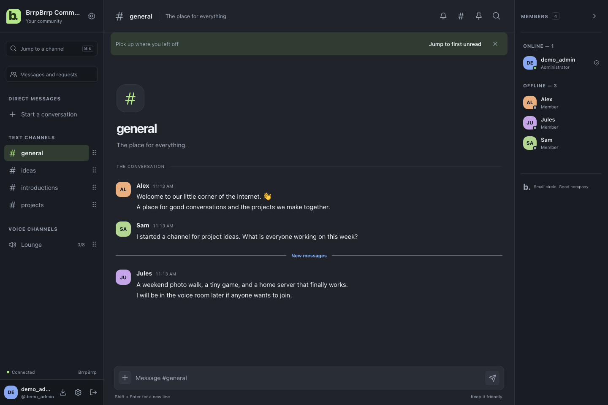

# BrrpBrrp

[](https://github.com/caamer20/BrrpBrrp/releases)

**[User manual](docs/manual/README.md) · [Installation](docs/installation.md) · [Roadmap](ROADMAP.md) · [Deployment readiness](docs/launch-readiness.md) · [Contributing](CONTRIBUTING.md)**

**A small, self-hosted place to talk.** BrrpBrrp runs on a computer you control and gives a
small community text channels, private conversations, voice rooms and screen sharing. It is one
native program with its own database file, and it needs no hosted account, no database service and
no third-party chat platform.



- **Text channels** with persistent history, replies, focused threads, reactions, mentions, pins,
  file sharing, full-text search and slow mode.
- **Private conversations** that start only when the other person accepts, groups, and blocking in both
  directions.
- **Voice rooms** with push to talk, and **screen sharing** with the screen's own sound.
- **Roles you can delegate.** Create a role below your own, grant only what you hold, and assign it per
  account. Channels can be restricted to named roles or accounts, and an access inspector answers
  "who can access this?" using the server's own rule.
- **Administration you can explain.** Invitations, two-factor sign-in, moderation with reports and timeouts,
  scheduled and verified backups, offline restore, and operator alerts.
- **Light, dark and system themes**, a phone layout and an installable web app.

> **Status: 1.0.0-rc.1, a release candidate.** This is the feature set intended for version 1.0.0. It has
> **not been published**, has **no independent security, privacy or accessibility review**, and no beta has
> run. Two conversation features — restricted channels and private conversations — are **on by default** and
> have not been reviewed. Automated verification and real-host qualification are tracked separately in
> [deployment readiness](docs/launch-readiness.md). Read the [release record](docs/releases/1.0.0-rc.1.md) and [known limitations](docs/known-limitations.md)
> before you rely on it.

## Documentation

| If you are… | Start with |
| --- | --- |
| **A member** using a server | [User manual](docs/manual/README.md) |
| **An administrator** setting one up | [Installation](docs/installation.md), then the [administrator guide](docs/admin.md) |
| **Reading about the project** | [Project overview](docs/project-overview.md) |
| **Planning** or wondering what is next | [Roadmap](ROADMAP.md) |
| **Checking security** | [Security](docs/security.md) and [SECURITY.md](SECURITY.md) |
| **Contributing code** | [CONTRIBUTING.md](CONTRIBUTING.md) and [architecture](docs/architecture.md) |

The full set of guides, decision records and release notes is listed in the
[documentation map](docs/project-overview.md#13-documentation-map).

## Quick start

The repository is private while the candidate is qualified. **There is no published application release
yet.** Build from source below, or use Docker to build from the checkout. Maintainers can prepare release
archives through the [gated GitHub workflow](docs/github-setup.md#prepare-a-release).

Native packages are built for **Windows, macOS and Linux**, each on **x64 and ARM64**.
Docker images target Linux x64 and ARM64. Members connect through a browser, including
phones and tablets; the web app can also be installed. Build targets and completed
deployment qualification are tracked in [deployment readiness](docs/launch-readiness.md).

The badge counts downloads of published native and Docker source ZIPs, including
prereleases. It refreshes daily and on release changes, works with the private repository,
and excludes draft releases and CI fixtures. It counts archive downloads, not unique users.

When a candidate release is available, download the ZIP for your operating system and processor from
[GitHub Releases](https://github.com/caamer20/BrrpBrrp/releases), verify its checksum, extract it, and run the setup wizard.
The wizard installs the server as a background service, checks the port and storage, and creates your
administrator account in the browser.

- **Windows:** double-click **Setup.cmd** or **brrpbrrp.exe**, and accept the administrator prompt.
- **Linux:** run `chmod +x brrpbrrp`, then `sudo ./brrpbrrp install` on a systemd host.
- **macOS:** open **Setup.command**, or run `./brrpbrrp install` as your normal user.

Port **8082** is the default. Your data stays on the server. For each step, and for choosing between
this computer only, your local network, or an HTTPS proxy you manage, read the
[installation guide](docs/installation.md). Hosting choices are in [hosting](docs/hosting.md).

### With Docker

The source includes a multi-stage Dockerfile and Compose files for Linux x64 and ARM64. From this folder:

```sh
cp .env.docker.example .env.docker
# Edit .env.docker for your server's address and voice IP.
docker compose --env-file .env.docker up -d --build
docker compose --env-file .env.docker exec brrpbrrp /usr/local/bin/brrpbrrp setup-token
```

The defaults serve `https://localhost:8082` with a generated local certificate authority. Trust its public
root before you use voice. The [Docker guide](docs/docker.md) covers LAN and public HTTPS, voice ports,
backups and updates. The hosted Docker build and container lifecycle check passed on 8 October;
real deployment qualification remains in [deployment readiness](docs/launch-readiness.md).

## Backups and restore

A new installation backs itself up every 12 hours, keeping seven copies, and reports a problem until a
second copy exists on separate storage (`BRRP_BACKUP_COPY_DIR`). Backups are not encrypted and contain
password hashes and push keys; store them privately.

Every archive carries a manifest with a size and SHA-256 digest for its database and each attachment, so an
altered or truncated archive is refused rather than installed. Check any archive with:

```sh
./brrpbrrp verify-backup --file /backups/manual.zip
```

Restore is always offline, into a **new** data folder. The [administrator guide](docs/admin.md#backups-and-maintenance)
covers the procedure, and [upgrading](docs/upgrading.md) covers updates and rollback.

## Build from source

Use Go 1.27.1 or newer and Node.js 22.12 or newer. Build the frontend before the Go binary, because the binary
embeds it:

```sh
npm --prefix web ci
npm --prefix web run build
CGO_ENABLED=0 go build -trimpath -ldflags='-s -w' -o dist/brrpbrrp ./cmd/brrpbrrp
```

`make build`, `make test` and `make check` run the same workflow. `make check` runs the static gates and the
documentation, packaging and workflow audits. `go run scripts/release.go` builds the release archives with
checksums and dependency notices. [Architecture](docs/architecture.md) describes the code layout, and
[CONTRIBUTING.md](CONTRIBUTING.md) describes development and review.

## Scope and limits

BrrpBrrp is built for **one small community on one server**. It is not a hosted service and it does not federate.

- Up to **100 accounts**, 100 channels, 20 voice participants across the server and 10 per room, and a
  12 MiB upload limit by default. These are implementation boundaries, not measured capacities.
- **Not end-to-end encrypted.** The operator can read stored messages and hear relayed voice. Read
  [privacy and safety](docs/manual/privacy-and-safety.md) for what the application does and does not protect.
- Voice uses **IPv4** and the built-in relay only. A network that blocks UDP and the relay's fallbacks cannot
  take part. There is **no camera video** and no recording.
- Formatting is limited to emphasis, block quotes and literal code. There are no lists yet.

The complete list is in [known limitations](docs/known-limitations.md).

## Project layout

| Path | Contents |
| --- | --- |
| `cmd/brrpbrrp/` | The executable and its service commands |
| `internal/` | The Go packages: API, authorization, database, realtime, voice, backups, installer |
| `web/` | The Svelte application, its unit tests and browser journeys |
| `docs/` | Guides, the end-user manual in `docs/manual/`, decision records in `docs/adr/`, release records |
| `scripts/` | Release packaging, audits and rehearsals |
| `planning/` | The execution ledger and verification queue that record how each change was made (development repository; not in release packages) |

## Contributing, security and licence

Contributions are welcome. Read [CONTRIBUTING.md](CONTRIBUTING.md) first, and the
[Contributor License Agreement](CLA.md), including its signature sentence and signatory record. Please follow the
[code of conduct](CODE_OF_CONDUCT.md). For help, see [SUPPORT.md](SUPPORT.md).

To report a vulnerability, read [SECURITY.md](SECURITY.md). Its private reporting channel is not live yet.

BrrpBrrp is released under the [MIT License](LICENSE). Third-party licences are listed in
[THIRD-PARTY-NOTICES.md](THIRD-PARTY-NOTICES.md).
