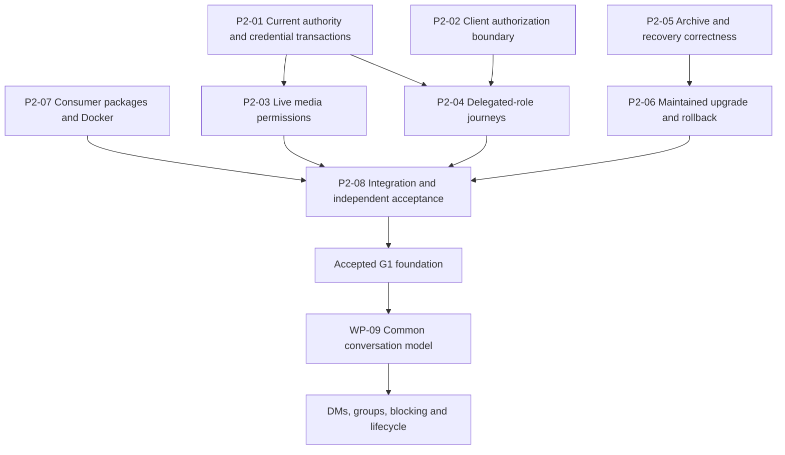

# BrrpBrrp — Second Completion Review and Next-Steps Plan

**Review:** 2 · 24 September 2026, America/Los_Angeles  
**Current candidate:** `0.4.0-alpha.4` · schema **5** · backup format **2**  
**Required deployments:** Windows/Tailscale and Linux Docker  
**Task boundary:** inspect, verify and plan; no application-source changes or deployment

## Contents

1. [Assessment](#1-assessment)
2. [Verified progress since review 1](#2-verified-progress-since-review-1)
3. [Fresh verification and its limits](#3-fresh-verification-and-its-limits)
4. [Status of the previous findings](#4-status-of-the-previous-findings)
5. [Remaining findings](#5-remaining-findings)
6. [Immediate implementation plan](#6-immediate-implementation-plan)
7. [Full v1 work-package status](#7-full-v1-work-package-status)
8. [Route from the next checkpoint to v1](#8-route-from-the-next-checkpoint-to-v1)
9. [Both-host qualification and remaining inputs](#9-both-host-qualification-and-remaining-inputs)
10. [Completion and reporting rules](#10-completion-and-reporting-rules)

## 1. Assessment

**The app has made substantial progress since the first review. It is still an alpha and is not ready to be declared production-complete or v1.0.0.** The remediation added real policy checks, better recovery primitives, capability-aware UI and stronger release inputs. Several original reproductions are now covered by permanent regression tests.

The remaining work is not exclusively deployment or independent approval. This second review reproduced failures in ownership concurrency, owner security settings, voice capability revocation, active client privacy state and backup consistency. Packaging also has unresolved consumer-path defects. Several “fixed” and “done locally” labels in the remediation ledger therefore remain too broad.

**Next milestone: finish foundation correctness and verify complete user/operator journeys.** Focus on the residual cases below, then perform independent review and both-host acceptance. Continue host preparation, release engineering, accessibility design and the media feasibility study in parallel. Begin the common conversation implementation after its authorization and recovery prerequisites are accepted.

No G0–G8 gate is marked passed. This review does not assign a completion percentage: a working majority of a privacy or restore path cannot compensate for a failing boundary.

### Document hierarchy

- [Master v1 implementation plan](v1-implementation-plan.md): product scope, architecture, capacity targets and formal G0–G8 gates.
- [First completion review](completion-review-and-next-steps-2026-09-24.md): historical alpha.3 working-tree findings, F-01–16 and N-00–08.
- [Remediation ledger](completion-remediation-2026-09-24.md): changes made in response to review 1; useful implementation evidence, with closure claims qualified below.
- [Progress ledger](v1-progress.md): ongoing delivery record.
- **This second review is the latest current-status assessment and immediate execution plan.** Earlier reviews remain useful historical evidence. No previous document was rewritten by this task.

## 2. Verified progress since review 1

The comparison found **74 changed files from the first snapshot**, plus 13 additional files: the prior review document, the remediation ledger, new regression tests/checkers and the owner ceremony component. The new snapshot contains 308 files under the same source/document/configuration inventory rules.

The workspace still has no Git repository. These counts describe local content differences, not commits, authorship or a verified upstream branch.

| Area | What changed and should be retained | Remaining boundary |
| --- | --- | --- |
| Candidate identity | Application, frontend, lockfile and release default now identify alpha.4; consistency tests added | No newly published or locally packaged alpha.4 distribution was found in the existing release directory |
| Account authority | Account mutations recheck actor authority in transactions; hierarchy/owner guards and an ownership-established marker address the original simple escalation path | Target ownership can change between the initial read and commit; see R2-01 |
| Lifecycle metadata | Private create/update/delete events use scoped audiences; reorder uses a content-free refresh; lookup failures fail closed | Full concurrent delivery/revocation review still required |
| Read policy | SQL visibility now receives effective channel-read authority and role IDs, including the default role | Category name/count disclosure remains an explicit policy decision |
| Delivery revocation | Event generations and account/session-scoped streams exist; self-password/session revocation has focused tests | Operator password reset and atomic commit/delivery ordering need closure |
| Voice permissions | Initial connect restrictions, a server-side speak-denial flag and hierarchy-aware moderation were added | Active permission changes and resume still bypass parts of the contract |
| Client management | Effective capabilities, owner ceremony and durable category ordering are real implementations | Single-capability roles still lack complete usable paths |
| Client privacy | Search/pins now guard against old authorization generations; threads close and visited caches clear | Active messages, quoted reply state and other delayed requests remain unsafe |
| Backup limits/publication | Original 600-file manifest defect addressed; larger bounded limits and temporary-file atomic publication introduced | Creation, verification and restore still disagree on other supported/adversarial cases |
| Backup health | Health follows recorded archive/copy names and digests rather than simply selecting a recently touched file | Actual snapshot age, scratch placement, schedule policy, retries and protected retention remain incomplete |
| Migration safety | CLI backup/verify can open without migrating; incomplete-upgrade state is persisted with schema application and retried on startup | Rollback requires a compatible old-format archive; platform/fault qualification remains |
| Docker/release configuration | Dedicated notices stage has Go/Node/inputs; runtime carries LICENSE; Docker checks now join native/browser packaging prerequisites | Static checks do not establish a working image or complete extracted source package |
| Evidence | New targeted Go regressions and four frontend tests; 63 frontend tests total | Negative tests must cover changing authority and complete workflows, not only initial admission or generation increments |

### 2.1 Newly established old-binary upgrade/rollback evidence

This review added a **disposable local rehearsal using the actual archived macOS amd64 alpha.3 executable**, rather than a synthetic schema fixture alone:

1. Install with alpha.3; create an account, two messages and one 40-byte attachment through HTTP.
2. Confirm the installation is schema 2.
3. Take a backup with the old executable and a second pre-upgrade backup with alpha.4.
4. Confirm alpha.4's backup leaves schema 2 unchanged.
5. Confirm the old executable rejects alpha.4's format-2 backup with `unsupported backup format`.
6. Migrate the old installation with alpha.4 to schema 5, verify it, serve it and confirm login/messages/exact attachment bytes.
7. Restore the **old executable's own archive** into a clean directory with the old executable; confirm login/messages/exact attachment bytes and schema 2.

**Result: 22 checks passed, including the expected format-incompatibility rejection.** This establishes one working local upgrade/rollback combination. It does not establish Windows/Docker acceptance, interruption recovery, a representative dataset, private-role history preservation, off-host recovery or RPO/RTO. The temporary rehearsal is audit evidence, not a permanent maintained project command.

## 3. Fresh verification and its limits

### 3.1 Baseline checks

| Check | Fresh result | Scope |
| --- | --- | --- |
| Frontend unit tests | **63 passed**; previously 59 | Existing tests plus capability/grouping/generation cases |
| Svelte/TypeScript diagnostics | **0 errors, 0 warnings** | Current component/type consistency |
| Frontend formatting | **Passed** | Configured Prettier checks |
| Production frontend build | **Passed** | Current bundle generated from the snapshot |
| Go vet | **Passed** | Static Go checks |
| Full uncached Go race suite | **Passed**, exit 0; API package 416.717 seconds | `go test -race -count=1 ./...`; all test-bearing packages executed without cached results |
| Local executable build | **Passed** | Alpha.4 with the newly generated frontend |
| Notices freshness | **Passed**: 39 components, 20 license texts | Generator consistency on this host; not a complete legal/target-distribution audit |
| Docker input checker/self-test | **Passed** | Current static inputs and detection of the original broken-stage fixture |
| Source package checker | **Passed**, 283 listed files before this document was added | The check's own dependency rules; it misses release-script dependencies described below |
| Chromium journey | **1 passed** | Existing setup/chat/search/sign-out journey and its existing assertions |
| Existing fresh-install recovery rehearsal | **23 passed** | Same-build schema-5 install, backup, verify, clean-directory restore and content checks |
| Actual old-binary upgrade/rollback | **22 passed** | The specific local alpha.3/alpha.4 procedure in §2.1 |

A passing baseline and a failing adversarial probe are compatible results: the latter exercises conditions the current suite does not cover.

### 3.2 Focused probes in this review

All extra probes used disposable copies/data. No diagnostic tests were added to the application's source tree.

| Probe family | Observed outcome | Interpretation |
| --- | --- | --- |
| Ownership race | A pending delete resumed after its target became owner; HTTP 200 and owner count 0 | Owner protection still uses stale target state |
| Owner security-setting change | HTTP 500 only after the test's 400 ms context expired; database connection wait increased by approximately 399 ms | Nested query waits for the sole connection already held by the transaction |
| Voice capability withdrawal | Active peer remained; a real WebSocket resume succeeded with effective `voice.connect=false`; removal of speak left peer state unmuted/speaking | Lifetime enforcement is incomplete; no flowing-RTP claim from this probe |
| Operator password reset during download | Reset returned 200 and the old session then returned 401, but the existing response delivered all 7,471,104 bytes | Credential invalidation does not cancel this admitted stream |
| Self-service password-change audit | Password change returned 200; audit row count stayed 0 before and after | A successful credential change lacks its required audit record |
| Failed client refresh after revocation | Active message body and quoted reply remained | Clearing caches/generation alone does not clear the active view |
| Late client history/context responses | Old private content repopulated the active view | Those request completions do not check the authorization generation |
| Database-only backup | Create succeeded; verification rejected its attachment references; restore succeeded | Supported modes have inconsistent validation semantics |
| Oversized entry fixture | Create accepted a 12,582,913-byte attachment fixture; verification and restore rejected it | Creation omits a per-entry limit enforced by readers |
| Manifest schema mismatch | Verification rejected manifest schema 1 over actual schema 5; restore accepted it | Restore does not share the verifier's schema agreement check |

Five bounded API regressions and three client-model privacy tests exposed the failures above. Their required-behavior assertions failed; the backup probe instead asserted the observed defects and passed. These test exit codes must not be conflated with product correctness.

### 3.3 Baseline identity and reproducibility

Canonical snapshot manifest SHA-256:

`5a9466fc7425b88328d0a8a9e38af7cc4e8704bdde41aa2dd6d57032fbfe5415`

Actual old executable SHA-256:

`918c4c873b4d848aaaeeaf30a187db985935472ab8b27d74c1472ab13e365099`

Locally built audit candidate SHA-256:

`09965b52ee7c0e61632b37a86ea7df49d2f8ff3e6ec3548fbeaf592e22c56900`

The manifest excludes dependencies, toolchains, generated output and local platform metadata. It identifies inspected local content; it is not a source provenance attestation. The candidate was built in disposable storage and was not promoted or substituted into the existing release directory.

Baseline commands: `npm test`, `npm run check`, `npm run format:check`, `npm run build`, `go vet ./...`, `go test -race -count=1 ./...`, `node scripts/licenses.mjs --check`, `node scripts/check-docker-inputs.mjs --self-test`, `node scripts/check-source-package.mjs`, a local Go build, `npm run test:e2e` and the existing recovery script with an explicit temporary binary/report. The bundled Go executable and existing dependency/browser caches were used.

### 3.4 Evidence not supplied by this review

- Docker Engine is unavailable locally. No real image build, container startup or Linux runtime acceptance was performed.
- No Windows native/service/UAC/tray/reboot or power-loss testing was performed.
- No deployed server, user data, registry, repository, hosted CI, signing account or external notification destination was changed.
- No physical-device accessibility, real microphone/relay/capture, full target dataset, load/soak, independent security approval or beta evidence was produced.
- The new UI is still covered by one existing Chromium journey rather than the required delegated-role/ownership/revocation journeys.

## 4. Status of the previous findings

“Original case addressed” means the earlier mechanism has changed and has focused regression coverage. It does not certify all adjacent behavior or authorize exposure.

| Prior finding | Review 2 assessment | What still controls closure |
| --- | --- | --- |
| F-01 account escalation/owner deletion | **Original simple escalation addressed; owner protection incomplete** | Target-owner concurrency, R2-01 |
| F-02 global private lifecycle metadata | **Original cases addressed** | Independent review plus consistent commit/audience/queue boundary across concurrent events |
| F-03 current authority at commit | **Partial** | Actor reload improved; target state and all sensitive transaction checks must be current |
| F-04 read-surface disagreement | **Original policy omissions addressed** | Category name/count policy and full matrix review |
| F-05 queued/streamed revocation | **Partial** | Operator reset, remaining transaction-to-delivery interleavings and all session changes |
| F-06 voice capabilities | **Partial** | Active capability withdrawal and resume, then actual RTP qualification |
| F-07 security settings/audit | **Partial** | Owner-setting deadlock and credential/MFA audit consistency |
| F-08 active client privacy | **Partial; reproduced failures remain** | Active content/quoted state and every late request, not only search/pins/caches |
| F-09 role/category UI | **Substantially implemented; integration incomplete** | Single-capability API/tab/action paths and rendered browser journeys |
| F-10 unreadable created backups | **Original 600-file case addressed; contract incomplete** | Per-entry/aggregate limits and database-only mode |
| F-11 backup publication/health | **Partial** | Shared validation, scratch placement, true snapshot age, retention/retry |
| F-12 upgrade safety | **Mechanisms improved; one local real-binary path now verified** | Compatible rollback material and permanent, fault-injected both-host rehearsals |
| F-13 file durability | **Error/cleanup documentation improved; not qualified** | Unsupported synchronization is still tolerated by publication; align declared platform contract and evidence |
| F-14 Docker inputs | **Original static input defect addressed** | Actual clean Linux image build/runtime |
| F-15 identity/package consumer | **Identity and workflow join implemented; consumer path incomplete** | Platform release scripts, Windows path handling, native docs/notices and actual artifacts |
| F-16 evidence labels | **Partially corrected** | Current closure claims, gate names and predecessor identities still need correction |

## 5. Remaining findings

**Evidence labels:** “Reproduced” identifies a specific observed failure. “Source-confirmed” identifies an inspected implementation path whose full runtime consequence was not separately exercised. Concurrency cases not executed are explicitly left as tests to perform. Priorities below guide implementation order; they are not formal vulnerability scores.

### R2-01 — Owner protection still races a concurrent ownership transfer

**Release blocker · Reproduced · Prior F-01/F-03.**

`deleteUser` loads the target account before reading confirmation and before its transaction. The transaction refreshes the actor, but passes the old target record to `mayAdminister`. In the probe, a body-read barrier allowed a valid `/owner` transfer to make that target the owner. Resuming the original delete returned HTTP 200 and left no owner.

Evidence: [admin.go](../internal/api/admin.go), lines 339–367; account-rank/owner checks in [authz.go](../internal/authz/authz.go). The new ownership-established marker prevents simply regaining the old bootstrap bridge; the demonstrated consequence is deletion of the designated owner, not a claim that the original operator escalation chain still works unchanged.

**Required outcome:** reload and authorize both actor and target inside the same committing boundary. Cover deletion, ban/deactivation, role/admin changes, ownership transfer and credential takeover. Add a database invariant or equivalent guarded mutation where appropriate so a stale caller cannot remove the current owner. Legitimate transfer and management must remain functional.

**Acceptance:** pause each sensitive request, change the target's ownership/rank or the actor's authority, resume, and assert refusal with no authority/content loss. Include a permitted-control case and verify mandatory audit results.

### R2-02 — An owner security-policy change waits on its own database transaction

**Release blocker · Reproduced · Prior F-07.**

[updateSettings](../internal/api/settings.go), lines 59–85, begins a transaction, then calls recent-authentication/factor helpers that query `s.store`. [Database opening](../internal/db/db.go) limits the store to one connection. The transaction holds that connection while the helper waits for it.

A fresh MFA-enabled owner changing `RequirePrivilegedMFA` received HTTP 500 only after the controlled request context expired. Connection wait count increased by one and wait duration approximately matched the 400 ms cancellation interval.

**Required outcome:** transaction-aware authentication/security-policy checks using current session, factor and owner state, with an explicit lock order. Do not fix only the wait by moving the whole check back to a stale pre-transaction snapshot. Review other helpers for this same nested-connection pattern.

**Acceptance:** authorized enable/disable completes promptly and audits atomically; stale sessions, factor/ownership changes and ordinary settings managers are rejected; cancellation rolls back cleanly without leaving the settings mutex or connection held.

### R2-03 — Credential revocation and mandatory audit coverage remain uneven

**Release blocker · Operator-reset and password-audit failures reproduced; MFA audit placement source-confirmed · Prior F-05/F-07.**

Self-password changes now cancel account streams, but the operator password-reset path deletes sessions and disconnects voice/sockets without the corresponding delivery cancellation. In the probe, reset returned HTTP 200 and the old session subsequently received HTTP 401, yet its admitted download delivered all **7,471,104 bytes**. A separate successful self-password change left the audit count at **0 before and 0 after**. MFA enable/disable still call the general audit helper after commit; their failure behavior was inspected but not separately injected in this review.

Evidence: [resetPassword](../internal/api/admin.go), beginning at line 386; [changePassword](../internal/api/auth.go), lines 179–188; [MFA](../internal/api/mfa.go), lines 138–146 and the disable path around 215–221.

**Required outcome:** a route/action inventory covering every password, factor, recovery-code, session, role and account transition. Each action specifies the sessions/streams/media/push devices it invalidates and the audit record that commits with it. Preserve unaffected accounts and any deliberately surviving session.

**Acceptance:** operator reset interrupts a paused original/preview/range download; the old session cannot resume it; another valid account still works. Force audit insertion failure for each required credential mutation and prove the mutation does not silently commit. Document any deliberate exception rather than claiming universal atomicity.

### R2-04 — Voice permission changes are not enforced throughout a call

**Release blocker · Reproduced at peer/signaling level · Prior F-06.**

Initial join now enforces connect and speak permissions. The lifetime path differs: resume checks channel readability without the new connect gate, and `enforceVoiceAccess` removes only peers that lose readable-channel access. It does not update the active speak-denial flag or evict peers losing connect while retaining read access. Authority is also resolved before entering the voice gate.

Evidence: [voice.go](../internal/api/voice.go), lines 23, 41–57 and 105–106; [voice_access.go](../internal/api/voice_access.go), around line 180; [SFU](../internal/rtc/sfu.go), speak-denial forwarding guard.

The probe removed `voice.connect` through the API while a peer was active. The peer remained, and a real socket later received `voice.resumed` with effective connect permission false. Removing `voice.speak` left the peer state unmuted/speaking. **This probe did not forward RTP.**

**Acceptance:** one current authority decision governs join/move/resume and live permission changes. Losing speak stops server forwarding without requiring a cooperative client state update; losing connect ends active/detached admission. Use actual negotiated peers and RTP, with malicious-client commands and deterministic revoke/admit interleavings. Keep existing media caps until separate qualification.

### R2-05 — Authorization invalidation does not invalidate the whole active client

**Release blocker · Three reproduced client-model failures · Prior F-08.**

`invalidateAuthorization()` increments the generation, clears visited caches and closes the thread, but leaves active messages, the quoted reply and active request versions. History and message-context completions do not compare the captured authorization generation.

Evidence: [workspace store](../web/src/lib/workspace.svelte.ts), lines 339–348, 422–423, 789, 833 and 973–986.

Observed failures:

- After revocation and failed `/state`, the active restricted message and quoted reply remained.
- A history response admitted before revocation repopulated private content afterward.
- A pre-revocation context/jump response also restored private content.

**Required outcome:** one client authorization boundary covers active messages, selected resource metadata, reply references, panels/previews, drafts as policy requires, caches and every asynchronous completion. Make history/context/state/unread/incremental/send callbacks generation-aware, with a clear recovery state on refresh failure. Retain the limitation that previously received bytes cannot be recalled from a user's device.

**Acceptance:** permanent versions of the three failing probes, plus browser assertions inspecting actual rendered text and panel state. Test failed refresh, reconnect after missed events, open search/pins/thread/preview and a successful permitted refresh. Do not equate “generation increased” with “restricted content disappeared.”

### R2-06 — Narrow delegated roles do not have complete UI/API workflows

**Integration blocker for role completion · Source-confirmed · Prior F-09.**

The broad capability UI is improved, but testing combined manager roles misses single-capability failures:

| Capability | Remaining mismatch | Required behavior |
| --- | --- | --- |
| `invite.manage` only | Server-tools entry exists, but no permitted tab contains invitations | Reach invitation creation/list/revocation with only necessary data |
| `role.manage` only | Role definitions are reachable; account assignments are inside People, whose tab/list require other powers | A scoped assignment workflow with an appropriate account-summary API |
| `audit.read` only | Opens Settings although audit logs are in Maintenance | Read the audit log without unrelated settings/backup authority |
| Narrow maintenance authority | Unconditional health/diagnostic/audit calls produce unrelated 403s; backup controls still render | Each request/action is gated by its own effective capability |
| Category/channel subsets | Controls inside Channels do not consistently follow separate grants | Usable category-only/channel-only flows under approved policy |

Evidence: [AdminPanel](../web/src/lib/components/AdminPanel.svelte), lines 12–20; [Users](../web/src/lib/components/admin/Users.svelte); [Maintenance](../web/src/lib/components/admin/Maintenance.svelte), lines 62–70 and 191–216; [router](../internal/api/router.go), account-list policy. The settings form also still offers turning audit off although the server refuses it. Pins can remain loading after generation invalidation because its stale request's cleanup is discarded without resetting the loading state.

**Acceptance:** browser journeys for every single capability, selected combinations, target hierarchy, live demotion and owner transfer. Backend permissions remain authoritative; UI work must not broaden data access merely to make a tab load.

### R2-07 — Backup creation, verification and restore still have different contracts

**Release blocker · Three reproduced cases · Prior F-10/F-11.**

| Fixture | Create | Verify | Restore |
| --- | --- | --- | --- |
| One normal attachment, `uploads=false` | Succeeds | Rejects missing uploaded files | Succeeds by removing attachment rows |
| Attachment fixture of 12,582,913 bytes | Succeeds | Rejects per-entry size | Rejects per-entry size |
| Valid archive with only manifest schema changed from 5 to 1 | Already created | Rejects manifest/database disagreement | Succeeds |

The oversized entry is a controlled stored-file fixture, not a claim that the current upload endpoint normally accepts that size. It exposes a missing boundary check in creation. Creation also omits manifest bytes from aggregate budgeting. The new 600-file test is useful but does not cover these cases.

Evidence: [backup.go](../internal/backup/backup.go), `archiveBudget`, `addFile` and `Restore`; [manifest.go](../internal/backup/manifest.go), `entryLimit` and `verifyCoverage`, around lines 169–182 and 378–390.

**Required outcome:** one archive contract with explicit database-only semantics, actual-schema agreement, attachment coverage and entry/count/manifest/database/aggregate limits. Apply it consistently during staged creation, verification and restore, with read-only validation before publishing/importing completed state. Preserve bounds against malformed/compressed input.

**Acceptance:** a supported successfully completed archive verifies and restores under its declared mode; malformed metadata is refused consistently; just-below/at/above each bound is tested. A database-only snapshot is explicitly incomplete recovery material for uploads, while still functioning if that mode remains supported.

### R2-08 — Backup operation still has scratch, freshness and retention gaps

**Release blocker for operational recovery · Source-confirmed · Prior F-11.**

1. **Scratch location:** scheduled/manual backup calls `VerifyArchive` with default system temporary storage ([backup_schedule.go](../internal/api/backup_schedule.go), line 90). Compose limits `/tmp` to 64 MiB. Only the production-check CLI uses explicit data-volume scratch. A realistic database can exhaust container `/tmp` despite sufficient `/data` capacity. This container failure was not executed here.
2. **Recovery-point age:** health ages `LastSuccess`, recorded after archive creation/verification, rather than the actual snapshot time ([production.go](../internal/app/production.go), lines 137–138). A long-running backup appears younger than its recoverable data. Carry snapshot time separately from job completion/copy times.
3. **Schedule versus generation content:** `readGeneration` combines the current schedule's upload flag with the prior backup's content flag using an effective OR (lines 96 and 117–119). A prior full backup can mask a currently disabled upload schedule. Track these two facts independently.
4. **Retention and retries:** retention still removes by UUID filename/count; local retention runs even after copy failure; failed attempts wait for the normal interval ([backup_schedule.go](../internal/api/backup_schedule.go), lines 101–113 and 192–225). This does not implement the planned protected verified recovery generation and bounded retry budget.

**Acceptance:** manual/scheduled/CLI verification uses appropriate bounded scratch and cleanup; slow backup reports the true recovery-point age; disabling future upload coverage is visible; copy failure never deletes the protected recoverable generation; bounded retries and delivered alerts uphold the accepted RPO policy.

### R2-09 — A non-migrating snapshot is not automatically an old-binary rollback archive

**Procedure/compatibility blocker · Reproduced · Prior F-12.**

Three baselines must be distinguished:

| Baseline | Application label | Database | Backup format |
| --- | --- | --- | --- |
| Archived release from 23 September | alpha.3 | schema 2 | format 1 |
| Working tree in review 1 | alpha.3 | schema 5 | format 2 |
| Current working tree | alpha.4 | schema 5 | format 2 |

Alpha.4 correctly snapshots schema 2 without migration, but writes format 2. The actual old alpha.3 restore executable accepts format 1 only. Using alpha.4 to restore instead subsequently migrates the data, so it does not by itself produce a prior-version rollback folder.

**Working local procedure:** preserve a quiesced backup made by the old executable in its supported format, together with that executable and configuration. Upgrade using the candidate; if rollback is required, restore the old archive into a clean destination with its matching old executable. This precise combination passed §2.1. Do not attempt in-place downgrade or hide the loss of post-snapshot writes.

**Next acceptance:** make the compatibility matrix/procedure a maintained rehearsal, include schema/format/version/hash checks, and repeat under interrupted upgrade, realistic data and both deployment lifecycles. Correct the ADR/ledger conflation of the two different alpha.3 baselines. Describe the local result accurately; it closes “no actual old-binary rehearsal at all,” but does not close platform qualification.

### R2-10 — Passing package checks do not prove an extracted source package can release

**Release blocker · Source-confirmed · Prior F-15.**

- `dockerSourcePaths` omits `scripts/linux`, `scripts/windows` and `scripts/macos`, while native packaging requires `scripts/<platform>` with `os.ReadDir`. The source checker only follows its listed rules and misses this transitive release-script dependency. Evidence: [release.go](../scripts/release.go), lines 78–84 and 154–224.
- The checker constructs its root from URL `.pathname` and POSIX joins, while the Go list uses native filesystem separators. This is not a portable Windows file-path/manifest contract. Evidence: [check-source-package.mjs](../scripts/check-source-package.mjs), lines 25–54. A native Windows execution is still required; no Windows failure was run here.
- Native documentation packaging uses its own limited allowlist. Validate its local links separately from the source package.
- Notice generation still needs target-specific linked-dependency/bundled-helper review; freshness is evidence that a generator is repeatable, not evidence that its inventory is exhaustive.

**Acceptance:** create a real candidate source archive; extract it in a clean location; install declared dependencies; run check/build/rehearsal/release commands using only packaged inputs. Run Windows path tests and the actual Windows job. Validate native documentation and license/notices per target. Then build/run the real Linux image. Preserve the existing alpha.3 archives.

### 5.1 Remaining review boundaries, not additional reproduced claims

The newer event-generation and voice gates are improvements, but transaction commit, audience calculation, generation invalidation and writing remain separate operations. Specify their ordering and exercise deterministic boundary tests before describing them as a single atomic revocation mechanism. This review did not reproduce every possible interleaving.

Specifically test: an old audience queued after invalidation receiving a new generation; invalidation between the writer's generation check and socket write; a download registering with a principal authenticated before revocation; and an implicitly applied default-role change when stream cancellation enumerates only explicitly assigned role holders. Evidence paths are [event publication](../internal/api/authz.go), [WebSocket writer](../internal/api/websocket.go), [upload admission](../internal/api/uploads.go) and [role mutation](../internal/api/roles.go). These are identified missing-ordering/coverage cases, not additional reproduced timing exploits.

Unsupported directory synchronization is now explicit internally, but [Publish](../internal/app/publish.go) still tolerates the sentinel and reports publication success. Establish the actual supported-filesystem contract and observable limitation; native power-loss durability remains unqualified. Cleanup tests establish orphan handling, not final-name persistence after power loss.

Category names/counts, community-manager visibility, announcement posting, privileged MFA/FULL defaults and the private-conversation trust/deletion policy still need the owner decisions already recorded in the master plan. Do not change those policies silently during a bug fix.

## 6. Immediate implementation plan

This section proposes future implementation. **No fixes below were applied in this review.** Roles: TL technical lead, BE backend, FE frontend, QA test owner, OPS operator, REL release engineer, SEC independent reviewer, OWNER project/product owner. Assign actual people; AI assistance does not supply independent human approval or host access.

### P2-01 — Close account/security transaction invariants

**Owner:** BE; review TL + SEC. **Covers:** R2-01–03. **Start:** immediately.

Deliver in small reviewed changes:

1. Permanent failing reproductions for owner-transfer-versus-delete and security-settings connection wait.
2. Transaction-current actor, target, session, factor and ownership checks; no nested queries through the same single-connection store outside its transaction.
3. A complete credential/recovery transition inventory, including operator reset and self-MFA/password changes.
4. Required audits in the committing transaction and exact cancellation of affected sessions/streams/media.
5. Deterministic negative/allowed-path tests across transfer, rank changes, cancellation and audit failure.
6. Close the server queue/stream ordering cases in §5.1, including implicit default-role revocation; integrate with P2-03's voice gate contract.

**Done when:** no request can remove the current owner using a stale target; a valid owner security-policy change completes; each required security transition preserves its audit/invalidation contract. The ownership-established marker remains intact.

### P2-02 — Complete client authorization invalidation

**Owner:** FE + QA. **Covers:** R2-05. **Start:** independently of P2-01 against the agreed event contract.

1. Adopt a single authorization generation for all active state and asynchronous work.
2. Clear restricted active content/references at invalidation, before an uncertain refresh completes.
3. Guard history, context/jump, snapshot, unread, incremental lookup, send/retry and panel responses against old generations.
4. Define recoverable loading/error/focus states for failed authorization refresh; resolve the pins loading issue.
5. Promote the three model failures to permanent tests and add rendered privacy journeys.

**Done when:** failed refresh cannot leave restricted content visible and no older request can restore it; permitted users can recover without broken navigation/drafts. Browser evidence must inspect active DOM content.

### P2-03 — Complete live media permission enforcement

**Owner:** BE/media + QA. **Covers:** R2-04. **Depends on:** common current-authority semantics from P2-01.

1. Resolve authority at the actual admission boundary, with a documented gate/transaction order.
2. Apply connect/read/speak restrictions consistently to join, move, resume and already admitted peers.
3. Reconcile peer forwarding flags immediately when capabilities change; do not require a client to volunteer a new mute state.
4. Add negotiated RTP tests with non-cooperative clients and deterministic revoke/admit races.
5. Retain current audio limits; microphone-free listening and private-call UX remain WP-19 work with explicit acceptance.

**Done when:** permission loss stops the prohibited operation at the defined boundary, including real audio forwarding, and legitimate movement/reconnect still works.

### P2-04 — Finish delegated-role user journeys

**Owner:** FE + BE + QA. **Covers:** R2-06. **Depends on:** P2-01 authorization semantics; can proceed with P2-02.

1. Define the minimum API data/action contract for every single management capability.
2. Align entry points, tabs, internal requests and controls, including invitation-only, role-assignment-only, audit-only and category-only roles.
3. Keep audit always-on UX consistent with the server; show actionable recent-authentication flows where appropriate.
4. Add browser journeys for ownership designation/transfer, single-capability roles, hierarchy, demotion during use and failed refresh.
5. Verify keyboard/focus behavior and loading/error recovery across the new forms.

**Done when:** every granted function is reachable without unrelated privileges and every forbidden function is absent/clearly denied. Increasing backend visibility to satisfy a UI convenience is not acceptable.

### P2-05 — Unify archive validation and recovery operations

**Owner:** BE + OPS + QA. **Covers:** R2-07–08. **Start:** parallel with privacy fixes.

1. Decide and document database-only semantics; implement one shared validator for all supported modes and formats.
2. Enforce per-entry, manifest, database, count and aggregate budgets during staged creation and in both readers.
3. Route manual/scheduled/CLI scratch to configurable bounded storage; prove cleanup and disk-pressure behavior.
4. Store snapshot time, completion time, copy time, content coverage and current schedule policy as distinct facts.
5. Protect a verified independently recoverable generation across failures; implement bounded retries and an observable alert state.
6. Add the three archive reproductions, a >64 MiB database in the actual container, long-copy freshness, disabled-upload schedule and repeated-copy-failure tests.

**Done when:** supported creation/verification/restore agree, monitoring describes the actual recovery point, and failures cannot falsely claim full protection or remove the protected recovery generation. Target-scale RPO/RTO is still a separate host gate.

### P2-06 — Maintain a real upgrade/rollback compatibility path

**Owner:** OPS + BE + QA. **Covers:** R2-09. **Depends on:** P2-05 shared archive contract for final acceptance.

1. Turn the proven old-binary/old-format procedure into a maintained command/fixture and operator instructions.
2. Record exact old/candidate binaries, schema/format combinations, hashes, configuration and rollback data-loss boundary.
3. Extend from the tiny local fixture to representative accounts/MFA/roles/replies/pins/search/uploads; reconcile post-snapshot bans, role removals, credentials and erasure before traffic returns.
4. Inject interruption before migration commit, after commit/before postconditions, during repair and during restore staging. Verify that service either repairs and verifies or refuses safely.
5. Repeat on a Windows service and Linux container with a clean destination and independent backup acquisition.

**Done when:** operators can execute the approved path using maintained materials and matching artifacts. Separate successful local rehearsal, host lifecycle acceptance and measured recovery objectives in the evidence record.

### P2-07 — Test packages as consumers use them

**Owner:** REL + OPS. **Covers:** R2-10. **Start:** parallel; final candidate reruns after integration.

1. Include transitive platform release-script dependencies and validate native documentation links.
2. Separate native filesystem paths from normalized archive paths in the checker; test Windows drive paths and spaces.
3. Generate and extract actual source/native candidate packages in isolated locations and run the documented consumer commands.
4. Build and run Docker on Linux; verify notices/license, non-root volume access, scratch capacity, TLS/UDP, restart and recovery.
5. Run the joined hosted CI gate on a canonical source identity; finish SBOM/provenance/signing and target-specific notice review before distribution.

**Done when:** clean consumers reproduce the promised build/release/install paths, the actual Docker image passes runtime checks, and no required platform result is inferred from a static checker or cross-build.

### P2-08 — Integrate, independently review and propose foundation acceptance

**Owner:** TL + QA + OPS + SEC. **Depends on:** P2-01–07 and available reference hosts.

1. Run the full shared authorization/delivery matrix and the new rendered browser/RTP journeys.
2. Review lock/revision/commit/delivery ordering, including event queues and file admission, with a second reviewer.
3. Execute both-host lifecycle and off-host recovery checks; record exact artifact identities and limitations.
4. Correct closure claims and the gate map in the ledgers; have named owners accept decisions and evidence.
5. Propose G1 only when its privacy/upgrade/review requirements pass. Continue G5 operational capacity work separately.

**Done when:** the foundation has implementation, local verification, required platform evidence and independent review. It is then a safe base for WP-09; it is not yet v1 feature completion.

### 6.1 Dependency map

The media feasibility spike, host procurement, accessibility design, project governance and documentation can start independently. Serialize overlapping database migrations and changes to shared permission/protocol semantics. Assign one technical owner to each shared contract.

## 7. Full v1 work-package status

“Partial” distinguishes useful code from completed acceptance; “not implemented” refers to the planned v1 addition, not the absence of all alpha functionality.

| WP | Current status | Next completion evidence |
| --- | --- | --- |
| 01 Project rights/stewardship | **Partial**: MIT/CLA/notices/policies retained | Canonical repository/history, maintainer/alternate, tested private intake, publication identities |
| 02 Scope/ADRs | **Partial** | Ratify remaining defaults, privacy/lifecycle scope and named gate ownership |
| 03 Reference environments | **Not qualified** | Both hosts, clean recovery targets, load generator, reviewers and devices |
| 04 Migration/durability | **Mechanisms implemented; qualification partial** | Maintained real-binary/fault rehearsal and native durability evidence |
| 05 Identity/session/recovery | **Partial** | Transaction/credential/audit fixes and actual both-host lockout recovery |
| 06 Authorization | **Partial** | Current actor/target invariants and all action/delivery boundaries |
| 07 Roles/categories/private channels | **Substantial; incomplete** | Narrow-role journeys, ownership race closure, policy decisions and browser evidence |
| 08 All-surface privacy | **Partial; reproduced defects** | Active-client, live-voice, session/queue/stream acceptance and independent review |
| 09 Shared conversation/state | **Not implemented as planned** | Common identities/pipeline, durable outbox, deletion-safe receipts and lifecycle contract |
| 10 Direct messages | **Not implemented** | Request/acceptance, membership, history/trust, scoped delivery and UI |
| 11 Groups/blocking | **Not implemented** | Membership/history/block/removal concurrency and user journeys |
| 12 Export/retention/erasure | **Not implemented** | Approved policy, tombstone continuity, data export and deletion acceptance |
| 13 Named threads | **Alpha replies only** | Named lifecycle/subscriptions/cursors/full history and old-link continuity |
| 14 Notification preferences/inbox | **Alpha mentions only** | Per-conversation settings, unified inbox and deduplication |
| 15 Moderation/reports | **Partial prerequisites** | Timeout/slow mode/report queue/evidence access plus hierarchy-safe actions |
| 16 Composer/formatting/profile | **Alpha foundation** | Safe formatting, stable-identity mentions and integrated conversation UX |
| 17 UX/accessibility foundations | **Partial** | Complete role/security/private-state navigation and keyboard/focus recovery |
| 18 Media feasibility | **Not implemented** | Measured architecture/network spike and approved decision |
| 19 Voice/private calls/network | **Partial prerequisites** | Lifetime permissions, listen-only UI, private calls, configurable relay and diagnostics |
| 20 Media publications/signaling | **Not implemented** | Scoped publication/subscription identities, negotiation/cancellation/bounds |
| 21 Screen sharing | **Not implemented** | Desktop capture/viewer lifecycle, permissions and failure UX |
| 22 Media qualification | **Not qualified** | Negotiated RTP plus physical device/network/relay/sharing matrix |
| 23 Backups | **Partial** | Shared validator, operational correctness and independent target-scale recovery |
| 24 Host lifecycle | **Not qualified** | Local upgrade evidence now exists; real Windows/Docker install/restart/update/rollback remains |
| 25 Metrics/alerts | **Partial baseline** | True recovery-point health, independent probes and delivered fault alerts |
| 26 Capacity | **Not qualified** | Target datasets, end-to-end latency/resource measurements and both-host soaks |
| 27 Release engineering | **Partial** | Clean consumer packages, Windows checks, actual Docker/CI, signatures and provenance |
| 28 Independent security | **Not complete** | Foundation review, then final integrated product review |
| 29 Browser/accessibility | **Not complete** | New journeys, multiple engines, physical devices and assistive technology |
| 30 Community beta | **Not started** | Entry gate, real communities and 14-day acceptance evidence |
| 31 Documentation | **Partial** | Correct evidence/compatibility labels and non-author member/operator rehearsal |
| 32 Release candidate | **Not started** | Freeze/qualify final artifact bytes and seven-day observation |
| 33 Publication/support | **Not started** | Approved rollout, verified distribution, support and maintenance handoff |

## 8. Route from the next checkpoint to v1

Keep the master plan's exact gate meanings. The remediation ledger currently labels G3/G4 as upgrade/recovery; those labels are incorrect and should be repaired when the ledger is updated.

| Gate | Correct outcome | Path from here |
| --- | --- | --- |
| G0 | Approved baseline | Project identity, scope/trust/support decisions, named owners and reference environments |
| G1 | Privacy foundation | P2-01–08; all required authorization/upgrade/review evidence |
| G2 | Private messaging integration | WP-09 → WP-10–12: common conversation model, DMs/groups/blocking/lifecycle |
| G3 | Community feature completion | WP-13–17: named threads, notifications, moderation/reports, composer and UX |
| G4 | Media feature completion | WP-18–22: measured architecture, dependable calls, publications and screen sharing |
| G5 | Operational recoverability | WP-23–27: both-host lifecycle, recovery, alerts, capacity and consumer artifacts |
| G6 | Accepted beta | WP-28–31: independent reviews, browser/accessibility, documentation and 14-day beta |
| G7 | Accepted stable candidate | WP-32: frozen final artifacts and seven consecutive days of observation |
| G8 | v1.0.0 released | WP-33: explicit publication approval, staged rollout and accepted maintenance |

### 8.1 The next feature tranche after G1

1. **Common conversations/state first:** one authorization/message pipeline for channels, DMs, groups and threads; no separate DM data stack. Design stable identifiers, navigation, unread state and lifecycle together.
2. **Reliable send semantics:** durable outbox and request identity with deletion-resistant idempotency receipts and approved pruning horizons. Retrying a deleted message must not recreate it because its only deduplication record disappeared.
3. **Private data rules before migrations:** settle requests/acceptance, history after joining, blocking, leaving, deletion/tombstones, export and operator disclosures.
4. **DMs and groups in reviewable slices:** fully authorize text/files/search/events/notifications/media for each membership transition; add minimum report/moderation handling before outside private-message pilots.
5. **Community UX:** named threads preserve existing reply links/content; inbox/preferences and safe formatting extend the same conversation model.

### 8.2 Media and operations continue alongside product work

Run the bounded media spike before choosing a screen-sharing implementation. Keep desktop sharing in the proposed v1 scope and camera video deferred unless the owner revises scope. The existing audio system remains limited by its present participant/receiver model; raising a shared constant is not a qualified capacity improvement.

Make outbound STUN/TURN and optional push/preview dependencies explicit/configurable. Test actual direct/relay networks and user permission/capture behavior. Federation, E2EE, native mobile and active-active hosting remain separate programs rather than incidental additions to this release.

Maintain recovery/consumer-package checks through every schema/protocol change. Final capacity/support claims require measured workloads; the master targets remain proposals rather than current guarantees.

## 9. Both-host qualification and remaining inputs

The owner already chose **both** deployment paths. Do not reopen that decision. Windows x64 native/Tailscale and Linux amd64 Docker remain the proposed reference configurations; exact supported OS/runtime versions and resources need to be recorded.

| Qualification area | Required Windows/Tailscale evidence | Required Linux Docker evidence |
| --- | --- | --- |
| Install/start/reboot | Clean installation, service/UAC/tray, data permissions and reboot | Actual image, clean volume, non-root permissions, restart policy and host reboot |
| TLS/network | Name/certificate/firewall/browser/WebSocket path | Published ports/proxy/TLS/WebSocket/UDP and relay path |
| Upgrade/rollback | Matching old/candidate binaries, stopped service and clean-target rollback | Matching image digests, quiesced volume and clean-target rollback |
| Lockout/owner recovery | Offline host procedure, audit and restored sign-in | Offline volume/container procedure, audit and restored sign-in |
| Files/archives | Supported filesystem error/crash/durability behavior | Supported volume/filesystem and realistic scratch/temp limits |
| Independent recovery | Retrieve/decrypt verified off-host copy onto clean Windows target | Same recovery generation onto clean container target |
| Failure/monitoring | Full disk, stale/failed copy, scheduler interruption, delivered alert | Same faults plus container/network/storage constraints |
| Media | Real microphone/listen-only/connectivity/revoke checks across networks | Actual UDP/relay behavior and resource bounds with real clients |
| Capacity | Separate generator, target data, peak and mixed soak | Separate generator, target resources, peak and mixed soak |
| Final consumer | Actual signed/extracted download, docs and upgrade | Actual candidate image/source archive, digest/notices/build/runtime |

For independent restore, verify users/roles/membership, search, messages and sampled attachment hashes. Invalidate stale sessions/push associations and reconcile known post-snapshot credentials, bans, membership/role revocations, blocks and erasure before admitting traffic. State what cannot be reconstructed.

The master objectives remain **RPO ≤24 hours** and **RTO ≤60 minutes** on the approved reference dataset. Start RTO at the declared recovery event, before operator work, and include response delay, retrieval/decryption, restore, reconciliation and verification. Record total outage separately. The tiny local rehearsals do not establish these targets.

### Inputs to resolve at the relevant gate

- Canonical owner-controlled repository/history, release/registry identities, signing credentials and maintainers/alternate.
- Reference hosts, clean recovery destinations, independent encrypted storage, key custody and an alert recipient.
- Independent security reviewer, browser/accessibility testers, physical devices, separate networks/relay and load generator.
- Ratification of FULL durability, privileged MFA policy, restricted exposure gate, community-manager visibility and category name/count disclosure.
- Private-history/deletion/export/report-evidence policy, support scope/response coverage and final capacity profile.

MIT/CLA direction and the both-host requirement are already recorded. Local remediation, artifact inventory, hashes and tracked documentation can be prepared now; do not describe all of that work as impossible merely because the canonical repository or external hosts are not yet available.

## 10. Completion and reporting rules

### 10.1 Before closing another finding

For every finding, record the actual scenario, source/artifact identity, environment, fixture size, command/test, expected/observed result, negative and allowed controls, reviewer and limitations. Keep separate states for:

**Implemented → locally verified → platform qualified → independently reviewed → released.**

A helper test or a getter test establishes only the helper/getter behavior. A role change requires tests of already-started operations; an authorization generation requires tests of active state and late responses; a source manifest requires an actual extracted consumer path. Closure must follow the public/user/operator contract.

### 10.2 Correct the ledgers during the next implementation work

1. Replace broad “fixed/done locally” labels for the reopened findings with the precise remaining acceptance conditions above.
2. Distinguish archived alpha.3/schema-2/format-1 from the review-1 alpha.3/schema-5/format-2 working tree.
3. Record the new actual local binary rehearsal, its compatible rollback archive and its small fixture/platform limitations.
4. Restore the correct G0–G8 map; G3/G4 are community/media gates.
5. Update the stale 59-test headline to the current verified count, without treating test count as quality or completion.
6. Separate current schedule policy, snapshot time and completion time in all backup claims.
7. Remove claims that owner targets, all credential audits, all client views or all voice lifetimes are protected until their negative tests pass.

### 10.3 Next checkpoint checklist

- [ ] Current owner cannot be deleted/demoted/deactivated by a request with stale target state.
- [ ] Owner security settings complete without a nested connection wait and use current strong authentication.
- [ ] All required credential/recovery audits and delivery invalidations have complete transition coverage.
- [ ] Active client content clears on revoke even when refresh fails; no old callback restores it.
- [ ] Join/move/resume/live voice permissions pass negotiated RTP and concurrency tests.
- [ ] Each single-capability manager has a usable, correctly scoped browser/API path.
- [ ] Supported backup modes, all limits, schema agreement and attachment coverage are consistent in creator/verifier/restorer.
- [ ] Realistic Docker scratch, true snapshot age, current schedule coverage, protected retention and bounded retry work.
- [ ] Old/candidate compatibility procedure is maintained and qualified under the required host/fault conditions.
- [ ] Extracted packages can perform their documented release/build/recovery commands; Windows checker and Linux image run for real.
- [ ] Independent review and both-host evidence satisfy the relevant foundation gate.
- [ ] Documentation describes exact evidence and remaining limitations; no v1 gate is inferred from green local tests alone.

### 10.4 Scheduling

Commit first to the eight packages in §6, with the authority/client/media work and backup/package work progressing in parallel where their shared contracts allow it. Size each package after its failing regression and proposed contract are reviewed. Track focused engineering effort, defect/review effort and external waiting separately.

Do not subtract purportedly completed packages from the original total to invent a release date. Re-estimate after two completed remediation iterations and after the media architecture spike, using measured throughput and accepted support scope. Preserve the master plan's 14-day beta and seven-day final-candidate observation, including its reset rules when relevant artifacts or behavior change.

**Recommended next action:** implement P2-01 and P2-02 first, while P2-05 and P2-07 proceed in parallel; then integrate live media and delegated-role journeys and complete P2-06/P2-08. Advance into WP-09 once the required foundation is accepted.
