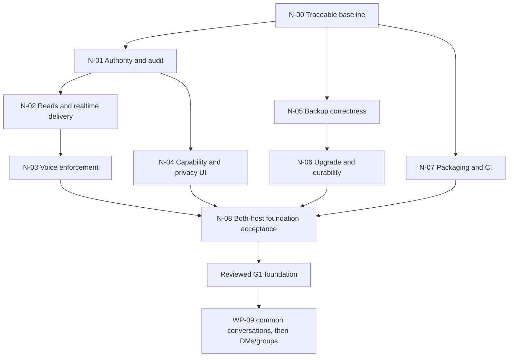

# BrrpBrrp — Completion Review and Next Implementation Plan

**Review date:** 24 September 2026  
**Source reviewed:** application version `0.4.0-alpha.3`, database schema **5**, backup format **2**  
**Required deployment paths:** Windows/Tailscale and Linux Docker, as requested by the owner  
**Deliverable:** an evidence-based completion review and implementation plan; no application changes or deployments in this task

## Contents

1. [Executive assessment](#1-executive-assessment)
2. [Review method and evidence](#2-review-method-and-evidence-limits)
3. [What has been achieved](#3-what-has-actually-been-achieved)
4. [All 33 work-package statuses](#4-work-package-completion-matrix)
5. [Findings controlling the next work](#5-findings-that-control-the-next-work)
6. [Immediate implementation plan](#6-immediate-implementation-plan)
7. [Roadmap from the foundation to v1](#7-continue-from-the-foundation-to-v100)
8. [Both-deployment acceptance matrix](#8-both-deployment-acceptance-matrix)
9. [Remaining decisions and inputs](#9-decisions-and-inputs-still-needed)
10. [Execution and reporting](#10-execution-discipline-estimation-and-reporting)
11. [Next checkpoint checklist](#11-next-checkpoint-checklist)

## 1. Executive assessment

**The project is an advancing alpha, with substantial new foundations, but it is not production-complete or ready for v1.0.0.** The main chat application works in the existing automated journey. Licensing, migrations, roles, session security, restricted-channel controls and backup integrity have progressed considerably since the original v1 plan.

Several recent completion claims are premature. This review reproduced an authority escalation, private-channel metadata disclosure and a backup that the application creates successfully but cannot restore. Other source-confirmed gaps affect migration recovery, media permissions, client privacy state and packaging. Passing the existing test suite does not establish the missing guarantees.

**Recommended next milestone: complete and verify the privacy, recovery and packaging foundations.** Close the findings in sections 5–6 before exposing restricted channels or starting the production implementation of DMs and group conversations. Host preparation, release engineering, the media feasibility study and accessibility design can proceed alongside that work.

No G0–G8 release gate is marked passed by this review. A completion percentage would obscure the remaining trust and recovery failures, so this document uses work-package and gate status instead.

### 1.1 How this document relates to existing plans

- [The v1 implementation plan](v1-implementation-plan.md) remains the full product scope, architecture, capacity and acceptance reference. Its schema-2 starting-point description is historical.
- [The implementation ledger](v1-progress.md) records valuable delivered work and previous checks. Its WP-04–08 completion labels and some backup/media claims need correction based on this review.
- **This document supersedes their current-status assessment and immediate execution order.** It preserves the long-term scope: a self-hosted, open-source community communications product with private messaging, useful moderation, dependable voice and desktop screen sharing.
- MIT licensing is now recorded in the project. The owner has already selected **both deployment paths**. Neither decision needs to be asked again.

## 2. Review method and evidence limits

### 2.1 What was examined

The review compared the 33 work packages against current API routes and handlers, authorization and database code, frontend state and components, voice delivery, backup/migration commands, release scripts, Docker inputs, workflows, ADRs and existing distribution archives. Three parallel reviews covered identity/data, experience/media, and operations/release; the findings below were consolidated with direct source inspection and local checks.

The workspace is not a Git checkout: `git status` reports that it is not a repository. Consequently, this review cannot attribute changes to commits, establish branch cleanliness or attest that hosted CI ran against this source. A disposable snapshot captured 295 source/document/configuration files, excluding dependencies, toolchains, generated output and local platform metadata. Its canonical path/digest manifest has SHA-256:

`54f33c40837764a0f67d4bf3f2b2eca802f457ed1f87ecb09d75d98a2f70330c`

This identifies the inspected local snapshot; it is not a release provenance attestation.

### 2.2 Fresh verification from this review

| Check | Result | What the result establishes |
| --- | --- | --- |
| Frontend unit tests | **59 passed** | Current covered state, client, update, notification and voice behaviors |
| Svelte/TypeScript diagnostics | **0 errors, 0 warnings** | Current frontend type/component consistency |
| Frontend formatting | **Passed** | Existing configured files conform to Prettier |
| Production frontend build | **Passed** | Current source produces the embedded web bundle |
| Go vet | **Passed** | Configured static Go checks |
| Generated notices freshness | **Passed**: 39 components, 20 license texts | Checked-in output matches the current generator on this host; redistribution completeness still needs review |
| Go race suite | **Passed**, exit 0; API package 262.088 seconds; RTC/scraper results reused from Go's cache | Existing covered Go paths; this does not replace adversarial authorization checks |
| Go executable build | **Passed** | Current source and newly built frontend produce a local executable |
| Chromium end-to-end journey | **1 passed** | First setup, persistent chat, search and sign-out; includes the journey's existing automated accessibility assertions |
| Existing local recovery rehearsal | **23 passed, 0 failed** | Fresh schema-5 installation → backup → verification → fresh-directory restore → login/message/attachment-byte preservation |
| Adversarial authorization probes | **Security contract failed; two findings reproduced** | Delegated member manager escalates authority; outsider receives private lifecycle metadata over a real WebSocket |
| Backup inventory boundary probe | **Defect reproduced** | Successful creation of a 600-attachment archive followed by verification and restoration rejection |

Builds, browser output, recovery data and the extra diagnostic tests were confined to disposable storage. Existing application source and release archives were not modified. The extra probes are not additions to the project's regular test suite: turning them into permanent regressions is planned work.

The baseline commands were `npm test`, `npm run check`, `npm run format:check`, `npm run build`, `go vet ./...`, `go test -race ./...`, `node scripts/licenses.mjs --check` with `BRRP_GO` set, a local `go build`, `npm run test:e2e`, and `node scripts/upgrade-recovery.mjs --binary <disposable-build> --report <temporary-report>`. The two API probes ran with `go test ./internal/api -run '^TestCompletionAudit' -count=1 -v` and failed their intended security assertions; the backup probe ran only its `TestCompletionAudit` and passed by asserting the demonstrated defect. Test exit status and product correctness are therefore reported separately.

### 2.3 Checks this review does not claim

- No Docker executable/runtime is available on this workstation; the Docker defect below is a **static dependency finding**, not a recorded container build failure.
- No Windows service, UAC, tray, reboot, power-loss, native filesystem or Linux container lifecycle acceptance was performed.
- The recovery rehearsal used two directories on one Mac and a tiny current-schema fixture. It did not demonstrate an old executable upgrade, prior-version rollback, off-host recovery, encrypted-copy retrieval, key recovery or target-scale RPO/RTO.
- The Chromium test is one journey. It does not qualify Firefox, Safari/WebKit, physical phones, assistive technology, delegated roles, private-view revocation or all new account-security screens.
- No physical microphone, forced relay, flowing-audio revocation, screen-sharing or capacity qualification was performed.
- No current hosted vulnerability scan, independent security approval, public repository, signed release, pilot or v1 publication is established by this audit.

## 3. What has actually been achieved

### 3.1 Useful product foundations retained

The application already has a functioning self-hosted chat shell, authentication/setup, channels, persistent messages, search, attachments, reactions, pins, reply views, unread state, optimistic sends/retries, drafts, responsive layouts, PWA update handling, mention notifications and audio-room foundations. Existing client tests protect several important stale-response and reconnection cases.

These are meaningful assets for the competitor vision. DMs, groups, named threads and richer live communication should extend the common product foundations after their access and recovery contracts are dependable.

### 3.2 New work since the original v1 baseline

| Area | Delivered in current source | Completion boundary |
| --- | --- | --- |
| Open-source foundations | MIT [LICENSE](../LICENSE), [CLA](../CLA.md), signatory record, [security policy](../SECURITY.md), generated third-party notices | Repository ownership/history, tested private intake, actual contribution/release operations and support ownership remain |
| Migration system | Ordered migrations through schema 5, preflight inspection, downgrade refusal, verification/FTS rebuild, FULL durability default and fixtures | Pre-upgrade backup ordering and failed post-commit completion are not closed |
| Identity/session security | Member MFA, privileged MFA policy, session list/revocation, recent authentication, factor removal and offline owner recovery | Policy bypasses, mandatory audit behavior and complete delivery/session invalidation remain |
| Role model | Capability catalog, owner/operator concepts, role CRUD/assignment, hierarchy helpers and route policies | Legacy account APIs, stale authority, SQL visibility and voice do not consistently enforce the model |
| Channel structure | Durable categories, restricted/announcement channels, grants, access inspector and invitation roles | Capability-aware UI, ownership UI, category display ordering and full privacy delivery remain |
| Restricted-content protection | Scoped ordinary reads/search/files, mention audience filtering, push dispatch checks, voice audience filtering and some revocation handling | Lifecycle metadata, queued events, races, sessions and rendered client views still have gaps |
| Upload publication | Temporary-file publication and data flush before a database reference | Supported-platform final-name durability and abrupt-crash claims need resolution |
| Backup integrity | Format-2 inventory with app/schema identity, sizes and SHA-256; staged restore; archive verification; checked copies | Manifest limits, atomic completion, freshness/identity binding and real recovery remain |
| Evidence/tooling | More focused Go/client tests, 8 ADRs, notice freshness gate, local recovery script | Current tests miss several decisive negative cases; operational and final release evidence remains absent |

### 3.3 Source and packaged versions are no longer the same baseline

Current source still reports `0.4.0-alpha.3`, although it writes schema 5 and backup format 2. Existing native alpha.3 archives date from 23 September and contain the older deployment documentation and third-party notices, but no newly added project LICENSE. The existing Docker source archive directly contains **schema 2**, no migration 3, and no current license/notices document.

**Those archives are historical alpha.3 deliverables, not packages of the current source.** Do not overwrite them under the same name. Select a distinct candidate version and record source identity, application version, schema version and backup format separately before rebuilding distributions.

## 4. Work-package completion matrix

**Status meanings:** “Partial” means useful implementation exists but an acceptance condition is missing; “Not implemented” refers to the planned v1 addition, not the absence of all related alpha functionality; “Not qualified” means test/release evidence is missing. None of these labels implies a release gate has passed.

| WP | Scope | Current assessment | Next completion requirement |
| --- | --- | --- | --- |
| 01 | Project rights and stewardship | **Partial** | Preserve MIT/CLA work; establish canonical repository/history, responsible maintainers, recovery and publication identities, tested security intake |
| 02 | Scope and ADRs | **Partial** | Ratify outstanding defaults, trust/lifecycle/support choices and named gate owners |
| 03 | Reference hosts and evidence | **Not qualified** | Windows/Tailscale and Linux Docker hosts, clean recovery targets, load generator and reviewer availability |
| 04 | Migrations and durability | **Partial** | Safe no-migration snapshot, recoverable migration postconditions, genuine upgrade/rollback and platform durability evidence |
| 05 | Identity, sessions, MFA and recovery | **Partial** | Close policy/audit/session-delivery gaps; exercise new UI and both-host recovery |
| 06 | Central authorization | **Partial; blocking defects** | Remove account escalation/owner deletion; align current authority, SQL, routes and voice |
| 07 | Roles, categories and restricted channels | **Partial** | Complete capability-aware management, owner ceremony, category order and consistent authority behavior |
| 08 | All-surface privacy | **Partial; blocking defects** | Fix lifecycle broadcasts, queued delivery, admission races, session invalidation and client views; independent review |
| 09 | Common conversation/state model | **Not implemented** | Shared identifiers and message pipeline, durable outbox/idempotency receipts, tombstones and lifecycle contract |
| 10 | Direct messages | **Not implemented** | Request/acceptance, membership, history/access policy and integrated journeys |
| 11 | Groups and blocking | **Not implemented** | Group membership/history rules, blocking and concurrent-removal behavior |
| 12 | Lifecycle, export and erasure | **Not implemented** | Approved deletion policy, retained continuity/tombstones, export and retention enforcement |
| 13 | Named threads | **Alpha replies only** | Named identity, subscriptions, lifecycle, read cursor, history traversal and legacy link migration |
| 14 | Notification preferences/inbox | **Alpha mentions only** | Conversation preferences, unified inbox, deduplication and DM/thread policy |
| 15 | Moderation and reports | **Partial prerequisites** | Hierarchy-safe actions, timeout/slow mode, reports and restricted evidence workflow |
| 16 | Formatting, profiles and composer | **Alpha foundation** | Safe formatting, stable-identity mentions/member context and complete new conversation UX |
| 17 | UX/accessibility foundations | **Partial** | New role/security flows, keyboard/focus behavior, privacy cleanup and broader browser checks |
| 18 | Media architecture spike | **Not implemented** | Measured embedded-Pion feasibility and documented decision against the screen-sharing contract |
| 19 | Voice/private calls/network | **Partial prerequisites** | Enforced connect/speak/moderate, safe admission, listen-only/private calls, configurable external connectivity and diagnostics |
| 20 | Media publications/signaling | **Not implemented** | Publication/subscription identities, renegotiation, cancellation, bounds and compatibility |
| 21 | Screen sharing | **Not implemented** | Authorized desktop capture, viewer controls, track lifecycle and failure UX |
| 22 | Media qualification | **Not qualified** | Actual connected media, physical devices, network/relay matrix, prolonged calls and sharing acceptance |
| 23 | Backups and recovery | **Partial; blocking defects** | Coherent limits, atomic publication, authoritative identity/freshness, verification equivalence and independent restore |
| 24 | Host lifecycle | **Not qualified** | Installation/update/reboot/rollback/recovery on both required deployments |
| 25 | Metrics and alerts | **Partial baseline** | Correct backup-health model, independent probes, delivered alerts and operational runbooks |
| 26 | Capacity qualification | **Not qualified** | Deterministic datasets and measured target/overload/soak results on both hosts |
| 27 | Release CI and packaging | **Partial; Docker regression** | Fix build inputs, join required checks, distinct version, consumer tests, signing and provenance |
| 28 | Independent security review | **Not complete** | Review corrected foundation before exposure; final review after v1 integration |
| 29 | Browser/accessibility qualification | **Not complete** | Expanded automation plus physical browser/assistive-technology evidence |
| 30 | Community beta | **Not started** | Safe entry gate, real communities, 14-day observation and finding closure |
| 31 | Operator/member documentation | **Partial** | Correct overclaims, align packages and rehearse with a non-author |
| 32 | Release candidate | **Not started** | Frozen final artifacts, applicable reruns and seven-day observation |
| 33 | Publication and maintenance | **Not started** | Approved release, verified downloads, staged rollout and accepted support handoff |

## 5. Findings that control the next work

**Priority:** P0 here means a demonstrated trust-boundary failure that blocks the affected feature's exposure. P1 means a required correctness/recovery/build fix before foundation or release acceptance. P2 means unfinished product integration or qualification. These are project planning priorities, not formal vulnerability scores.

**Evidence:** “Reproduced” means an actual local probe observed the defect. “Source-confirmed” means the implementation path is present and was inspected. “Interleaving to prove” means the source lacks a synchronization boundary, but this review did not reproduce the timing case.

### F-01 · P0 · Delegated account management can become operator authority

**Reproduced.** A caller holding only the custom `member.manage` capability PATCHed its own account to `is_admin=true` and received HTTP 200. It then deleted the designated owner and received HTTP 200. The database contained zero owners; the caller resolved both `operator.backup` and `operator.credential_recovery` through the ownerless administrator bridge.

The legacy account mutation handlers assign administrator status/roles without the new delegation rules and protect only the presence of another administrator. Evidence: [admin.go](../internal/api/admin.go), lines 136–198 and 226–245; [route policies](../internal/api/router.go), line 206; [operator bridge](../internal/authz/authz.go), around line 160.

**Required fix:** make all account entry points use the same current hierarchy/owner/operator policy. Account CRUD must not bypass role-assignment rules. Ownership removal must require the approved transfer/recovery ceremony. Define the ownerless bootstrap transition so deleting a record cannot recreate installation privileges.

**Acceptance:** permanent negative tests for self-promotion, creating a higher-ranked administrator, assigning/removing higher roles, deleting/deactivating/banning an owner, and reclaiming operator powers after each attempt. Legitimate delegated member management must still work.

### F-02 · P0 · Private lifecycle metadata reaches unrelated sockets

**Reproduced.** An outsider received HTTP 404 for private channel history, yet its actual WebSocket received the private channel ID, name and topic in `channel.created`, `channel.updated` and `channel.deleted` events.

Evidence: unconditional broadcasts in [channels.go](../internal/api/channels.go), lines 97, 153, 168 and 278. [publishToChannel](../internal/api/authz.go), lines 204–209, also broadcasts globally when channel lookup fails.

**Required fix:** send lifecycle events to the correct authorized audience, including the previous audience for deletion/visibility changes. Lookup failure must fail closed. If a broad refresh signal is necessary, it must contain no restricted identifiers or content.

**Acceptance:** outsider sockets connected before create/rename/move/delete receive no private metadata; permitted users receive correct updates; database errors/deleted-resource races cannot trigger global payload delivery. Check actual sockets, not just an audience helper.

### F-03 · P1 · Current authority is not consistently checked at commit

**Source-confirmed; timing exploits not reproduced here.** Several role/ownership changes use a principal captured before their transaction. The resolver refreshes roles but accepts the passed-in account's owner/admin flags and does not reload active account/session state. Channel access mutations also need transaction-time actor checks.

Evidence: [roles.go](../internal/api/roles.go), lines 215, 245, 357 and 445; [channel_access.go](../internal/api/channel_access.go), line 74; [service.go](../internal/authz/service.go), lines 31–48.

**Acceptance:** deterministically pause a privileged request after authentication; revoke the session/role, deactivate the account or transfer ownership; resume the request and prove no obsolete authority can commit a mutation. Establish an explicit lock/revision/transaction order rather than adding another unrelated read.

### F-04 · P1 · Search/state visibility differs from direct authorization

**Source-confirmed.** The shared SQL condition checks public visibility/admin/grants but omits `channel.read` and implicit default-role membership. A direct read can therefore be denied while state/global search uses a more permissive predicate. The effective-reader inspector contains another policy approximation.

Evidence: [roles.go](../internal/db/roles.go), lines 31–46; [state.go](../internal/api/state.go), lines 54–64; [messages.go](../internal/api/messages.go), line 323; [authority service](../internal/authz/service.go), around line 131.

**Acceptance:** a common permission matrix gives identical decisions across single-resource reads, state, unread/counts, global/scoped search, inspector, files, mentions and events, including removed `channel.read`, default-role grants and delegated channel managers. Pagination/counts must be scoped before limits are applied.

Include category metadata in this matrix: `/state` returns the global category list and category queries count all channels ([state.go](../internal/api/state.go), lines 69–77; [roles.go](../internal/db/roles.go), lines 394–396). Category names are currently described as shared workspace structure. Explicitly approve that disclosure and decide whether counts may reveal inaccessible channels; test a category containing only restricted channels against the accepted policy.

### F-05 · P1 · Revocation misses queued and newly admitted delivery

**Source-confirmed mechanisms; admission interleavings remain to prove.** Socket queues contain raw bytes, with no resource/revision check when the writer sends them. Download access is resolved before its revocable stream is registered. Session revocation/password changes close or invalidate sessions without canceling all of that session's admitted downloads; the stream registry identifies channels, not accounts/sessions.

Evidence: [hub.go](../internal/ws/hub.go), line 69; [websocket.go](../internal/api/websocket.go), line 78; [uploads.go](../internal/api/uploads.go), lines 128–136; [delivery.go](../internal/api/delivery.go), line 19; [sessions.go](../internal/api/sessions.go), lines 112–173.

**Required fix:** define one revocation boundary across authorization commit, delivery admission, queues and streams. Carry sufficient resource/account/session identity to cancel or revalidate delivery. Preserve the stated limitation that already received bytes cannot be recalled.

**Acceptance:** controlled queue backlog, access-check/admission barriers, password/session/role changes, original/preview/range downloads and failed lookups. Nothing newly admitted or still queued may escape the approved boundary. Test that unrelated permitted sessions continue working.

### F-06 · P1 · Voice roles and admission do not enforce the advertised contract

**Source-confirmed; concurrent join/move/revoke remains to prove.** Join checks channel readability but not `voice.connect`; speak state and forwarding do not enforce `voice.speak`; moderation checks legacy `is_admin`. Resume does not recheck channel access. Access resolution and SFU admission occur separately, allowing an interleaving that must be closed.

Evidence: [voice.go](../internal/api/voice.go), lines 27, 44–70, 94 and 105; [voice_access.go](../internal/api/voice_access.go), lines 125 and 176; [SFU](../internal/rtc/sfu.go), around line 218.

**Acceptance:** readable-but-connect-denied member cannot join/resume; listen-only member cannot transmit despite malicious state commands; delegated moderators act only within hierarchy; join/move/resume racing revocation cannot leave an unauthorized peer. Use negotiated peers forwarding RTP to prove actual media stops.

### F-07 · P1 · Security policy and required audit records are ordinary settings

**Source-confirmed.** `settings.manage` can update the full settings object, including `RequirePrivilegedMFA` and `Audit`. Audit recording can be disabled and happens after sensitive mutations through a warning-only failure path.

Evidence: [settings.go](../internal/api/settings.go), lines 17–73; [router.go](../internal/api/router.go), line 214; [audit helper](../internal/api/admin.go), around line 416.

**Acceptance:** owner-level security policy changes require current operator authority and recent authentication; routine settings management cannot weaken MFA or mandatory audit. Authority/recovery mutations and required audit records commit atomically, or fail together. Define and test emergency recovery audit behavior separately.

### F-08 · P1 · Revoked private content remains in application views

**Source-confirmed; no browser reproduction added in this review.** Authorization refresh clears channel caches but leaves independent search/pins arrays and panels mounted. Active messages and thread content can remain while refresh is pending or fails. Delayed requests need a shared authorization generation.

Evidence: [workspace store](../web/src/lib/workspace.svelte.ts), lines 239–295; [SearchPanel](../web/src/lib/components/SearchPanel.svelte), lines 10–90; [PinsPanel](../web/src/lib/components/PinsPanel.svelte), lines 8–37; [Workspace](../web/src/lib/components/Workspace.svelte), line 348.

**Acceptance:** open history/search/pins/thread/attachment preview, revoke access, and prove the application clears restricted views and ignores older responses immediately under the approved boundary, including when `/state` fails. Tests must inspect rendered content, not only an internal map.

### F-09 · P2 · Role and category UI is unfinished

**Source-confirmed.** `/state` provides effective capabilities, but the frontend state type/management controls still use `is_admin`. Delegated managers/moderators cannot reach granted functionality. Ownership designation/transfer has an API but no frontend invocation. Sidebar grouping ignores durable category positions.

Evidence: [state.go](../internal/api/state.go), line 78; [types.ts](../web/src/lib/types.ts); [Workspace](../web/src/lib/components/Workspace.svelte), lines 52–65, 126 and 357; [MessageItem](../web/src/lib/components/MessageItem.svelte), lines 44, 292 and 345; [owner endpoint](../internal/api/roles.go), line 437.

**Acceptance:** capability-based controls match server decisions for non-admin managers/moderators, ownership ceremony handles MFA/recent authentication and confirmation, category order survives reload and appears in the sidebar. Users see useful explanations for denied actions. Reconcile manager-only announcement posting with the original posting-role proposal.

### F-10 · P1 · The application can create an unrestorable backup

**Reproduced.** With 600 one-byte attachment files, archive creation succeeded. The result contained 602 entries and an **84,876-byte manifest** in a **164,568-byte ZIP**. Both `VerifyArchive` and `Restore` returned `backup exceeds restore size limits` because the manifest ceiling is 64 KiB.

Evidence: [backup inventory creation](../internal/backup/backup.go), lines 68–85; [entry limits](../internal/backup/manifest.go), lines 107 and 135–138.

**Required fix:** align creation, validation and restoration around explicit entry-count, manifest, database and aggregate limits; use bounded parsing/streaming as appropriate. Keep decompression/resource limits. The original F-T target has 20 GiB of attachments **plus** a database, so a 20 GiB aggregate restore ceiling is also incompatible with that target.

**Acceptance:** just-below/at/above limits, thousands of small files, large database, target dataset and hostile ZIP fixtures. Every successfully completed backup within the declared support profile must verify and restore.

### F-11 · P1 · Archive completion, health and retention need stronger identity

**Source-confirmed.** Creation opens the final ZIP before writing it; abrupt termination can leave a partial archive under a completed-looking name. Integrity verification is stronger now, but health still selects/ages archives by filesystem mtime and ignores recorded success identity/digests. Touching an old valid archive can make it appear fresh, and unrelated valid local/copy archives are not tied to the same recovery generation.

Evidence: [backup.go](../internal/backup/backup.go), line 40; [production.go](../internal/app/production.go), lines 48–69, 95–104 and 175–219; [backup scheduling](../internal/api/backup_schedule.go), lines 87–98 and 200–213.

**Acceptance:** stage → close → flush → validate → atomic publish → directory durability → success record; interruption never advertises completion. Health uses the verified snapshot timestamp and matching independent-copy identity/upload coverage. A touched old archive fails freshness; a mismatched valid copy fails identity. Copy failure preserves a verified recovery generation, retries within the approved RPO budget and delivers an alert.

Also close verifier/restore differences: `VerifyArchive` checks SQLite integrity but omits restore's database-to-attachment coverage check and actual-schema/manifest cross-check. Verification extracts into default temporary storage while Compose supplies a 64 MiB `/tmp`; choose and bound scratch storage for realistic databases.

### F-12 · P1 · Upgrade safety is incomplete

**Source-confirmed.** The new executable opens/migrates the database before its `backup` and `verify` commands. That prevents those commands from serving as a no-mutation pre-upgrade snapshot/inspection path. Migration commits its schema history before FTS rebuild and invariant verification; failure after commit leaves the schema advanced, and a later open with no pending migrations skips those postconditions.

Evidence: [main.go](../cmd/brrpbrrp/main.go), lines 193–214; [db.go](../internal/db/db.go), lines 171–185.

**Acceptance:** preserve a final quiesced old-schema backup before changes; verification's mutation semantics are explicit; injected failure/crash during postconditions cannot allow normal startup until completion is repaired and verified. Rehearse actual old alpha.3/schema-2 binary/data → distinct candidate → matching old binary and pre-upgrade data rollback. Record lost post-snapshot writes and prohibit unsafe in-place downgrade.

### F-13 · P1 · File durability claims exceed platform evidence

**Source-confirmed implementation limitation; power-loss behavior not measured.** Windows directory publication synchronization is a no-op and permits the temporary name to remain after power loss. Unix code accepts some unsupported directory-sync cases. Deferred cleanup cannot establish that abrupt process termination leaves no temporary file.

Evidence: [Windows publication](../internal/app/publish_windows.go), lines 5–13; [Unix publication](../internal/app/publish_unix.go), lines 23–24; [publication helper](../internal/app/publish.go), lines 48–53; [ADR 0007](adr/0007-attachment-durability.md).

**Acceptance:** document and implement the final-name durability contract for supported filesystems; make unsupported behavior explicit; verify crash-orphan cleanup and database/file consistency. Distinguish ordinary write errors, process kill and power loss. Native host evidence is required for the corresponding claim.

### F-14 · P1 · Current Docker build inputs are incomplete

**Source-confirmed dependency chain; Docker execution unavailable here.** The Go Docker stage invokes `release.go -notices`, which now shells out to `node scripts/licenses.mjs`. That stage contains neither Node nor the generator; `.dockerignore` excludes the script, and the stage lacks `web/package.json`, another required input.

Evidence: [Dockerfile](../Dockerfile), lines 12–29; [release.go](../scripts/release.go), lines 168–174; [.dockerignore](../.dockerignore), lines 10–12; [licenses.mjs](../scripts/licenses.mjs), line 92.

**Acceptance:** generate notices in a stage with all required inputs/runtime, pass the actual distribution notices/license to the runtime image, and build/test the image on Linux. Validate clean source-archive builds too. Do not count a static Dockerfile check as a successful image build.

### F-15 · P1 before distribution · Release identity and consumer completeness

**Source/archive-confirmed.** Current version defaults still identify the older alpha.3 release. The source-package allowlist omits the rehearsal script referenced by its Makefile and several supporting documents. Main packaging and Docker checks run through separate workflows without a demonstrated single promotion gate. Generated notices passing freshness does not establish every target-specific linked dependency and bundled helper is correctly covered.

Evidence: [version.go](../internal/app/version.go), line 3; [release.go](../scripts/release.go), lines 21 and 109–114; [Makefile](../Makefile), lines 31–32; [main workflow](../.github/workflows/check.yml); [Docker workflow](../.github/workflows/docker.yml); [notice generator](../scripts/licenses.mjs).

**Acceptance:** one distinct source/version identity, all required native/browser/Docker gates joined before promotion, clean extracted-package consumer checks, complete license/notices, checksums and the approved signing/provenance process. Preserve old artifacts for rollback; cross-compilation alone must not grant runtime support.

### F-16 · P1 for gate accuracy · Evidence labels overstate coverage

The progress ledger's “nothing in WP-10–33 can start” before WP-09 is too broad: backup/build fixes, host preparation, media feasibility, security design review and documentation have independent paths.

The recovery script is a useful **fresh-install recovery** check, not an old-version upgrade/rollback rehearsal. Its “touched archive” assertion corrupts archive bytes; it does not test changing only mtime on an old valid archive. `TestRevocationReachesAnActiveVoiceStream` joins an SFU peer with a no-op signaling callback and checks state/events, without SDP/RTP; it proves peer eviction, not interruption of flowing audio. Evidence: [rehearsal](../scripts/upgrade-recovery.mjs), [voice test](../internal/api/voice_privacy_test.go), around line 297.

**Acceptance:** each completion claim names the actual scenario, artifact, environment, negative cases and limits. Correct the ledger and ADR wording during remediation; retain previous valid results with their narrower scope.

## 6. Immediate implementation plan

These are proposed future changes. This review has not implemented them. Assign a named person to each role before treating a gate as owned: **TL** technical lead, **BE** backend, **FE** frontend, **OPS** host/recovery operator, **REL** release engineer, **QA** test owner, **SEC** independent security reviewer, **OWNER** product/project owner. One person can hold several roles; independent approval still requires a separate reviewer.

### N-00 — Establish a traceable remediation baseline

**Owner:** TL + REL. **Dependencies:** none. **Maps to:** WP-01–03, 27, 31; F-15–16.

1. Preserve current source and old artifacts with hashes. Establish the owner-controlled repository and import/reconcile history deliberately; never infer history from filenames.
2. Open tracked items for F-01–16, each with its evidence level and acceptance test. Convert the reproduced defects into failing permanent tests before changing behavior.
3. Correct the WP-04–08/23 completion wording and rehearsal/media descriptions. Track implementation, local tests, platform acceptance and approval separately.
4. Choose a distinct development candidate identity and keep restricted-channel exposure disabled while its boundary is unfinished.
5. Record accepted decisions/defaults, current enforced limits, both deployment targets and missing named reviewers/hosts.

**Exit:** another developer can identify exactly which source/artifacts were reviewed, reproduce the three demonstrated defects, and see the real gate status. Code fixes may begin while repository/host logistics proceed; traceability must be complete before release.

### N-01 — Close account escalation and security-policy bypasses

**Owner:** BE; review SEC + TL. **Dependencies:** baseline regression cases. **Maps to:** WP-05–07; F-01, F-03, F-07.

1. Unify create/update/delete/deactivate/ban/role assignment under the policy service and hierarchy rules.
2. Protect the designated owner across every mutation path and define the ownerless bootstrap state transition.
3. Reload account/session/role/ownership authority inside the committing boundary; add deterministic revocation/transfer races.
4. Separate routine settings from owner-controlled MFA/recovery/audit policy.
5. Make required security audit events atomic with authority-changing operations, including offline recovery where applicable.

**Exit:** no custom member manager can grant higher authority or remove the owner; stale requests cannot commit; legitimate delegated workflows remain usable; all security-negative tests pass. These fixes should be small, independently reviewed changes, not a wholesale rewrite of authentication.

### N-02 — Make every read and realtime path use the same access contract

**Owner:** BE + QA; review SEC. **Dependencies:** N-01 policy semantics. **Maps to:** WP-06, 08; F-02, F-04, F-05.

1. Align SQL visibility/default-role handling with the policy engine and reader inspector, including the approved category-name/count disclosure policy.
2. Replace broad lifecycle payloads; handle deletion/visibility transitions with an explicit previous/current audience policy; fail closed on lookup errors.
3. Define authorization revisions for queued events and account/session/resource identity for streams.
4. Close delivery-admission races; cancel streams on session/password/role/account changes as required.
5. Add real socket, paused queue and original/preview/range-download regressions, including allowed-delivery controls so silence is meaningful.

**Exit:** outsider and revoked-user matrices pass across metadata, search, counts, events, files and push. The test suite deliberately fails if the lifecycle audience restriction or dispatch/admission guard is removed.

### N-03 — Enforce voice capability and revocation semantics

**Owner:** BE/media + QA. **Dependencies:** N-01/N-02 shared authority contract. **Maps to:** WP-08, 19; F-06.

1. Enforce connect, speak and moderator capabilities server-side, including role hierarchy.
2. Serialize or revision-check join/move/resume against revocation; clear associated relay credentials where required.
3. Preserve room movement and reconnect behavior without letting old clients regain revoked rights.
4. Add negotiated-peer/RTP tests for allowed audio, connect denial, listen-only enforcement and mid-stream revocation.

**Exit:** actual forwarded media obeys the same access boundary as the rest of the product. Retain existing audio capacity limits until WP-20/26 qualification; do not increase the participant constant as a shortcut.

### N-04 — Complete the role and privacy user experience

**Owner:** FE + QA. **Dependencies:** agreed N-01/N-02 API contract; can develop in parallel with backend fixes. **Maps to:** WP-07, 08, 17, 29; F-08–09.

1. Type/store effective capabilities and use them consistently in navigation, management tabs and actions.
2. Add owner designation/transfer with the approved recent-authentication/MFA/confirmation flow.
3. Consume durable category ordering and ensure reordering survives reload.
4. Centralize authorization-generation invalidation across active messages, thread, search, pins, previews, caches and in-flight responses.
5. Add browser journeys for delegated non-admin managers, role changes during use, owner transfer and revocation while panels are open; include failed refresh and keyboard/focus recovery.

**Exit:** real users can exercise granted authority and immediately lose revoked views/actions. The browser suite covers these new capabilities in addition to the original chat journey.

### N-05 — Make backup creation, verification and restore agree

**Owner:** BE/OPS + QA. **Dependencies:** none of the new conversation features; coordinate shared file-publication changes. **Maps to:** WP-23, 25; F-10–11.

1. Fix coherent manifest/count/database/aggregate limits with boundary fixtures and bounded parser behavior.
2. Implement crash-safe staged archive publication and completion recording.
3. Align verifier and restore checks for actual schema, database references, attachment presence and digests; retain explicit format-1 compatibility limits.
4. Select configurable bounded scratch storage that works with the container filesystem contract.
5. Bind health/copies/retention to the verified recovery generation and real snapshot time; add bounded retry and alert semantics.
6. Test disk-full, archive/copy interruption, old valid ZIP with changed mtime, wrong valid copy, missing referenced upload and repeated failed backups.

**Exit:** supported archives cannot succeed at creation and fail validation because of inconsistent limits; no partial archive is advertised as complete; production health identifies the actual recoverable snapshot. The 600-file reproduction and freshness/identity negative cases pass as permanent tests.

### N-06 — Complete the upgrade and durability contract

**Owner:** BE + OPS; review TL. **Dependencies:** N-05 archive contract for end-to-end rehearsal. **Maps to:** WP-04, 24; F-12–13.

1. Separate non-migrating inspection/snapshot commands from schema application.
2. Move required postconditions inside the atomic boundary or persist an explicit incomplete-upgrade state that is repaired/verified before normal service.
3. Resolve supported Windows/Linux filesystem publication semantics and revise unsupported claims.
4. Build a real schema-2 fixture with its matching prior executable and preserve the old-version recovery materials.
5. Rehearse quiesce → final old-schema snapshot → upgrade → verify → restart → rollback into a clean target, including process-kill and postcondition failure checkpoints.

**Exit:** upgrade cannot destroy its own rollback baseline or bypass failed completion on restart. Both native/container operators have an accurate procedure and evidence showing which data/credentials/permissions are restored or reconciled.

### N-07 — Restore clean packaging and join release gates

**Owner:** REL + OPS. **Dependencies:** source/version identity from N-00; candidate reruns after N-01–06. **Maps to:** WP-01, 27, 31; F-14–15.

1. Repair Docker generator runtime/inputs and include project license plus appropriate notices in distributions.
2. Audit native and source archive contents from a clean extraction; every documented build/rehearsal target and local documentation link must work with shipped inputs.
3. Reconcile notices against actual linked target dependencies and bundled frontend helpers, preserving required license/notice texts.
4. Join native tests, frontend checks, browser journeys, vulnerability/license checks, Docker build/runtime and package-consumer checks before candidate promotion.
5. Add checksums and the accepted SBOM/provenance/signing process; retain distinctions between cross-built and runtime-qualified architectures.

**Exit:** a distinct candidate can be built and consumed from clean source; Linux Docker build/runtime passes; no distribution is promoted when a required job has not passed. The old alpha.3 artifacts remain identifiable and intact.

### N-08 — Qualify the foundation on both deployment paths

**Owner:** OPS + QA, with SEC review. **Dependencies:** N-01–07 integrated candidate and available hosts. **Maps to:** WP-03, 04–08, 23–24, interim WP-28.

Run the matrix in section 8 using exact candidate hashes. Include an independent encrypted recovery copy, clean target restore, owner lockout recovery, post-snapshot security reconciliation and delivered failure alerts. A second reviewer examines authorization behavior and the negative-test evidence before restricted exposure is enabled.

**Exit:** G1 may be proposed for approval only after its implementation, upgrade/recovery, privacy and independent review requirements pass. This is a foundation checkpoint; it is not G5 capacity completion or v1 readiness.

### 6.1 Parallel work and the join point

Host preparation, reviewer scheduling, accessibility design, media feasibility and documentation can start before this join. Serialize overlapping migrations and shared authorization/protocol changes under a single technical owner. Do not use parallel work to bypass a dependency.

## 7. Continue from the foundation to v1.0.0

The full work-package definitions remain in the master plan. The following sequence clarifies what should follow the fixes rather than repeating every specification.

| Milestone | Implementation order | Required exit evidence |
| --- | --- | --- |
| **G0 baseline approval** | Finish WP-01–03 decisions, identities, named owners and support boundary while remediation runs | Accepted scope/trust/defaults; both-host reference environments; no unowned blocking decision |
| **G1 foundation** | N-01–08 | Closed authority/privacy/recovery findings, real upgrade evidence, interim independent review |
| **G2 private messaging** | WP-09 shared conversation/message/state model → WP-10 direct messages + WP-11 groups/blocking + WP-12 lifecycle | Membership acceptance/removal/block races; ordinary administrators cannot read unrelated DMs; deletion-safe idempotency/outbox; export/erasure/tombstone behavior; full authorization regression |
| **G3 community completion** | WP-13 named threads → WP-14 notification preferences/inbox; WP-15 moderation/reports; WP-16 composer/profiles; WP-17 integrated UX | Legacy links preserved; history/read cursors; notification deduplication; reports and safe evidence access; keyboard/mobile journeys. Minimum moderation precedes outside private-message pilots |
| **G4 live communication** | WP-18 measured spike → approved media decision → WP-19 network/private-call work → WP-20 signaling/publications → WP-21 sharing → WP-22 qualification | Authorized capture/subscription, cleanup/reconnect, direct and relay paths, physical cross-browser audio and sharing quality |
| **G5 operations** | WP-23–24 recovery/lifecycle → WP-25 metrics/alerts + WP-26 capacity; WP-27 final release pipeline | Target-scale independent recovery, Windows/Docker lifecycle, delivered faults, both-host load/soak evidence and signed/verifiable consumer artifacts |
| **G6 accepted beta** | WP-28 final independent review + WP-29 browser/accessibility + WP-31 newcomer docs, then WP-30 real-community beta | Required review findings closed, 14-day beta evidence and accepted support/incident ownership |
| **G7 accepted candidate** | WP-32 freeze source/dependencies/schema/protocol/docs and qualify final bytes | Seven consecutive days of final-candidate observation; affected gates rerun after changes/repacking/signing |
| **G8 stable release** | WP-33 owner-approved publication, staged rollout and maintenance handoff | Verified downloads/images, upgrade/rollback materials, working security intake and first-month support plan |

### 7.1 Protect the main architecture decisions

- **Conversation model first:** one message pipeline and consistent conversation identity across channels, DMs, groups and threads. Avoid separate DM storage/authorization paths.
- **Retry correctness:** receipts must survive message erasure for the approved replay horizon. Durable outbox state, request identity, tombstones and pruning must be designed together; a uniqueness constraint on existing messages alone is insufficient.
- **Private lifecycle first:** settle full-history versus join-time history, blocking, leaving, deletion, export and operator trust disclosures before schema/UI promises become hard to change.
- **Media design before screen UI:** evaluate the embedded Pion path against actual renegotiation/publication needs. Desktop sharing is in the proposed v1 scope; camera video, federation, E2EE, native mobile and active-active hosting remain separate future programs unless scope is explicitly revised.
- **Self-hosting independence:** inventory outbound dependencies; make STUN/TURN and optional push/preview behavior understandable and configurable. Current hard-coded public STUN and IPv4/UDP relay behavior do not fulfill the intended network contract.
- **Capacity follows measurement:** retain current enforced caps until the approved profile passes. The master plan's 250 accounts, 50 online users, 100 sockets, 20 total media seats/10 per room and two concurrent screen publishers are targets, not current guarantees.

## 8. Both-deployment acceptance matrix

Use Windows x64 native/Tailscale and Linux amd64 Docker as the existing plan's proposed reference configurations; confirm exact supported versions/resources before qualification. Other cross-built architectures remain unqualified until their runtime gates pass.

| Scenario | Windows/Tailscale evidence | Linux Docker evidence | Shared acceptance |
| --- | --- | --- | --- |
| Fresh installation | Clean host, service permissions/UAC, data location, setup and browser connection | Clean host/volume, actual image, non-root UID, Compose configuration and setup | Documented steps work; secrets never appear in distributable artifacts |
| Restart/reboot | Service/tray start/stop and host reboot | Restart policy, container replacement and host reboot | Persistent content/settings intact; one writer; readiness meaningful |
| Network/TLS | Tailscale name/certificate/firewall and browser access | Published ports/reverse-proxy/TLS/UDP configuration | Correct public origin, secure sessions, WebSockets and usable diagnostics |
| Upgrade | Stopped service, old-schema snapshot, distinct candidate | Quiesced container, old image/digest and volume snapshot | Correct schema/content/roles; failure cannot silently skip verification |
| Rollback | Matching old binary + old data on clean target | Matching old image + pre-upgrade volume/data | No in-place downgrade; lost-write boundary and reconciliation documented |
| Lockout recovery | Offline service-host operator path | Offline container/volume operator path | Exclusive access, safe factor/password recovery, mandatory audit and working login |
| Publication durability | Supported Windows filesystem, crash/power-loss qualification as claimed | Supported Linux volume/filesystem, crash and storage error cases | No acknowledged DB reference without its promised file; orphan cleanup demonstrated |
| Independent restore | Encrypted off-host archive onto separate clean Windows destination | Same generation onto fresh Docker volume/destination | Actual accounts/roles/search/uploads; stale sessions/push invalidated; security changes reconciled before traffic |
| Backup failure/retention | Failed destination, full disk, stale copy, scheduler interruption | Same faults including scratch/tmpfs limits | Verified recovery generation retained; age/identity correct; alert reaches responsible operator |
| Voice/connectivity | Real devices, independent networks and forced relay | UDP/relay/container path with real devices | Authorized join/speak/move/resume/revoke; measured quality; no scope leakage |
| Target load | Separate generator and reference hardware | Separate generator and reference resources | F-T data; latency/resource targets; controlled overload; two-hour peak and 24-hour mixed soak |
| Final artifacts | Actual signed download, extraction/install/upgrade | Actual published candidate image digest and source package | Hash/provenance/license checks; consumer paths; evidence tied to exact final bytes |

The master targets remain **RPO ≤24 hours** and **RTO ≤60 minutes** on the reference dataset. RTO starts at the declared recovery event, before the operator begins work, and includes response delay, retrieval/decryption, restoration, security reconciliation and verification. Report total outage separately. A same-host copy or a tiny local fixture cannot demonstrate these objectives.

## 9. Decisions and inputs still needed

These are planning dependencies to resolve at the relevant checkpoint; they do not prevent local remediation work. No new permission or deployment request is being made by this document.

| Input/decision | Already established | Still needed | Needed by |
| --- | --- | --- | --- |
| Deployment scope | **Both Windows/Tailscale and Linux Docker** | Reachable disposable reference hosts, exact OS/runtime/resources, clean recovery destinations | N-08 / WP-03, 24 |
| Source license | MIT and CLA direction recorded | Confirm exact holder spelling, accepted contribution process and appropriate agreement review | Public contribution launch |
| Governance | Policy files exist | Canonical repository, maintainers/alternate, tested private security intake, enforcement contact | G0 and before outside beta |
| Authority/defaults | ADRs propose FULL durability, restricted exposure disabled, privileged MFA enabled | Ratify defaults and community-manager visibility disclosure; clarify announcement posting policy | G1 approval |
| Private-data behavior | Master plan proposes bounded DM/group/operator trust model | Ratify history, blocking, deletion/tombstone/export/report-evidence rules | WP-09 schema |
| Recovery custody | Independent encrypted copy and recovery targets proposed | Actual destination, keys, recovery owner/alternate and accessible recovery materials | N-08 / G5 |
| Distribution identity | Old alpha.3 artifacts available locally | Distinct candidate identity, repository/registry ownership and signing credentials | N-07 / G5 |
| Network independence | Configurable external connectivity intended | Approved STUN/TURN/push/preview defaults, real relay/network test path | WP-18–19 |
| Staffing/support | Work packages have role names | Named implementers/reviewers, physical testers, accepted response coverage | G0; support claims before beta |
| Capacity/scope | Original targets and screen-sharing scope proposed | Freeze or explicitly revise after measurement/spike; never silently reduce gates | WP-18 / WP-26 |

## 10. Execution discipline, estimation and reporting

### 10.1 Small reviewable deliveries

For each N-package, use this sequence: reproduce the problem → agree on the shared contract → implement the smallest coherent change → run focused negative/allowed-path tests → run affected integration checks → update evidence and documentation → independent review where required. Avoid adding unrelated features while closing authority/recovery failures.

Run the full relevant CI set at integration/candidate checkpoints. Repeat wider qualification when an actual dependency changes, not simply to accumulate green runs. A source-only finding must become a behavior test when feasible; a passing test that only mirrors a helper is insufficient for a delivery guarantee.

### 10.2 Scheduling basis

Do not reuse the original total as a precise remaining estimate or subtract “completed packages”: this audit reopens several of them. The honest next commitment is **N-01/N-02 security closure plus N-05/N-07 recovery/build fixes in parallel**, followed by the integration and both-host checkpoint.

Estimate each package after its contract and regressions are agreed. Track focused engineering days, review/defect effort and external waits separately. Re-estimate the remaining program after two completed remediation iterations and again after the media spike. Keep explicit contingency for security, migration and platform findings. The 14-day beta and seven-day final-candidate windows remain calendar constraints, with resets under the master plan's change/severity rules.

### 10.3 Evidence record for every claimed completion

Each record must include:

1. Requirement/finding/work-package ID and the exact scenario.
2. Source commit or snapshot identity; candidate version, schema/backup format and artifact hashes.
3. Command/test case, fixture size, environment/host/browser/network and relevant configuration.
4. Expected result, observed result, duration where relevant, logs and reviewed limitations.
5. Negative and permitted-control cases; failure injection for race/recovery boundaries.
6. Implementer, reviewer, date, remaining caveats and the gate owner accepting the result.

Use separate states for **implemented**, **locally verified**, **platform qualified**, **independently reviewed** and **released**. A work package is complete only when all of its required states are satisfied.

## 11. Next checkpoint checklist

Before describing the privacy/recovery foundation as complete:

- [ ] F-01 account escalation/owner deletion is fixed and permanent regression tests pass.
- [ ] F-02 outsider lifecycle disclosure and lookup-failure broadcasts are fixed with actual socket tests.
- [ ] Current session/account/role/owner authority governs transaction commits and all read surfaces.
- [ ] Event queues, files/previews and media obey the approved revocation/admission boundary.
- [ ] Voice capability restrictions and real flowing-media revocation are verified.
- [ ] Mandatory audit/security settings cannot be weakened through routine delegated settings access.
- [ ] Capability-aware controls, ownership UI, category order and all private-view invalidation journeys work.
- [ ] Supported backup creation/verification/restore limits agree; the 600-file defect is fixed.
- [ ] Archive completion, snapshot freshness, copy identity, retention, retry and alerts are correct under failure.
- [ ] Pre-upgrade snapshot and postcondition recovery survive failure; genuine old-to-new and rollback rehearsals pass.
- [ ] Both-host durability claims are supported or explicitly narrowed to the evidence.
- [ ] Docker and extracted source/native packages build and run with the new distinct candidate identity.
- [ ] Existing alpha.3 artifacts remain preserved; final candidate evidence names exact hashes.
- [ ] Both deployment paths and an independent privacy review satisfy G1's requirements.
- [ ] Progress/ADR/operator documents accurately describe what was verified and what remains.

**After that checkpoint:** implement the common conversation model, then DMs/groups/lifecycle, while the approved media and operations streams continue. Reach v1.0.0 through measured gates and a dependable user experience rather than treating a larger feature list as completion.
