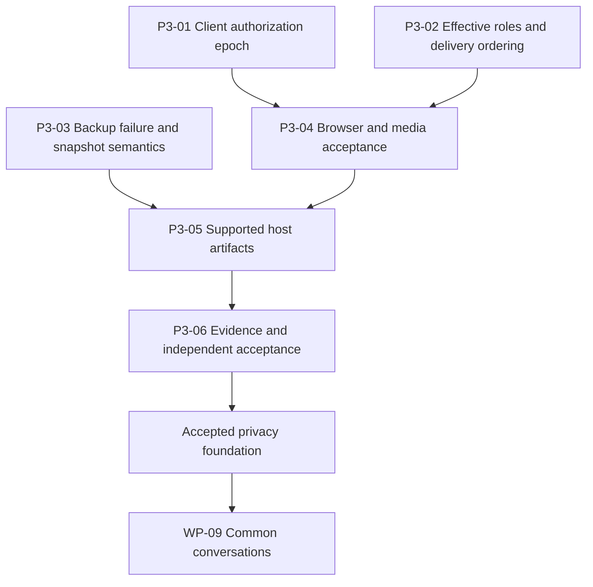

# BrrpBrrp — Third Completion Review and Next-Steps Plan

**Date:** 25 September 2026, America/Los_Angeles  
**Candidate:** `0.4.0-alpha.4` · schema **5** · backup format **2**  
**Required hosts:** Windows/Tailscale and Linux Docker  
**Scope:** completion audit, verification, next implementation plan and coder handoff. No application-source or deployment changes.

## Contents

1. [Assessment](#1-assessment)
2. [What changed and what is now verified](#2-what-changed-and-what-is-now-verified)
3. [Fresh checks and evidence limits](#3-fresh-checks-and-evidence-limits)
4. [Status of review 2 findings](#4-status-of-review-2-findings)
5. [Remaining findings](#5-remaining-findings)
6. [Next implementation packages](#6-next-implementation-packages)
7. [v1 completion map](#7-v1-completion-map)
8. [Deployment, decisions and release gates](#8-deployment-decisions-and-release-gates)
9. [Evidence and execution requirements](#9-evidence-and-execution-requirements)

## 1. Assessment

**The foundation is materially stronger than in review 2. The project remains an alpha; it is not yet production-complete or ready for v1.0.0.** Several previously reproduced security and recovery defects now have implementation fixes and permanent tests. New browser journeys cover real delegated-role, privacy and ownership behavior. A maintained cross-version rehearsal now verifies the actual old executable and its rollback archive.

The next work can be narrower than the previous plan. Do not redo the owner/credential/migration work merely because older documents contain historical failures. Finish the residual authorization-generation and stream-revocation cases, correct backup failure-state handling, repair the voice test harness, and obtain actual platform acceptance.

Four concrete problem areas remain from fresh checks:

1. Late incremental message and unread responses can cross the client authorization boundary.
2. Removing an implicitly held default-role permission does not cancel that account's registered delivery.
3. A failed backup copy does not enter the new short-retry path and discards the prior verified-generation identity/local retention protection.
4. The checked-in voice browser test waits inside a dialog that closes after joining; the unmodified browser suite fails and skips ownership.

Other delivery ordering and platform guarantees remain unverified. **No G0–G8 gate is marked passed.** DM/group/thread/screen-sharing work remains largely ahead; the present progress is foundation remediation rather than v1 feature completion.

### Source of truth

- [Master v1 implementation plan](../docs/v1-implementation-plan.md): overall scope, architecture, targets and gate definitions.
- [Second completion review](../docs/completion-review-2-and-next-steps-2026-09-24.md): historical R2 findings and P2 packages.
- [Remediation ledger](../docs/completion-remediation-2026-09-24.md) and [progress ledger](../docs/v1-progress.md): implementation records, with closure wording qualified by this review.
- **This document:** latest current assessment and next execution order.
- [Coder handoff prompt](handoff-next-coder-2026-09-25.md): ready-to-copy instructions for implementing this plan.

This review and its handoff live under `planning/` so developer-only source references are not added to native distribution documents. Earlier reports are preserved. Both deployment paths and the recorded MIT/contribution direction remain accepted inputs, not questions to reopen.

## 2. What changed and what is now verified

The source comparison found **35 changed files and 10 additional files** against the review-2 snapshot. One additional file is the review-2 report itself; the others include transaction/delegation tests, the rollback script, browser journeys/support and role-assignment UI. The application label remains alpha.4.

### 2.1 Authority and credential transactions

Current account mutation paths reload target state in their committing transactions. The owner-transfer/delete race has a permanent regression. Owner security-policy checks use the transaction rather than waiting for another connection from the single-connection store. Operator reset now cancels affected deliveries, and password/MFA changes insert audit records inside their transactions.

Evidence: [authority_transaction_test.go](../internal/api/authority_transaction_test.go), [admin.go](../internal/api/admin.go), [settings.go](../internal/api/settings.go), [auth.go](../internal/api/auth.go), [mfa.go](../internal/api/mfa.go).

**Assessment:** the direct R2-01–03 mechanisms are addressed. Independent review and the remaining shared delivery-ordering cases still matter; this does not certify every possible concurrent authority transition.

### 2.2 Client privacy and management

Authorization invalidation now clears active messages, quoted replies, thread state and loading/navigation references. History/context requests compare authorization generation, and delayed history/context regressions exist. The fresh browser privacy journey successfully removed visible content and rejected its delayed history response.

Invitation-only and audit-only browser flows passed, including live demotion and regrant. Role assignment now has a scoped account-summary API and a separate component. Ownership designation/transfer passed in the diagnostic full browser run described below.

**Assessment:** substantial progress; the remaining message-lookup/unread paths in R3-01 prevent a universal client-boundary claim. Category-only and role-only rendered journeys still need explicit coverage.

### 2.3 Voice permissions

Join/move/resume re-resolve authority inside the voice gate. Enforcement now removes peers losing connect/read and updates the server's speak-denial flag when speaking rights change.

The new voice browser journey measures WebRTC inbound audio-byte counters with synthetic microphone devices. The checked-in test has a locator defect. After changing only that locator sequence in a disposable copy, the journey passed withdrawal/regrant and the entire five-project browser chain passed.

**Assessment:** new negotiated local transport evidence exists. It is synthetic Chromium/loopback evidence, not physical audio quality, forced relay, all browsers or a deliberately malicious sender. No manual production code fix was made by this review.

### 2.4 Archive and recovery mechanics

The three R2 archive cases now have targeted implementation changes: database-only archives record omitted upload count, creation enforces per-entry/aggregate budgets, and restore calls the shared schema/attachment coverage validator. Scheduled verification uses scratch under the data directory. Health separates current schedule coverage from the saved generation and stores snapshot/completion/copy timestamps separately.

The **maintained rollback command passed 53 checks** using the archived macOS amd64 alpha.3 binary and current candidate. Its fixture included two users, three messages, a reply, pin, invitation, uploaded file and MFA. It verified:

- Old schema 2/format 1 → candidate schema 5/format 2.
- Candidate backup does not migrate old data, but remains incompatible with old restore.
- Old executable plus its own archive restores into a clean folder.
- Post-snapshot message/ban changes are absent after rollback and explicitly identified as lost.
- An injected incomplete-upgrade marker/index-damage state is refused by verification, repaired on startup, verified and cleared.

The interruption is **injected state**, not a process killed during live migration. There was one skipped coverage fact: the old release has no role API. This is not a failed candidate assertion, and the rehearsal does not prove preservation of pre-existing schema-5 custom-role data.

**Assessment:** maintained local compatibility evidence is substantially better. Copy retry/retention and exact snapshot-clock semantics remain incomplete; host/off-host/target-scale qualification remains open.

### 2.5 Packaging

The source package now includes platform release directories and the rollback rehearsal. The checker uses normalized archive paths and proper filesystem URL conversion, and checks native document links too. This review generated a macOS amd64 package and source ZIP from an unmodified baseline copy, extracted the source ZIP, rebuilt its frontend/executable and exercised its release/package consumer path using cached dependencies.

This is **one local macOS consumer path**, not Windows/Linux acceptance or a clean network dependency install. Docker remains unavailable here. Existing project release archives were preserved; test artifacts stayed in disposable directories.

## 3. Fresh checks and evidence limits

### 3.1 Results

| Check | Result | Scope |
| --- | --- | --- |
| Frontend unit tests | **68 passed**, up from 63 | Current project baseline before diagnostic probes |
| Svelte/TypeScript | **0 errors, 0 warnings** | Current type/component checks |
| Frontend formatting/build | **Passed** | Production assets regenerated from current source |
| Go vet | **Passed** | Static checks |
| Full uncached Go race suite | **Passed**, exit 0; API package 456.223 seconds | `go test -race -count=1 ./...`; all test-bearing packages executed without cached results |
| Notice freshness | **Passed**, 39 components/20 license texts | Generator consistency on this host |
| Docker input/self-test | **Passed** | Static build-input check; not a container build |
| Source-package checker | **Passed**, 310 source entries/34 native documents before new audit documents | Contents/link rules; actual local consumer run also passed |
| Checked-in browser suite | **3 passed, 1 failed, 1 did not run** | Release/authority/privacy passed; voice locator failed; ownership dependency skipped |
| Diagnostic browser suite | **5 passed** | Temporary locator-only adjustment; application code unchanged |
| Maintained cross-version rehearsal | **53 passed, 0 failed** | Actual archived alpha.3 → current candidate → compatible old rollback; injected incomplete-upgrade state |
| Clean extracted-source build | **Passed** | Fresh source extraction, cached dependency tree, rebuilt frontend and executable |
| Release/package consumer run | **Passed** | Extracted source produced another macOS amd64/source release; its rebuilt executable passed CLI setup, backup/restore, lock, health, production guard, embedded UI/manifest and graceful-stop checks |
| Additional API probes | **2 required-behavior tests failed** | Failed-copy retry/retention and implicit default-role stream cancellation |
| Additional client probes | **2 required-behavior tests failed** | Late incremental message and unread response invalidation |

The diagnostic browser adjustment followed the existing UI: wait for the sidebar's “Leave voice” control after joining, then reopen the room dialog for participant assertions. The original failing suite remains the baseline result. The temporary adjustment does **not** turn the checked-in suite green.

The failed API/client probes were created only in disposable source copies. They are evidence for future permanent regression tests, not changes to the application or its committed test suite.

### 3.2 What was not verified

- No actual Windows service/UAC/tray/reboot/filesystem run.
- No Docker Engine/image/lifecycle/volume/network run.
- No physical microphones, acoustic quality, separate-network forced relay, physical screen readers or mobile acceptance.
- No independent security approval, public repository/hosted CI/signing verification, beta, target load/soak or stable publication.
- No measured off-host RPO/RTO. Two local directories and a small fixture cannot establish those objectives.
- The diagnostic voice test observes ordinary application clients with synthetic capture. It does not prove a sender continued maliciously transmitting unchanged RTP after revocation; add that control.

### 3.3 Snapshot and change boundary

The workspace remains **not a Git repository**. The audit compared content hashes; it cannot identify a reviewed commit or attest hosted CI.

The baseline inventory contained 318 files, excluding dependencies, toolchains, generated output and local platform metadata. Its canonical path/digest manifest SHA-256 is:

`cacedc2055c83822bdd1b3a78da76a7db783ee18e454b0978de5e86aaf0abee9`

Temporary builds, probes, package extraction and browser changes were kept outside the workspace. An original-file hash comparison is used before delivery to verify that pre-existing source/configuration/documents were not edited. New review/handoff documents are the only intended workspace outputs.

## 4. Status of review 2 findings

| Review-2 item | Current assessment | Remaining work |
| --- | --- | --- |
| R2-01 stale target owner | **Direct defect addressed** | Broader independent authority/concurrency review |
| R2-02 owner-policy connection wait | **Direct defect addressed** | Keep current-auth/audit/cancellation regressions in the release gate |
| R2-03 credential cancellation/audit | **Direct paths addressed** | Shared delivery ordering and complete transition inventory |
| R2-04 voice lifetime permissions | **Implemented; peer and diagnostic transport evidence** | Checked-in harness correction; malicious RTP/forced relay/platform qualification |
| R2-05 full client authorization boundary | **Partial** | History/context fixed; message lookup, unread and snapshot lifecycle still need closure |
| R2-06 narrow-role UI/API | **Substantially improved** | Category-only/role-only rendered flows, broader panel/request coverage |
| R2-07 creator/verifier/restorer disagreement | **Reproduced cases addressed** | Boundary/malformed/legacy-mode matrices; platform/scale evidence |
| R2-08 backup operations | **Partial** | Failed-copy retry/protected generation and exact snapshot timestamp; host faults |
| R2-09 maintained rollback | **Locally verified, maintained command** | Windows/Docker, realistic scale, second version/platform pair and real interruption conditions |
| R2-10 package consumer paths | **Local macOS progress; qualification partial** | Windows/runtime/container/signing/provenance and fresh dependency installation |

The original first-review lifecycle broadcast/self-promotion/600-attachment cases also remain covered by their existing regressions. Their historical reports should not be presented as fresh discoveries unless they reappear.

## 5. Remaining findings

### R3-01 — Client authorization generation still misses incremental and metadata responses

**Priority: foundation privacy blocker. Evidence: two reproduced model failures.**

History/context now discard stale results, but `flushChanges` accepts an in-flight `/messages/{id}` response based on session/message revision without the authorization generation. `refreshUnreadCounts` similarly checks its request version/session only. Invalidation does not advance all those versions or clear the message revision that admits the old response.

Evidence: [workspace.svelte.ts](../web/src/lib/workspace.svelte.ts), `invalidateAuthorization`, `refreshUnreadCounts` and `flushChanges`, approximately lines 357, 880 and 895–940.

**Observed:** after revocation cleared the view, a late single-message response repopulated it with “late private incremental content.” After the scheduled `/state` refresh failed, that content remained. A separate late unread response restored an entry with unread count 42. These were deterministic promise-ordering probes, not timing guesses.

`refreshState` also lacks an authorization-generation guard and invalidation does not advance its request version; that path should be tested explicitly rather than assumed safe. The root snapshot/channel metadata held during a failed refresh needs an intentional disclosure/recovery contract.

**Acceptance:** one epoch covers every async completion that can change protected state: history, context, incremental events, unread, snapshot, parent refresh, send acknowledgement, restored reply and panels. Old success/error/finally callbacks must not restore data or overwrite the new loading/error state. Add rendered failed-refresh tests and permitted recovery controls; preserve drafts according to the approved user-owned-draft policy.

### R3-02 — Implicit default-role recipients are missing from stream revocation

**Priority: foundation privacy blocker. Evidence: reproduced cancellation failure.**

The authorization engine applies the default role even without a `role_assignments` row. [RoleHolders](../internal/db/roles.go), around line 346, enumerates explicit assignments only. [Role mutation](../internal/api/roles.go) uses that list to cancel affected streams.

**Observed:** an account relying on the implicit default role could read a channel. A stream was registered for that account/session/channel. Removing `channel.read` through the role API made its next history request return HTTP 404, but the registered stream context remained uncancelled.

This probe establishes the cancellation-registry defect; it did not measure a second real file transfer. Existing HTTP stream helpers make a full original/preview/range regression feasible locally.

**Acceptance:** default-role changes affect every effective holder, including accounts with no explicit default assignment and those with other roles. Test active transfers and event invalidation with unaffected-account controls. Role recipient selection must follow the same effective-role semantics as authorization.

### R3-03 — Failed independent copies bypass retries and lose generation protection

**Priority: operational recovery blocker. Evidence: reproduced.**

[runBackup](../internal/api/backup_schedule.go), lines 66–132, resets `Attempts` after local verification. Copy errors set `status.Error` but return `nil`; the deferred increment depends on a non-nil returned error. Therefore the new `backupDue` retry policy never sees the intended failed-copy attempt count. Local retention still runs and the status discards the previous copy identity.

**Probe:** create a verified local/copy generation with retention 1, then point the copy destination at a regular file and create another backup. Observed:

- Local backup returned success with an “extra copy failed” warning.
- `Attempts=0` and `backupDue(..., lastAttempt+16 minutes)=false` with a 24-hour schedule.
- The previous verified local archive was deleted.
- Its old independent copy still existed, but the recorded copy identity was empty.

This is **not** a claim that every copy was deleted. It is a failure to preserve the previously verified generation as an identified/protected recovery point and to schedule its required retry.

**Acceptance:** distinguish last attempt, latest local success and latest independently recoverable success. Preserve the verified identity until a replacement is complete, and make retention protect the approved recovery generation. Count copy/verification/retention failures consistently; retry within a bounded budget, preferably retrying the failed copy without repeatedly creating unnecessary full archives. Persist and deliver an actionable failure status.

**Related clock gap, source-confirmed:** `SnapshotAt` now comes from `manifest.CreatedAt`, but [Create](../internal/backup/backup.go) assigns that timestamp after `VACUUM INTO` and after compressing the database entry. A long database snapshot/compression still makes the declared recovery point too young. Record a conservative time at the actual snapshot boundary and keep job/copy completion separate. Test with a controlled clock/slow stage instead of waiting for a production-sized delay.

### R3-04 — The checked-in voice journey fails before reaching its media assertions

**Priority: release-check blocker. Evidence: fresh unmodified and diagnostic runs.**

[voice.spec.mjs](../web/e2e/voice.spec.mjs), line 68, waits for “Leave voice” inside the room dialog after clicking Join. Joining closes that dialog; the failure snapshot showed a connected speaker and the sidebar's “Leave voice” button. The actual initial join succeeded.

The current dependency chain makes ownership depend on voice, so this harness error also prevents ownership from running. The unmodified result was 3 passed, 1 failed, 1 not run.

A locator-only change in a disposable copy waited for the sidebar control and reopened the dialog. The resulting five journeys all passed, including negotiated inbound-audio withdrawal/regrant and ownership transfer.

**Acceptance:** commit a test correction following the product's real state transitions; do not change the product merely to satisfy a stale locator. Rerun the unmodified project suite. Add cleanup for permissions/contexts on failure and reconsider unnecessary project dependencies so unrelated coverage is not suppressed. Preserve a coherent run-scoped setup rather than relying on filename ordering.

Strengthen the voice test's threat model: prove the sending peer continues outbound RTP after revocation while the receiving peer stops getting that publication. A client that voluntarily stops capture cannot by itself prove server enforcement. Retain the positive regrant control and distinguish synthetic transport from audible quality.

### R3-05 — Remaining authorization/delivery ordering is still an open design/test item

**Priority: foundation gate requirement. Evidence: source inspection; interleavings below not reproduced in this pass.**

The latest remediation ledger explicitly leaves these cases open, and the relevant delivery/hub code was not changed in this tranche:

- An audience resolved before revocation can be queued after invalidation and receive the new generation.
- Generation can change between the writer's stale check and its socket write.
- A download can register after session/role revocation while still carrying its previously resolved principal.

Evidence: [event publication](../internal/api/authz.go), [hub queue](../internal/ws/hub.go), [WebSocket writer](../internal/api/websocket.go) and [download admission](../internal/api/uploads.go).

**Acceptance:** specify the precise boundary for authorizing a send and the lock/revision/transaction order. Make resource/audience decisions carry their authority revision through dispatch; revalidate session/account authority at admission as required. Add deterministic barriers for each named interleaving and test allowed delivery. Do not close these with helper-only tests or a broad “bytes already received cannot be recalled” disclaimer: the question is what the server newly admits/sends after revocation.

### R3-06 — Qualification and evidence labels need consolidation

**Priority: gate accuracy. Evidence: documentation/source review.**

The ledger has a useful new P2 section but retains conflicting older “complete” rows, a stale 59-test headline and an incorrect G3/G4 upgrade/recovery label. It says negotiated RTP needs an external host although this repository already has Pion RTP helpers and this review ran synthetic Chromium transport locally. Separate locally feasible protocol evidence from physical network/device acceptance.

Unsupported directory synchronization is still tolerated by the publication helper. The Windows/Linux power-loss guarantee must remain explicitly bounded by supported-filesystem behavior and evidence. Orphan cleanup proves cleanup, not final-name persistence after power loss.

The exact CI/release source identity is still absent: the workspace has no Git history, Docker is unavailable and no hosted run/signature/provenance is established. Correct source-package contents and local macOS reproduction are progress, not completion of all release targets.

## 6. Next implementation packages

These are future changes; this review did not apply them. Assign named owners to the roles: BE backend, FE frontend, QA verification, OPS operator, REL release engineer, TL technical lead, SEC independent reviewer and OWNER product/project owner.

### P3-01 — Finish the client authorization boundary

**Owner:** FE + QA. **Depends on:** agreed event semantics; may start immediately. **Covers:** R3-01.

1. Promote both failing probes into permanent tests.
2. Inventory every async state writer and use the same generation/version rule, including error/finally paths.
3. Close stale snapshot/unread/incremental/parent-refresh paths and define metadata behavior during failed refresh.
4. Add rendered failure/reconnect tests with search/pins/thread/preview open; ensure permitted regrant recovers.

**Done when:** no older completion can repopulate protected content/counts or defeat the current loading/error state, with both negative and permitted-path evidence. Keep the already working history/context behavior.

### P3-02 — Complete effective-role revocation and server delivery ordering

**Owner:** BE + QA; review TL/SEC. **Start:** alongside P3-01. **Covers:** R3-02/R3-05.

1. Compute affected accounts from effective membership, including implicit default roles.
2. Add real streaming regressions for implicit-role changes and controls for unaffected sessions/accounts.
3. Document and implement the commit/admission/audience/queue/write order; carry resource/session/revision identity where required.
4. Add deterministic race barriers for stale audiences, writer invalidation and post-revoke download admission.
5. Rerun actor/target/session/credential/voice regressions to protect prior fixes.

**Done when:** every named delivery path observes the same defined revocation contract; tests demonstrate actual delivery/refusal and cleanup, not just generation increments.

### P3-03 — Finish backup failure-state and recovery-point semantics

**Owner:** BE + OPS + QA. **Start:** independent parallel stream. **Covers:** R3-03.

1. Persist latest attempt, latest local success and protected independent success separately.
2. Count failed copies and drive bounded retry from the real outcome; preserve last verified copy identity.
3. Make retention protect the designated recoverable generation across repeated copy failures and restarts.
4. Capture snapshot time at the actual database snapshot boundary; keep completion/copy timestamps separate.
5. Add deterministic clock, copy-failure, restart, disk-pressure and retention tests. Route alerts to an actual operator during platform acceptance.

**Done when:** a failed copy retries according to policy without falsely resetting recovery age or losing protected generation identity; monitoring states what is actually recoverable. Test >64 MiB scratch behavior in Docker when the host is available.

### P3-04 — Repair and strengthen browser/media acceptance

**Owner:** QA + FE/media. **Start:** immediately; integrate with P3-01/P3-02. **Covers:** R3-04 and remaining P2 UI/media evidence.

1. Correct the post-join locator and failure cleanup.
2. Run the checked-in five-project suite successfully; record a clean baseline distinct from audit-only patches.
3. Add role-only/category-only browser paths and rendered failed-refresh coverage.
4. Prove negotiated server forwarding denial using a sender whose outbound traffic continues, including connect/revoke/resume and speak regrant. Existing Pion helpers can run locally; real microphone/relay tests follow on hosts.
5. Keep browser dependencies limited to real fixture requirements and test setup deterministic.

**Done when:** current source passes its maintained browser suite and the intended media threat model has direct evidence. Do not label synthetic Chromium checks as physical audio-quality qualification.

### P3-05 — Qualify the actual supported deployment artifacts

**Owner:** REL + OPS + QA. **Depends on:** integrated candidate from P3-01–04; setup work can begin now.

1. Establish a canonical reviewed source identity and immutable candidate hashes; preserve historical alpha.3 artifacts.
2. Run Windows and Linux hosted/native checks, actual Docker build/runtime, and clean consumer installation/build with declared dependency acquisition.
3. Rehearse install, service/container restart, reboot, update, rollback and owner lockout recovery on both required hosts.
4. Restore an independently encrypted copy onto clean destinations, including key acquisition, security reconciliation, search and attachment hashes.
5. Complete filesystem/disk-pressure/scratch/network acceptance; record actual limits and any unsupported configuration.
6. Finish release signing, SBOM/provenance, target notice inventory and private security intake before promotion.

**Done when:** specific Windows/Tailscale and Linux Docker artifacts have traceable runtime/lifecycle/recovery evidence. Platform blockers remain explicit and do not halt independent local fixes.

### P3-06 — Consolidate evidence and propose foundation acceptance

**Owner:** TL + SEC + OPS + QA + OWNER. **Depends on:** P3-01–05 and decision owners.

1. Reconcile progress/remediation/ADR/operator wording with actual test results and correct G0–G8 names.
2. Ratify the remaining trust/default/support decisions; do not silently redesign them during fixes.
3. Have a second reviewer assess authority transitions, delivery ordering and recovery evidence.
4. Propose G1 only when its full requirements pass. Track G5 capacity/operational completion separately.
5. Prepare the WP-09 conversation/state/lifecycle ADR and migration design; start production implementation when its foundation prerequisites are accepted.

**Done when:** there is one consistent evidence ledger with implementation, local verification, platform qualification, independent review and release status separated.

### Dependency order

Host preparation, governance, accessibility design and the media architecture spike can proceed before the join point. Serialize shared migrations and authorization/protocol contract changes under one technical owner.

## 7. v1 completion map

The core chat application remains useful: setup/authentication, shared channels, persistent messages/search/files, reactions/pins/replies, unread state, drafts/retries, PWA behavior and audio-room foundations. The competitor-level v1 scope remains larger than foundation fixes.

| WP | Current assessment | Next proof/deliverable |
| --- | --- | --- |
| 01 Project stewardship | Partial; licensing/policies present | Repository/history, maintainer/alternate, tested security intake and release identities |
| 02 Scope/ADRs | Partial | Remaining defaults/trust/support ratification |
| 03 Reference hosts | Not qualified | Both hosts, recovery destinations, devices/reviewers/load generator |
| 04 Migrations/durability | Maintained local rehearsal; host acceptance open | Native faults/filesystems and representative recovery |
| 05 Identity/session/recovery | Direct R2 fixes implemented | Shared revocation/invalidation and host recovery review |
| 06 Authorization | Substantial; not gate-complete | Effective-role and transaction-to-delivery ordering |
| 07 Roles/private channels/categories | Substantial; browser evidence improved | Narrow-role remaining paths and full acceptance |
| 08 All-surface privacy | Partial; reproduced residuals | P3-01/P3-02 and independent review |
| 09 Common conversation/state | Not implemented as planned | Shared identity, durable outbox, deletion-safe receipts and lifecycle |
| 10 DMs | Not implemented | Request/acceptance, membership/history and scoped delivery |
| 11 Groups/blocking | Not implemented | Membership/history/block/remove concurrency |
| 12 Lifecycle/export/erasure | Not implemented | Approved policy, tombstones, export/retention |
| 13 Named threads | Alpha reply foundation only | Named lifecycle/subscriptions/read cursors/history |
| 14 Inbox/preferences | Alpha mentions only | Conversation policies and cross-context deduplication |
| 15 Moderation/reports | Prerequisites only | Timeouts/slow mode/report/evidence workflow |
| 16 Composer/profile/formatting | Alpha foundation | Safe formatting and stable-identity member UX |
| 17 UX/accessibility | Improved management/privacy journeys | Remaining narrow-role/failure/keyboard/device coverage |
| 18 Media architecture spike | Not completed | Measured design decision for the intended scope |
| 19 Calls/network/voice | Permission enforcement improved | Private calls/listen-only UX/configurable relay and lifecycle qualification |
| 20 Media publications/signaling | Not implemented | Typed publications/subscriptions, negotiation/bounds |
| 21 Desktop sharing | Not implemented | Capture/viewer/permission/cleanup UX and transport |
| 22 Media qualification | Local synthetic evidence only | Adversarial RTP, physical browsers/devices/networks/relay |
| 23 Backups | Archive mechanics improved; operations partial | Retry/protected generation/snapshot-clock fixes and independent recovery |
| 24 Host lifecycle | Local maintained compatibility only | Windows service and Linux container qualification |
| 25 Metrics/alerts | Partial baseline | Accurate recovery health and delivered independent alerts |
| 26 Capacity | Not qualified | Target fixtures, end-to-end latency/resources, overload and soaks |
| 27 Release engineering | Local extracted-source progress | Actual supported hosts/images/CI/signing/provenance |
| 28 Independent security | Not completed | Foundation review and later final integrated review |
| 29 Accessibility/browser qualification | More Chromium journeys; incomplete | Multiple engines, physical devices/assistive technology |
| 30 Beta | Not started | Entry gate, real communities and 14-day evidence |
| 31 Documentation | Partial; inconsistent closure labels | Consolidation and non-author rehearsal |
| 32 Release candidate | Not started | Final artifact qualification and seven-day observation |
| 33 Publication/support | Not started | Approved rollout, verified downloads and maintenance handoff |

### Feature sequence after the foundation

1. **WP-09:** one common conversation/message/authorization pipeline; define durable outbox, request identities, deletion-resistant receipts, navigation and read state together.
2. **WP-10–12:** DMs/groups/blocking/history acceptance plus export/erasure/tombstone policy; keep ordinary admins out of unrelated private conversations under the approved operator-trust disclosure.
3. **WP-13–17:** named threads preserving legacy links, notification inbox/preferences, moderation/report evidence, formatting and coherent UX. Minimum moderation precedes outside private-message pilots.
4. **WP-18–22:** measure embedded media feasibility, then implement the approved publication/signaling and desktop-sharing model. Camera video/federation/E2EE/native mobile/active-active hosting remain separate scope unless explicitly approved.
5. **WP-23–33:** continue operations/capacity/artifacts alongside feature work, then independent review, beta, final-candidate observation and approved stable publication.

Do not increase current account/media limits merely to match the master targets. The proposed 250 accounts/50 online/100 sockets/20 media seats are qualification targets, not current promises.

## 8. Deployment, decisions and release gates

### Both-host matrix

| Required scenario | Windows/Tailscale | Linux Docker | Shared exit |
| --- | --- | --- | --- |
| Install/restart/reboot | Service/UAC/tray/data permissions | Actual image/non-root volume/restart policy | Documented clean install and persistent state |
| TLS/network | Tailscale identity/cert/firewall/browser | Proxy/TLS/ports/WebSocket/UDP/relay | Usable secured endpoint and diagnostics |
| Upgrade/rollback | Matching old/new binaries, stopped service | Matching image digests and quiesced volume | Compatible old archive and clear lost-write boundary |
| Owner recovery | Offline host procedure | Offline volume/container procedure | Exclusive access, required audit and successful sign-in |
| Storage/backup faults | Native filesystem/disk pressure | Real scratch/temp/volume limits | No false completion, protected recovery generation and actionable alert |
| Independent restore | Separate clean Windows destination | Fresh independent container volume | Decrypt/verify/restore/reconcile before traffic |
| Media | Physical microphone/browser/network matrix | Actual host/relay/UDP path | Permission enforcement and measured usable quality |
| Capacity | Reference host + separate generator | Reference resources + separate generator | Target data, peak/overload and mixed soak |
| Final distribution | Actual signed download/install/docs | Actual image/source package/digest | Consumer verification tied to final bytes |

RPO/RTO targets remain **≤24 hours / ≤60 minutes** on the approved dataset. Start RTO at the declared recovery event before operator work; include response, acquisition/decryption, restore, security reconciliation and verification. Record total outage separately. Reconcile post-snapshot bans, credentials, membership/role removal, blocks and erasure before admitting users; restored data is not automatically current security state.

### Outstanding inputs

- Exact supported host versions/resources and clean recovery targets.
- Canonical source/release/registry identities, signing credentials and maintainers/alternate.
- Independent encrypted destination/key custody, recovery owner and alert recipient.
- Independent security reviewer, accessibility/browser testers, physical devices and network/relay/load tools.
- Ratification of FULL durability, privileged MFA, restricted exposure, community-manager disclosure and announcement/category policy.
- Private-history/deletion/export/report policy, support coverage and final measured capacity scope.

Local RTP tests, package contents, artifact hashes, regression tests and documentation can be completed without external hosts. Do not group them under an inaccurate “needs other machines” blocker.

### Correct gate map

| Gate | Meaning |
| --- | --- |
| G0 | Approved baseline, scope, ownership and environments |
| G1 | Accepted privacy foundation, upgrade/recovery evidence and interim independent review |
| G2 | Integrated private messaging and data lifecycle |
| G3 | Community features and UX complete |
| G4 | Media features and qualification complete |
| G5 | Operational recovery, capacity and artifacts qualified |
| G6 | Independent reviews and 14-day beta accepted |
| G7 | Final stable candidate qualified with seven-day observation |
| G8 | Authorized v1.0.0 publication and support handoff |

## 9. Evidence and execution requirements

### Closure record

For each P3 package, record source/artifact identity, requirement/scenario, fixture, host/browser/network, exact command, expected/observed result, negative and permitted controls, reviewer/date and limitations. Separate implementation, local verification, platform qualification, independent review and publication.

An existing test passing is useful; it does not settle an untested adjacent contract. Tests should cover actual state transitions and delivery rather than only helper outputs. Fixes must not suppress failures by removing assertions, globally denying permitted users or disabling privacy features beyond the already-approved exposure gate.

### Documentation corrections during implementation

- Point current-status navigation at this review and preserve earlier audits as history.
- Replace unconditional “complete” privacy/recovery rows with their remaining acceptance conditions.
- Record **68** baseline frontend tests and distinguish unmodified versus diagnostic browser outcomes.
- Record the maintained **53-check** rollback result and its injected-state/small-fixture/macOS limitations.
- Record actual local extracted-source evidence without claiming fresh dependency acquisition or Windows/Docker acceptance.
- Correct G3/G4 names and stale alpha.3/schema/format wording.
- Distinguish real snapshot time from archive/job/copy completion and latest independently recoverable generation from latest attempt.

### Scheduling

Begin P3-01/P3-02 and P3-03 in independent streams where shared contracts permit, and correct the small P3-04 harness defect early so the maintained suite can exercise all journeys. Prepare hosts/identities during local fixes; integrate and qualify the exact candidate afterward.

Estimate focused work after reproductions and contracts are agreed. Track review/defect effort and external waits separately. Re-estimate the remaining v1 program after these packages and the media spike; do not infer a release date by subtracting nominally “complete” work packages. Preserve the 14-day beta and seven-day final-candidate observation/reset rules.

**Next checkpoint:** all four reproduced problem areas fixed with permanent regressions, delivery ordering reviewed, maintained browser suite green, real host evidence scheduled or completed with explicit owners, and one accurate current ledger. Then advance through G1 into the shared conversation model.
