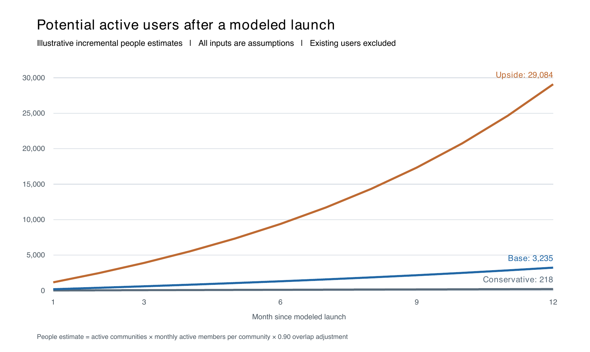

# BrrpBrrp Product and Growth Report

Product specification, quality assessment, market strategy and adoption scenarios

Prepared for Cameron Amer and the BrrpBrrp product team

25 September 2026

Assessed source version 0.4.0 alpha 4 with database schema 6

## Executive assessment

BrrpBrrp has a credible product direction: persistent chat and live voice for a small, invitation-based community that wants to operate its own service. Its strongest asset is the simple deployment model: one Go executable, an embedded browser interface and SQLite storage. The useful product already extends well beyond a prototype, with search, attachments, focused replies, roles, MFA, recovery tools and a PWA. Its strongest near-term opportunity is to make that small-community experience dependable and easy to operate.

The current source remains an alpha candidate. It has not earned a production-ready designation through recorded release gates, real Windows and Docker lifecycle qualification, physical-device voice/push evidence, independent security review and off-host recovery. Several serious defects in older reviews have since been fixed. Fresh focused tests in this assessment pass those fixes. Newly reproduced outbox failures can still discard unsent user text, however, and require attention before reliability is advertised as a differentiator.

The recommended strategy is to validate a narrow audience of technically comfortable organizers and their existing groups, close data-preservation gaps, qualify both deployment paths and run a small external pilot. DMs, consent-based groups, named threads and notification controls should follow the privacy and lifecycle foundation. Screen sharing should follow a media feasibility exercise. Camera video, federation and a broad extension ecosystem would substantially widen the product before its strongest promise has been proven.

Actual historical downloads, live installations, unique members, retention, revenue and demographic composition are unknown. Local release ZIPs demonstrate package history, not adoption. The growth model therefore estimates incremental adoption after a hypothetical launch. Under its conservative, base and upside assumptions, month-12 active people are approximately 218, 3,235 and 29,084. These are conditional planning outputs, not a forecast, probability range, measured traction or market-size estimate. A stalled launch could remain close to zero incremental adoption.

### Decisions recommended now

- Keep the next release positioned as an alpha until its actual acceptance requirements pass. Publish a clear matrix separating available, experimental and planned capabilities.
- Prioritize unsent-text preservation, truthful upgrade documentation, exact source/artifact identity and independent review before feature expansion.
- Recruit three pilot communities with different operating environments. Measure installation, first successful conversation, actual voice quality, restoration and four-week retention.
- Adopt an operator-and-community acquisition model. Track member usage separately from package downloads.
- Decide whether the full planned v1 must include DMs and screen sharing, or whether a narrower reliable small-community release should ship first under an explicit revised scope. This report recommends the narrower validation milestone; it does not change an existing release commitment.

### Decision snapshot

| Dimension | Assessment | Practical implication |
|---|---|---|
| Product utility | Substantial alpha functionality | Suitable for controlled testing with informed operators |
| Technical foundation | Simple architecture with meaningful regression coverage | Preserve the stack and complete contract-level review |
| Current quality | Previous major fixes pass focused tests; new outbox defects remain | Fix recovery behavior before wider reliability claims |
| Production readiness | Required evidence still incomplete | Do not equate local test success with release acceptance |
| Market fit | Plausible niche; no measured preference or retention evidence | Validate with existing groups rather than broad acquisition |
| Distribution | Local artifacts exist; attributable public adoption unverified | Establish canonical releases and measure the funnel |
| Growth outlook | Highly sensitive to acquisition, activation and retention | Use scenarios for planning and replace assumptions with cohorts |

## Assessment basis and evidence

This report assesses the working source in the BrrpBrrp workspace on 25 September 2026. The source declares application version 0.4.0-alpha.4; the migration registry declares schema 6. Earlier release files and numbered completion reviews are historical evidence. They do not override later source changes. In particular, review 7 predates the current authorization/session ordering fixes, backup-retention changes and shared conversation implementation.

Evidence is classified as follows: **verified** means directly inspected or rerun for this report; **recorded** means a previous result documented in the project; **implemented** means present in inspected code without implying all deployment acceptance has passed; **proposed** means a requirement or recommendation; **assumed** means an input to a scenario. A passing narrow test demonstrates its tested contract, not a universal absence of bugs.

The assessment combined source inspection, existing ADRs and product plans, package inventory, fresh frontend checks, focused Go regressions, isolated diagnostic probes and public primary-source market research. No application functionality was changed as part of creating this report. The report is a product and engineering assessment, not an independent penetration test or a complete device/network certification.

### Fresh and inherited verification

| Evidence | Status for this report | Boundary |
|---|---|---|
| Frontend unit and state tests | 84 passed, zero failed | Fresh run against current source |
| Svelte and TypeScript checks | Zero errors and warnings | Fresh static check |
| Earlier authorization and backup findings | Focused current regressions pass | Detailed disposition in the bug report |
| New outbox edge cases | Reproduced with isolated source probes | Added findings do not imply maintained regressions already exist |
| Full Go race and browser baseline | Historical results available | Not rerun in full for this report; do not transplant old counts to current source |
| Windows service and Linux Docker acceptance | Outstanding in the current runbook | Cross-builds and source checks do not establish runtime acceptance |
| Public analytics and unique users | No verified dataset | No historical user/download chart can be represented as measured |

The source snapshot inventory covers 234 selected source, test and identity files. Its canonical manifest digest is 9dfc89db2a9fc2a9b1b0e59318b212f235d207d9600ede24ead7197d98245144. There is no Git checkout in this workspace, so this is a local evidence anchor rather than a public commit identifier. The report's reproducibility material records the inventory and model assumptions separately.

## Product definition and strategic position

BrrpBrrp is a self-hosted, invitation-based communications application for roughly 10–20 people. One installation is one community. Members use a browser or installable PWA. Operators can run a native Go binary or use Docker; a separate application database service and vendor account are unnecessary. The intended use combines persistent channel conversations with small-group Opus voice.

The proposed product promise is simple: a small community can keep its chat and voice on a server it controls, understand who can access information, and recover its data when something goes wrong. Every part of that promise should be demonstrated in onboarding and acceptance testing. The interface's simplicity will not compensate for a failed first call or an unclear restore procedure.

The product competes on operator control, bounded complexity and a focused community experience. Its current distinction is not feature parity with large social platforms. An operator choosing it accepts responsibility for HTTPS, networking, storage, updates and backups in exchange for control. Reducing that responsibility through good defaults and clear diagnostics is therefore part of the core product, not merely documentation work.

### Product boundaries

The current app is not end-to-end encrypted: the server operator controls the database, attachments and media relay. Community channel managers can read all community channels, including restricted ones. Restricted channels are implemented behind a default-off exposure flag. DMs, private groups, screen sharing, camera video and federation are not current member-facing capabilities. Offline PWA opening restores the application shell and a reconnect experience, not an offline archive of private conversations.

These boundaries should appear in the product's capability matrix, invitation and administration explanations where relevant. They are especially important when using the word private: a restricted channel limits ordinary member access, while operator-level access remains possible.

### Product objectives for the next validation cycle

1. An independent organizer can install and run a first conversation without undocumented help.
2. A participant can send, retry and recover their work without silent loss or duplicate delivery under the supported contract.
3. Members understand access, notification and microphone state on desktop and phone.
4. The operator can recover a verified independent backup on a clean destination.
5. At least three real groups produce enough usage and feedback to prioritize features from evidence.

These are proposed outcomes. Adoption and readiness should be judged by their evidence rather than by the number of implemented features.

## Intended users jobs and adoption roles

These are **target-persona hypotheses**, not measured demographics. Age, income, country, gender, installed base and purchase intent require research or actual analytics.

| Persona | Job to be done | Important success condition | Likely friction |
|---|---|---|---|
| Community operator / technically comfortable organizer | Give a known group a stable home while keeping data and administrative control | Install, invite five people, make a call, verify a backup and recover without undocumented repair | HTTPS, certificate trust, NAT/UDP, service privileges, updates and storage responsibility |
| Small gaming / hobby group | Coordinate conversations, share files and talk during a shared activity | Fast onboarding and reliable voice on different networks | Missing screen share, DMs, rich formatting and notification controls |
| Homelab / open-source enthusiast | Run a transparent, inspectable communications service | Simple deployment, predictable dependencies, source/artifact identity and dependable upgrades | Public source/release maturity and ongoing maintenance confidence |
| Small club / volunteer group | Preserve decisions and organize recurring discussion | Searchable history, understandable channel permissions, phone usability | Members who do not want to troubleshoot certificates or install PWAs |
| Moderator / delegated manager | Manage invitations and behavior without taking over the server | Least-privilege management UI, audit trail and clear access inspector | Advanced reporting, timeouts and slow mode are still planned |
| Ordinary member, often on a phone | Join, find the right discussion, be notified and participate with little setup | Invite acceptance, readable chat, preserved work, accessible actions and useful failure recovery | Voice permission, notification support and background behavior depend on browser/OS |

The acquisition unit is usually the **operator/community**, while habitual usage is generated by **members**. Downloads should therefore not be treated as users. A single operator may download several builds and run one community; one server download may serve many browser users.

## Current feature inventory

| Capability | Current implementation | Boundary / evidence reference |
|---|---|---|
| Community installation | Loopback browser wizard, TLS guidance, port checks, settings persistence, native service registration, administrator creation | Native Windows/Linux/macOS paths and Docker packaging exist; real Windows/Docker production lifecycle remains an acceptance obligation. `README.md`; `docs/architecture.md`; `internal/installer/` |
| Community chat | Persistent messages, edit/delete, replies, reactions, pins, mentions, uploads, FTS search and presence/typing | One community, no direct/group UI. `internal/api/router.go:230`; `internal/api/messages.go`; `internal/db/messages.go` |
| Focused reply discussion | Parent and direct replies, live counts, 50-item pagination, maximum 250 replies in current view, separate channel/thread drafts | Replies stay in channel history/search; no named thread, subscriptions, lifecycle or complete thread browsing beyond window. `docs/architecture.md`, focused discussions; `web/src/lib/replies.svelte.ts` |
| Navigation and display | Channel/category sidebar, member panel, Ctrl/Cmd+K channel picker, Ctrl/Cmd+Shift+K search, light/dark/system themes, phone drawer, loading/error/disconnected states | Physical device and comprehensive accessibility acceptance remain open. `docs/design.md`; `web/src/lib/components/ChannelSwitcher.svelte` |
| Resilient send/read state | Idempotent sends, schema-6 operation receipts, shared channel conversation identity, opt-in account-scoped outbox and server-confirmed read-cursor tracking; BR-01–05 qualify the receipt, outbox bounds and recovery claims | Shared primitives are implemented; they do not imply a DM product. `internal/db/migration6.sql`; `web/src/lib/outbox.ts`; `web/src/lib/workspace.svelte.ts:89` |
| Identity and account security | Local passwords, invitations, MFA/recovery, sessions, owner designation/transfer, account moderation and audit | Privileged policy defaults require final owner ratification; recovery needs real-host exercise. `internal/api/router.go`; `internal/db/models.go:116` |
| Delegated management | Central capabilities, additive roles, hierarchy-limited grants, role assignment, categories and invite-time role promises | Owner-only operator powers are nondelegable; effective management views reflect caller's grants. `internal/authz/`; `internal/api/roles.go`; `web/src/lib/components/admin/` |
| Restricted / announcement channels | Access grants, access inspector, scoped delivery and revocation implementation | **Disabled by default** by `BRRP_ENABLE_RESTRICTED_CHANNELS`; independent privacy and media/host acceptance remain. `internal/app/config.go:76`; `internal/api/channel_access.go:62`; ADR 0003 |
| Community voice | Opus SFU, microphone/device controls, mute/deafen/PTT, room changes, reconnect handling, speaking indication and join chime; optional TURN | Ten participants serverwide; no camera, screen share, private call product, recording or voice history. Real browser/device/network evidence still required. `internal/rtc/sfu.go:17`; `web/src/lib/voice.svelte.ts` |
| Notifications | Browser notifications and Web Push; privacy-aware delivery paths | Full unified inbox, per-conversation hierarchy and robust cross-tab deduplication are future work; physical mobile push is not certified by desktop tests. `docs/roadmap.md`; `docs/v1-implementation-plan.md:502` |
| Media previews | Authenticated bounded thumbnails, external link previews with optional click-to-load privacy and data-saver controls, data-saver handling | Link previews default enabled; privacy/data-saver modes default off. Originals remain subject to authorization; thumbnail generation is bounded. `docs/architecture.md`, resource bounds |
| PWA / updates | Installable shell, static-asset caching, offline reconnection screen, explicit activation with draft handoff | Private messages/API/upload bytes are not cached for offline reading; active voice/sends/uploads block refresh. `docs/architecture.md` |
| Backup / restore / operations | Online snapshot, scheduled local archive/copy, manifest/digests, standalone verification, empty-destination restore, health/production checks, rollback rehearsal | Archives are not encrypted by the application; operator custody and independent encrypted off-host recovery must be qualified. `internal/backup/`; `README.md`; current progress ledger |
| Public project | MIT license, CLA, notices generator, contribution and security documents, CI definitions, package builder | Public repository/security intake, signing/provenance and hosted consumer acceptance are not established by these files. `docs/roadmap.md`; `SECURITY.md` |

## Explicit present limits and trust boundaries

- **100 accounts**, **100 community channels**, **100 WebSockets total**, **five sockets per account**, **ten simultaneous voice participants across the server**. These are enforced caps, not measured production-capacity promises (`internal/db/accounts.go:33`; `internal/api/channels.go:88`; `internal/ws/hub.go:137`; `internal/rtc/sfu.go:17`).
- Messages: **4,000 Unicode characters**, **five attachments**, **12 MiB per file**, **100 pins/channel**; 50-item fetch pages and 250-message display windows. The README uses the rounded phrase “12 MB”; the enforced cap is 12 MiB (`internal/api/messages.go:183`; `internal/app/config.go:17`; README).
- Outbox currently declares **50 entries**, **24 hours**, **64 KiB text limit**; the bug register documents failures in its actual write-time bounds and text recovery. The plan's proposed 100 combined draft/outbox entries is a future target, not this source's constant (`web/src/lib/outbox.ts:21`).
- The operator can inspect the database and media relay. This is **not end-to-end encryption**. Community managers can read all community channels, including restricted channels; the access inspector explicitly discloses that (`internal/api/channel_access.go:48`).
- Browser voice requires secure-context and microphone permission. Voice media needs a working UDP route or relay; HTTP reverse proxying alone is insufficient.
- Messages are retained indefinitely unless configured retention or explicit deletion applies. Restore invalidates sessions/push associations. Certificates and host configuration need separate backup.
- Scheduled backups start disabled. When enabled, their default interval is 24 hours with seven retained backups. Other defaults include SQLite FULL durability and privileged MFA; existing installation settings and actual operator configuration may differ (`internal/app/config.go:79`; `internal/db/models.go:123`).
- Optional external dependencies exist: push providers, fetched preview sites, STUN/TURN. In inspected server construction, Google STUN is hard-coded (`internal/api/router.go:173`); fully operator-configurable STUN is a roadmap requirement and should not be presented as already complete.

## System architecture and product implications

A browser/PWA sends same-origin HTTP requests and authenticates WebSocket sessions using the same cookie. The Go process owns authentication, capabilities, SQLite, recipient-scoped realtime events, filesystem uploads, background jobs, embedded assets and audio SFU. SQLite uses WAL, foreign keys and one connection, trading very simple deployment and serialized state changes for a natural scaling boundary. Full-text search is local FTS5. Upload bytes publish durably before database references are committed. Schema-6 receipts preserve the result of a logical send after message deletion while its receipt is retained; late replay after pruning remains BR-01.

The frontend bounds message windows, caches a small number of visited channels, coalesces event fetches and clears scoped state on session/authorization changes. The PWA caches startup assets rather than conversation content. Background queues and workers are bounded. Backup snapshots are verified by manifest inventory and file digests, and copies are reconciled separately from snapshot scheduling. The audio SFU uses fixed sender/receiver slots, which is economical at the current cap but requires publication/subscription redesign for screen sharing.

Architectural recommendation: preserve Go + embedded Svelte + SQLite and the single-process baseline until measured constraints justify change. Refactor around authorization, conversation resolution, send operations, events, notification decisions and media publications. Additional database or distributed services would require a measured operational need. Treat media reliability, recovery and trust boundaries as product features with visible diagnostics and acceptance tests.

## Proposed functional requirements and acceptance contracts

These are the essential product contracts for future work; many portions already exist but have not passed all release gates.

1. **Installation and recovery:** a new operator installs, establishes trusted HTTPS, creates the owner, invites a member and completes a backup/restore/update rehearsal from published instructions. A failed migration never starts as though successful. Restore uses a clean destination and preserves declared identities/history/files.
2. **Identity:** users manage their sessions and second factor; privileged actions require current authority, recent authentication and policy-required MFA. Role assignment cannot exceed the grantor's powers. Ownership cannot disappear accidentally.
3. **Conversation authorization:** resolve authority before any history/search/count/file/event/push/media disclosure. Revocation ends future admission, cancels affected streams/media and clears frontend views. Private titles and counts are sensitive too.
4. **Messaging:** one logical send produces at most one stored result; changed intent under the same key conflicts; expired/deleted results cannot silently recreate old content. Upload failures and interrupted responses preserve recoverable author text in its originating scope.
5. **Read state:** a background or stale view does not mark unseen messages read; cursors never regress; one conversation's activity does not clear another's unread state.
6. **Voice:** users understand capture state, chosen device, route and failure. Joining, switching, reconnecting, permission revocation and leaving produce no stuck microphone, duplicate peer or cross-room media.
7. **Moderation:** capabilities and hierarchy apply to all action paths; selected report evidence does not grant a moderator unrestricted access to unrelated DMs; significant authority/security actions are audited transactionally.
8. **Interface:** critical actions work with keyboard/touch and selected assistive technology; dialogs restore focus; narrow layouts and the physical virtual keyboard preserve access to composer and controls; loading/error states match actual outcomes.
9. **Updates:** version compatibility, stale clients, active capture and pending work are handled explicitly; no forced refresh drops work.
10. **Operations:** checks report integrity and freshness of real recoverable generations, not merely a recent file timestamp; external alerts reach the operator; diagnostics avoid private contents and credentials.

Sources: master plan §§3, 5, 11 and its T-AUTH/T-CHAT/T-DATA/T-MEDIA/T-RESTORE/T-A11Y catalogs.

## Proposed performance and reliability requirements

The master plan proposes a measured v1 profile of 250 registered accounts, 50 active people, 100 sockets, 100 channels, 20 media participants serverwide/ten per room, one screen publisher per room/two per server, one million retained messages and 20 GiB of attachments. Present caps remain until measured qualification succeeds (`docs/v1-implementation-plan.md:764`).

Reference testing uses four dedicated CPU cores, 8 GiB RAM, local SSD with at least 80 GiB free and a measured 100 Mbit/s symmetric link. This is a proposed **test environment**, not a minimum-system specification. Targets include LAN message delivery p95 ≤500 ms/p99 ≤1 s, target search p95 ≤1 s/p99 ≤2 s, foreground chat reconnect p95 ≤10 s, media join p95 ≤8 s direct/≤12 s relay after permission prompts, zero unauthorized delivery/duplicate logical sends/lost acknowledged messages under the declared durability contract, RPO ≤24 h and RTO ≤60 min. Every target needs an exact candidate, dataset, host/network identity and sample count. None is an achieved production measurement in this assessment.

## Core user journeys and acceptance

### The organizer establishes a community

The organizer obtains a traceable package, selects the intended access mode and data location, completes setup, establishes a trusted HTTPS origin and creates the initial administrator. They invite a second member, exchange messages, make a two-person call and create a verified independent backup. Completion means a working service and a demonstrated recovery path, not merely reaching the setup completion page. Troubleshooting must explain certificate trust, browser origin and voice routing in terms an operator can act on.

### A member joins and returns

The member follows an invitation, creates local credentials, understands the server operator's role, finds the relevant text channel and sends a message. On return they recover their reading position, identify unread discussion and receive only notifications they permitted. Expired invitations, denied permissions and disconnected networks need clear recovery actions. Members should not need to know the server's database or media architecture.

### A conversation survives interruptions

A person writes text, attaches a file and sends. The connection drops after the server may have committed the message. Reconciliation resolves the original operation without duplicate creation. If the destination becomes unavailable or the send expires, authored text remains retrievable independently of a writable channel, with an explicit new-send action. This journey is only partially satisfied today: BR-01–05 identify remaining contract failures.

### A moderator changes access

A delegated manager performs only actions within their capabilities and hierarchy. The access inspector explains who can read the channel, including community managers. When permission is removed, future HTTP, socket, file, notification and media admission must stop consistently and affected views must clear. Previously received bytes cannot be recalled. Controls must prove that unaffected members continue to work during revocation.

### Participants join and leave voice

The interface requests microphone permission, shows capture and device state, establishes audible two-way media and explains a failed route. Switching rooms, brief signaling loss, moderation, deafen and leave must not leave a stuck microphone or leak room audio. Real-device and relay tests are necessary; a connected signaling socket alone is not voice success.

### The operator updates and restores

The operator records the current build, creates a verified backup, installs the exact next artifact and checks accounts, a stored message, search and attachment bytes. If upgrade fails after a schema change, recovery uses the matching previous executable and pre-upgrade archive in a fresh destination. Host configuration, TLS keys and certificates are separately protected. A successful local backup download is only one step in this journey.

## Bug report and remediation priorities

Seven current findings are detailed below. The first three affect the promised semantics of message delivery or recovery and are recommended before wider beta. BR-04 is a corruption-handling robustness defect; BR-05 is a helper-boundary defect with limited ordinary-UI exposure; BR-06 is documented configurable operational friction; BR-07 is a current documentation and release-risk defect. None establishes a P0 emergency or a new unauthorized-account-access exploit.

Priority definitions are P1 for high-priority data-integrity/recovery contract failures, P2 for bounded robustness or operational issues, and P3 for lower-exposure defensive work. They are this report's triage recommendation, not externally assigned security severity scores.

| Finding | Priority | Evidence | Main impact |
|---|---|---|---|
| BR-01 Expired key accepted after receipt pruning | P1 | Current API reproduction | Previously deleted text can be recreated by a very late original replay |
| BR-02 Refused send recovery truncates or loses text | P1 | Current source probe | Author text lost while UI reports recovery |
| BR-03 Retry expiry removes recoverable text | P1 | Current source probe | Returning after a day can lose persisted unsent text |
| BR-04 Malformed entry suppresses valid siblings | P2 | Current source probe | Corrupt entry prevents recovery of valid work |
| BR-05 Write-time outbox size limit missing | P3 | Helper reproduction | Stored size can exceed declared bounds |
| BR-06 Shared-address login budget | P2 | Current documented behavior | Legitimate group sign-ins can hit throttling |
| BR-07 Schema and progress documentation conflicts | P2 | Source/document comparison | Wrong upgrade expectations and stale defect status |

### BR 01 Pruned send receipt lets an original expired operation recreate deleted content

**Priority/status:** P1, **reproduced current behavior; contract/design inconsistency**. It is the explicitly implemented pruning policy as well as a conflict with the stronger master-plan invariant; it should not be mislabeled a regression against every current ADR sentence.

**Trigger/repro:** Send text with key K, delete the message, age that receipt to 31 days (the probe changed timestamps to simulate age), invoke the real 30-day pruning function, replay the exact original payload with K. HTTP **201**, one message stored, original deleted text recreated.

**Expected:** An expired original operation cannot silently become new work; recovering text requires explicit new intent with a new key. Master plan `docs/v1-implementation-plan.md:263` states this. Existing working clients stop normal restored retries at 24 hours, so the reproduced case is an unusually late/stale/replayed client request, not normal immediate retry behavior.

**Cause/evidence:** `internal/db/receipts.go:57–63` deletes old receipts; absence is admissible new work (`:29–31`); `internal/api/messages.go:219–257` accepts a missing receipt and generates a new server-side receipt/deadline. `messageInput` at `messages.go:88–92` contains no original creation/admission timestamp or server-issued expiry token. `docs/adr/0010-conversation-model-receipts-outbox-and-cursors.md:53,73–81` both permits reuse after pruning and claims a late original retry cannot become a new send. The maintained test at `internal/api/message_receipts_test.go:215–227` positively asserts reuse after pruning; it therefore does not prove the stronger invariant.

**Impact:** Deleted/purged content can reappear under an old operation identity after the tombstone horizon; normal message side effects can occur again. This weakens the advertised deletion-safe send contract. No unauthorized account access or mass exploitation is established.

**Fix direction:** Specify and enforce operation admission independently of receipt retention (for example an authenticated operation epoch/deadline token or a durable minimal identity rejection policy); never infer new intent solely from receipt absence. Align ADR, implementation and test expectation. Preserve explicit new sends using a new key.

**Acceptance:** Lost acknowledgement → deletion → retry inside 24h; expired unpruned retry; pruned same-payload retry; changed content/destination after pruning; clock skew and restart; new-key control. Every original expired retry must be non-recreating, including no attachment claim or new notification.

**Fresh evidence:** retained supporting probe `report_audit_test.go`, `TestReportOriginalRetryAfterReceiptPruning`, intentional required-contract failure; API package 0.709s. The application logic in the copy is unchanged.

### BR 02 Refused outbox sends can lose authored text while claiming recovery

**Priority/status:** P1, **reproduced**.

**Trigger/repro A:** Enable persisted drafts, have a full 4,000-character draft in the currently active text channel, then release a refused outbox entry containing additional authored text. The persisted outbox is removed; recovered text is absent; the toast says it is in the composer.

**Trigger/repro B:** Lose every available text channel before a persisted outbox entry is rejected/restored. There is no destination into which to recover it. The entry is removed, no recovered draft exists, but the recovery toast is still displayed.

**Cause/evidence:** `web/src/lib/workspace.svelte.ts:748–768` removes the entry and persists that deletion first, only recovers when an active text destination exists, and concatenates then `.slice(0,4000)` at `:763–765`. `:783–787` calls this for an inaccessible restored destination. ADR 0010 `:136–145` promises recovery of authored text rather than silent discard.

**Impact:** Irrecoverable loss of unsent user-authored text; multiple recovered messages can similarly overflow the composer. The misleading success wording hides the loss.

**Fix direction:** Keep recoverable text in an account-scoped recovery queue independent of a writable channel; retain the source entry until recovery is durably saved; show explicit copy/review/discard actions and split/review overlong content rather than truncating it.

**Acceptance:** Empty/no text channel, a 4,000-character existing composer, multiple refused messages totaling over 4,000 characters, storage-quota failure, account switch, reload and recovery acknowledgment. All original authored text must be retrievable and no revoked server attachment/content restored.

### BR 03 The 24 hour retry deadline silently deletes recoverable text

**Priority/status:** P1 under the current recovery promise, **reproduced**.

**Trigger/repro:** Persist a valid unsent entry; return/reload after 25 hours; call the current restore path. Result: stored outbox `null`, no recovered composer text, no toast.

**Cause/evidence:** `web/src/lib/outbox.ts:64–69` filters old entries entirely; `web/src/lib/workspace.svelte.ts:774–793` restores only survivors then persists an empty scope, which removes the stored entry (`outbox.ts:100–102`). `writeOutbox` also drops old entries at `:95–97`. ADR 0010 `:78–80,136–145` distinguishes cancelling automatic retry from recovering user-authored text, but the implementation conflates expiry and deletion. The existing unit test at `web/tests/outbox.test.mjs:66–72` actually requires abandonment and thus misses the recovery obligation.

**Impact:** Anyone returning after a day offline can lose unsent text despite opting into persistence.

**Fix direction:** Expire the operation's retry eligibility separately from the authored text. Expose expired entries for copy/explicit new send; do not auto-resend them and do not silently delete them.

**Acceptance:** Boundary just before/at/after 24h, multi-day reload, a revoked destination, missing attachment, account switching, and user-confirmed final discard. Preserve text without reusing expired operation keys.

### BR 04 One malformed outbox entry suppresses valid siblings

**Priority/status:** P2, **reproduced current robustness defect**.

**Trigger/repro:** Persist an array with one valid entry and a malformed empty-content entry whose `attachments` field is missing/null. Reading the outbox returns `[]`, losing all otherwise-valid entries from the restore result.

**Cause/evidence:** `web/src/lib/outbox.ts:44` dereferences `.length` before `Array.isArray` at `:45`. That throws during `.filter(isEntry)` and the outer catch at `:79–80` discards the whole scope. `restoreOutbox` subsequently persists the empty scope. Ordinary entries generated by the current client have an attachments array; corruption, an old/incompatible record, or storage manipulation is needed to trigger this case.

**Impact:** One corrupt entry hides or removes unrelated valid unsent text in that account's outbox.

**Fix direction:** Validate array shape before any dereference; isolate invalid entries and salvage valid siblings. Retain diagnostic/recovery information without exposing another account's text.

**Acceptance:** Mix valid entries with missing/null/string/object attachments and empty content, plus malformed reply IDs/timestamps; only malformed entries rejected; valid siblings remain recoverable; no throw.

### BR 05 Outbox text limit is not enforced when writing browser storage

**Priority/status:** P3 for current UI exposure, **reproduced helper contract breach**. Normal message sends have a 4,000-character bound, reducing current UI exposure.

**Trigger/repro:** Call current `writeOutbox` with 80 KiB text. Raw stored content is **81,920 characters**; only the later read truncates it to **65,536**. The declared 64-KiB limit is also implemented as UTF-16 string slicing rather than a UTF-8 byte limit.

**Cause/evidence:** `web/src/lib/outbox.ts:21–23,71–76,93–104`. The writer bounds entry count and age but serializes unbounded text. `web/tests/outbox.test.mjs:63–64` checks the post-read shape rather than serialized size, allowing the write claim to pass.

**Impact:** Larger/corrupt/imported state can consume more browser storage than promised; quota failure is swallowed and persistence can silently fail. This probe does not establish that ordinary composer input currently generates oversized records.

**Fix direction:** Enforce shape/count/text-byte bounds before serialization on both read and write, define whether the limit is bytes or code points, and make persistence failure visible where recovery depends on it.

**Acceptance:** Inspect actual storage after an 80-KiB and multibyte input; test quota failure; ensure no silent truncation of authored text presented as safely saved.

### BR 06 Shared address login budget can block a legitimate small community

**Priority/status:** P2 product/operational issue, **documented current behavior; configurable mitigation implemented**, not a newly reproduced security flaw.

**Trigger:** More than 20 total login attempts in five minutes share one apparent client address (office NAT, VPN, or proxy misconfiguration), including successful logins and factor verification attempts. Later people receive 429.

**Evidence:** `docs/completion-remediation-2026-09-24.md:689–711`; default remains 20, configurable with `BRRP_LOGIN_ATTEMPTS`; proposed owner decision D-17 remains open. The ledger records this happening to browser journeys before the harness was configured.

**Impact:** New-community onboarding can look broken for the intended 10–20-member group, especially multiple devices or MFA. Raising only the global ceiling is a workaround and changes the abuse tradeoff.

**Fix direction:** Decide a two-level limit (per-account failure budget plus a larger shared-address abuse ceiling), expected retry behavior and safe defaults; preserve rate-limit protection. Surface precise retry guidance.

**Acceptance:** Twenty members, two devices and MFA behind one NAT; incorrect-password burst against one account; distributed account targeting; proxy client-IP configuration; Retry-After correctness.

### BR 07 Release and planning documents disagree about implemented schema and progress

**Priority/status:** P2 documentation/release-risk issue, **confirmed by source comparison**.

**Evidence:** Current schema registry `internal/db/migrations.go:24–34` includes schema 6; README's upgrade paragraph still says schema 2→5; `docs/v1-progress.md:5` says schema5 even though `:37,90–104` describes schema6. Review7 says no progress/source unchanged; remediation §9 records subsequent work. Master plan `:466` still says client outbox/read cursors owed although current source/ledger implements them. Remediation `:687` similarly still lists outbox as owed before `:724` counts its tests.

**Impact:** Operators can plan upgrades against the wrong schema, reviewers may repeat fixed bugs or assume missing features, and release evidence cannot be interpreted consistently.

**Fix direction:** Establish one authoritative current candidate/evidence summary with source/artifact identifier; update README, headers and stale current-status cells; retain dated historical reviews as history with clear supersession links. Keep schema/app/backup-format version distinctions explicit.

**Acceptance:** All current-candidate pages agree on app 0.4.0-alpha.4/schema6/backup2, and each claimed feature/test links to current evidence. Historical review dates remain intact.

## Historical findings and current disposition

| Original finding | Current disposition and source | Fresh verification |
| --- | --- | --- |
| R6-01 DB connection/authority lock-order cycle | **Locally fixed.** The documented commit, registration and invalidation protocol uses connection before fence; standalone invalidation reads revision before taking fence. `internal/api/authz.go:416–471,563–567`; ADR0009 `:28–67`. | `TestAStandaloneInvalidationNeverWaitsForTheDatabaseUnderTheFence` PASS. |
| R6-02 credential/session commit to socket-admission gap | **Locally fixed for maintained scenarios.** Credential/session mutations use commit+invalidation helper; socket registration re-verifies account/session in transaction before hub add. `authz.go:405–471`; route inventory ADR0009 `:75–94`. | `TestACredentialCommitRefusesAQueuedWriteOnTheRevokedSession` and `TestASocketRegisteredAfterItsSessionEndedIsRefused` PASS, including real sockets and permitted controls. |
| R6-03 combined copy/status failure deletes durable local backup identity | **Locally fixed for maintained matrix.** Verified local generation is persisted before retention; explicit persistence boolean gates pruning; previous/new local and recoverable identities protected. `internal/api/backup_schedule.go:210–242,398–417`. | Combined copy+status, status INSERT failure and final status UPDATE failure tests PASS. |
| R6-04 broad WP09 note contradictions | **Partially resolved/implemented, with residual issues found above.** ADR0010 resolves account/key uniqueness, destination-as-intent and staged migration; schema6, receipts and client outbox/read cursor exist. BR-01–03 leave part of the broader invariant unresolved. | Existing receipt expiry regression PASS, but additional original-retry-after-pruning probe FAILS the stronger contract. |

Other historical remediation includes stale-response/account-switch protection, effective default-role revocation, capability-aware public voice presence, declared backup snapshot time, verified copy reconciliation, persistent retry clocks, role-only/category-only UI and rendered failed-refresh coverage for pins/thread/search/preview. These are implementation/evidence achievements, not a reason to claim release gates passed. See remediation ledger §9, especially `:681–740`.

## Verification gaps and deployment risks

1. **Independent authorization/privacy review:** ADR0009 ordering and broader authorization contracts lack independent acceptance. This audit is focused assistance, not the independent human review gate.
2. **Actual deployment hosts:** no supplied actual Windows/Tailscale service or Linux Docker runtime evidence, reboot/interrupted upgrade/rollback/data-preservation matrix, or tested exact production artifact.
3. **Off-host encrypted recovery:** local verified archives and two rehearsal scripts exist; clean independent host restore, copy-destination/disk-pressure faults, key handling/key-loss and measured end-to-end RPO≤24h/RTO≤60m remain unproven targets.
4. **Voice:** newest documented browser run stalls acquiring the microphone before any RTP assertion (`docs/completion-remediation-2026-09-24.md:726–732`). The same code reportedly passed earlier; isolated repeats failed. Treat as capture-environment/harness blocker until isolated, not evidence that server RTP privacy regressed. No fresh voice run performed in this audit. Physical microphones, forced relay, mobile devices, browser matrix and audible quality remain open.
5. **Remaining rendered privacy cases:** pins, search, thread and preview failed-refresh cases are documented; voice and admin panels remain unqualified (`:685`). No concrete current leak is established merely by missing a test.
6. **Release identity/operations:** canonical Git history, hosted CI, signed artifacts/provenance, external alert receipt, load/soak, beta and release acceptance remain requirements; **no G0–G8 gate has passed**.
7. **Feature gaps:** DMs, consented groups, blocking, account deletion/tombstone policy D-08, named threads, full notifications/moderation, private calls and screen sharing are roadmap work. Their absence is not a malfunction of already-shipped UI.

## Market evidence and demographics

### Measured market context

Large communities already use text and voice together. Discord reported more than 90 million daily active users in March 2026. That is evidence of an established communication habit and a strong incumbent; it does not quantify demand for a self-hosted alternative. Discord's separate April 2025 announcement of more than 200 million monthly active users uses a different metric and date, so these two figures should not be combined into a growth rate. [Discord 2026 gaming update](https://discord.com/press-releases/discord-deepens-its-ability-to-drive-growth-for-games) and [Discord 2025 announcement](https://discord.com/press-releases/discord-appoints-new-ceo-humam-sakhnini).

The Entertainment Software Association's June 2026 report estimated 212.3 million Americans play games weekly and put the average player age at 37. Its February survey included 13,545 respondents and was weighted to the U.S. population; the estimated player population covers ages 5–90, including household information reported by adults. This supports researching adult gaming groups as well as younger communities. It does not establish how many players use voice chat, can run a server or would switch products. [ESA 2026 findings](https://www.theesa.com/two-thirds-of-americans-play-video-games-every-week-according-tonew-report-from-the-entertainment-software-association/).

Pew's May 2024 publication, based on a September–October 2023 survey of U.S. teens ages 13–17, reported Discord use among 28% of teens and 44% of teens who identify as gamers. This is dated U.S. teen context, not BrrpBrrp demographics or current global behavior. It shows familiarity with the category but does not justify making minors the initial audience. [Pew Teens and Video Games Today](https://www.pewresearch.org/internet/2024/05/09/teens-and-video-games-today/).

These sources establish broad category demand. None provides a reliable census of small communities willing to self-host. This report therefore does not assign a dollar total addressable market or treat an arbitrary fraction of Discord's users as obtainable demand. A bottom-up market estimate should begin with reachable organizers, observed installation conversion, retention and willingness to pay, then expand only where data supports it.

### Actual BrrpBrrp demographics

Age, gender, region, occupation, income, language, device mix and accessibility needs have not been measured for actual BrrpBrrp users in the reviewed material. Demographic percentages cannot be inferred from test accounts, the developer's environment or a competing platform. The following segmentation describes who to research, not who is already using the app.

| Research dimension | Initial hypothesis | Validation needed |
|---|---|---|
| Age | Adult organizers and adult friend groups are a practical starting point; sample 18–24, 25–44 and 45+ separately | Compare operator effort, device needs and recurring use across cohorts |
| Technical comfort | At least one willing operator per group matters more than every member being technical | Observe a nonexpert member joining a technically hosted community |
| Geography and language | Begin where the team can provide clear documentation and support; English-language pilots are a practical assumption | Record actual regions, latency, time zones and localization requests |
| Gender | No evidence supports a gender-skewed product target | Recruit across genders and separate organizer preferences from member needs |
| Device access | Operators may use desktops while members frequently use phones | Test physical device/browser combinations instead of inferring from OS package counts |
| Income and spending | Ability and willingness to pay are unknown; existing hardware can lower perceived entry cost | Ask about hosting/support budget and total operating effort |
| Accessibility | Keyboard, screen-reader, visual and motor needs belong in the core experience | Include participants with relevant needs in observed sessions |

### Priority market segments

**Homelab and self-hosting organizers** are the strongest initial operator hypothesis. The single-binary design, local storage and transparent limits fit their interests. The central question is whether their invited friends also use the product, rather than whether the operator enjoys installing it. Success means unassisted installation, a nontechnical member joining, repeat use and a verified restore.

**Existing adult gaming and hobby groups of roughly 5–20 people** fit persistent chat and small calls. Their main barrier is switching from the app where their friends already are. A 20-member group cannot put all members into BrrpBrrp voice simultaneously under the current ten-person serverwide cap. Voice reliability, invitation convenience, mobile behavior and screen-sharing demand should be measured before acquisition expands.

**Maker, tabletop, open-source and volunteer groups** may value searchable history and a place that is not controlled by a large hosted platform. Named threads, an activity inbox and clear moderation could matter more than camera video. Test whether the group has an ongoing conversation need and a durable operator, rather than a short burst of setup enthusiasm.

**Family and close social groups** are exploratory. They bring strong phone, notification, photo and video expectations. Current media limits, absent camera video and certificate/network friction may prevent adoption. They should not drive the initial roadmap until interviews establish that server control compensates for those costs.

**Small professional teams** are a later possibility. They may need availability commitments, integrations, identity management, records policies and responsive support beyond the current scope. Large creator communities and sensitive regulated deployments are poor initial targets given the current caps, alpha status and operator trust boundary.

## Competitive assessment

The comparison below uses current official documentation and product positioning, not a hands-on performance benchmark. BrrpBrrp's opportunities are product hypotheses. No claim of lower latency, easier setup or lower operating cost should be published until comparable installation and usage trials substantiate it.

### Discord

Discord provides familiar hosted communities and supports screen sharing in server voice channels and DMs. Its convenience and established social connections make switching costly. BrrpBrrp's distinction is operator-controlled infrastructure, local accounts and data, and a small self-hosted footprint. It needs dependable onboarding and voice before adding enough features to become a daily alternative. [Discord screen-sharing documentation](https://support.discord.com/hc/en-us/articles/360040816151-Go-Live-and-Screen-Share).

### Mumble

Mumble is an established free, open-source voice application with self-hosted servers, access controls, positional audio and gaming-oriented capabilities. BrrpBrrp can be evaluated as a more integrated persistent-chat and browser/PWA experience. Mumble sets a meaningful reliability expectation for voice; BrrpBrrp should not claim to outperform it without measurements on comparable devices and networks. [Mumble official site](https://www.mumble.info/).

### TeamSpeak

TeamSpeak is another established self-hosted voice alternative. The cited license documentation principally describes TS3 options. BrrpBrrp's MIT-licensed application and integrated chat/search/package model are relevant distinctions, while capacity and mature voice behavior favor evaluating TeamSpeak carefully. Exact prices and TS3/TS6 feature terms should be checked separately for a specific buyer comparison. [TeamSpeak license options](https://support.teamspeak.com/hc/en-us/articles/26033788383261-What-licenses-are-available).

### Element and Matrix

Element offers Matrix-based communication with a different privacy and interoperability model, including end-to-end encryption and federation. Its Community server distribution targets nonprofessional and evaluation deployments of 1–100 users and includes several service components. BrrpBrrp's proposed advantage is a simpler single-community deployment, while its missing E2EE, federation, private conversations and mature native-client ecosystem are material differences. Self-hosting does not make the two trust models equivalent. [Element Community server suite](https://element.io/server-suite/community) and [Element product plans](https://element.io/pricing).

### Rocket Chat

Rocket.Chat serves broader collaboration and organizational workflows. Its current documentation distinguishes the free Starter plan, up to 50 users, from Community with a stated 100-concurrent-user limit and basic messaging. BrrpBrrp can focus on a smaller deployment without a separate database service. It currently lacks much of the private communication, integration and identity-management breadth a professional team may expect. These tier limits can change and are not comparable to BrrpBrrp's 100 registered-account cap without naming the metric. [Rocket.Chat plan documentation](https://docs.rocket.chat/our-plans).

### Stoat

Stoat, formerly Revolt, offers community chat, roles, voice, files, customization and DMs. Its official self-hosting instructions use Docker and several components, and note that most official clients do not support self-hosted instances while web/PWA access works. BrrpBrrp's single native executable is a concrete architectural distinction; Stoat's broader community feature set is a gap. A mobile-client claim should always say whether it works with an independently hosted server. [Stoat](https://stoat.chat/) and [official self-hosting instructions](https://github.com/stoatchat/self-hosted).

### Competitive priorities

The most useful differentiation test is operational: compare time to first administrator, first accepted invitation, first audible two-device call and a completed restore on equivalent networks. Record every troubleshooting intervention. A second test follows ordinary members for four weeks to see which tool they actually return to. Those results can support a positioning claim more credibly than an extensive feature checklist.

BrrpBrrp should first earn the claim that one willing organizer can reliably host a small group's daily communication. DMs, better discussion organization and screen sharing reduce switching friction, but they cannot compensate for lost drafts, confusing trust boundaries or a difficult first call.

## Download history and distribution evidence

No verified time series of BrrpBrrp downloads, installations or users is available for this assessment. This is an unknown value, not zero. SECURITY.md states that the public repository and its intended private vulnerability intake are not live. README.md describes CI packaging but explicitly distinguishes that from public release publication. Exact-name public searches did not identify a distribution listing attributable to this project. Search absence cannot prove that no private or unindexed distribution has occurred.

The local release directory contains 48 native application ZIPs: eight version labels, each with six operating-system and processor combinations. The combinations are Windows, Linux and macOS on amd64 and arm64. There are additional Docker source and diagnostic artifacts elsewhere. The table records local filesystem modification dates in America/Los_Angeles; these are not publication dates and may change when files are copied.

| Local version label | Native ZIPs | Local modification date | What the evidence supports |
|---|---|---|---|
| 0.1.0 | 6 | 4 Sep 2026 | Packages exist locally |
| 0.2.0 | 6 | 4 Sep 2026 | Packages exist locally |
| 0.2.1 | 6 | 4 Sep 2026 | Packages exist locally |
| 0.3.0 | 6 | 4 Sep 2026 | Packages exist locally |
| 0.3.1 | 6 | 5 Sep 2026 | Packages exist locally |
| 0.4.0 alpha 1 | 6 | 7 Sep 2026 | Alpha packages exist locally |
| 0.4.0 alpha 2 | 6 | 22 Sep 2026 | Alpha packages exist locally |
| 0.4.0 alpha 3 | 6 | 23 Sep 2026 | Latest matching native release ZIP set in this directory |
| 0.4.0 alpha 4 | 0 matching ZIPs here | Current source | Not evidence that alpha 4 was publicly distributed |

The source being assessed and the latest matching release ZIP set differ. An alpha-3 ZIP should not be assumed to contain alpha-4/schema-6 fixes. A reliable release record must tie source identity, frontend build, schema, signed or checksummed package and test results to the same artifact.

### What to obtain for a real historical analysis

Use timestamped release-asset counters or distribution/CDN logs for download events; server installation completions for setup; an explicitly consented deployment panel for active communities; and content-free local aggregates for member activity. Retain version, platform, date range, source and metric definition. Keep raw asset requests separate from estimated human first downloads, upgrades, automated checks and retries.

A GitHub release-asset counter, if a public repository is created, is a cumulative asset-request signal. It does not establish unique people or when all prior downloads occurred without repeated historical snapshots. Container pulls are also not unique installations. A browser member may never download a native package. Existing private usage should be established directly with the owner and participating operators rather than inferred from the directory or test fixtures.

The first history table should show one row per week with visitors, asset requests, qualified first-download estimates, installation starts, completed installations, activated communities and retained communities. Leave unavailable cells unknown, annotate definition changes and preserve the distinction between recorded counts and modeled estimates.

## Potential future adoption

### Model purpose and definitions

The model estimates incremental adoption from a hypothetical public launch. It starts with zero modeled incremental communities, not an assertion that BrrpBrrp currently has no users. Once a verified current active-community baseline exists, add its retained cohorts separately. Month 1 begins at the modeled launch, not at the report date. There is no calendar launch commitment.

A qualified first-download intent represents a prospective operator obtaining the software for an initial installation. It excludes repeated upgrade downloads conceptually; future measurements must estimate that distinction. An activated community is an installation that reaches at least three distinct participating members and a successful shared conversation within seven days. Backup verification and a two-person voice test are separate onboarding-quality checks, so a community is not invisible merely because it has not completed those tasks.

For this model, a monthly active community has at least three non-bot accounts sending a message or reaction or participating in voice during a rolling 30-day period. Active account memberships use the same action and period, and count a person again when they are active in multiple communities. Modeled monthly active people apply an assumed overlap adjustment; they are not verified unique humans. Neither measure equals registered accounts, cumulative signups, DAU or concurrent voice users.

### Assumptions

All values below are planning assumptions, not industry benchmarks or measured BrrpBrrp conversion rates. The upside case requires a sustained audience and onboarding performance that have not been demonstrated. Acquisition failure, release delays or poor retention can produce outcomes below the conservative case.

| Input | Conservative | Base | Upside |
|---|---|---|---|
| Qualified download intents in month 1 | 50 | 200 | 600 |
| Monthly download growth in months 2 through 12 | 5% | 10% | 15% |
| Monthly download growth in months 13 through 24 | 2.5% | 5% | 7.5% |
| Downloaders attempting installation | 40% | 50% | 60% |
| Installation attempts reaching community activation | 20% | 24% | 30% |
| Overall download-to-community activation | 8% | 12% | 18% |
| Monthly active-community retention | 90% | 94% | 96% |
| Monthly active members per active community | 6 | 9 | 12 |
| Assumed adjustment for overlapping memberships | 90% | 90% | 90% |

For example, the base case starts with 200 qualified download intents. Half attempt installation; 24% of those become activated communities, yielding 24 new communities in month 1. Subsequent monthly community counts combine surviving prior communities with new activations. The overlap factor means ten memberships are modeled as nine people; it is not measured and should not motivate cross-server identity tracking.

### Calculation method

For months 1–12, monthly downloads equal the month-1 value multiplied by one plus the growth assumption for each elapsed month. Starting in month 13, use the slower second-year growth rate, compounded from month 12. New activated communities equal that month's downloads multiplied by installation-attempt rate and activation rate.

Active communities this month equal last month's active communities multiplied by monthly retention, plus this month's new communities. Active account memberships equal active communities multiplied by assumed monthly active members per community. Estimated people equal active memberships multiplied by 0.90. Cumulative downloads are the sum of monthly qualified download intents, not the sum of active users.

The model uses expected values internally and rounds displayed outputs to whole numbers. It has no reactivation, seasonality, paid acquisition, changes in members per community, competition response or capacity constraint. This makes it transparent but incomplete. Sustained compounding over 24 months is especially uncertain.

### Scenario outputs

| Scenario and horizon | Modeled cumulative first downloads | Modeled active communities | Modeled monthly active people |
|---|---|---|---|
| Conservative month 3 | 158 | 11 | 62 |
| Conservative month 6 | 340 | 22 | 116 |
| Conservative month 12 | 796 | 40 | 218 |
| Conservative month 24 | 2,005 | 71 | 383 |
| Base month 3 | 662 | 75 | 608 |
| Base month 6 | 1,543 | 162 | 1,314 |
| Base month 12 | 4,277 | 399 | 3,235 |
| Base month 24 | 13,814 | 1,053 | 8,528 |
| Upside month 3 | 2,084 | 362 | 3,905 |
| Upside month 6 | 5,252 | 870 | 9,394 |
| Upside month 12 | 17,401 | 2,693 | 29,084 |
| Upside month 24 | 72,687 | 9,959 | 107,558 |

The month-12 base result is about 3,594 active account memberships before the overlap assumption and 3,235 estimated people after it. The upside result spans thousands of independent communities; it is not a claim that one BrrpBrrp server can support 29,000 users. Each installation retains its existing account and voice limits until independently qualified changes are made.

The 24-month upside is a stress scenario for support and release planning, not an expected result. It requires roughly 72,700 qualified download intents, sustained acquisition growth, strong activation and 96% monthly community retention. There is no current evidence establishing those conditions. Growth should be gated by retained communities and operating quality, not by enthusiasm about this upper scenario.

### Sensitivity around the base case

Each row changes one assumption while holding all other base assumptions fixed. Month-12 results show that user count is particularly sensitive to community activation and active members per community. Monthly retention also compounds over time; its full effect is not captured by a single month-12 comparison.

| Changed assumption | Month 12 active communities | Month 12 estimated people |
|---|---|---|
| Activation 6% instead of 12% | 200 | 1,617 |
| Activation 12% | 399 | 3,235 |
| Activation 18% | 599 | 4,852 |
| Monthly retention 88% instead of 94% | 319 | 2,583 |
| Monthly retention 97% instead of 94% | 451 | 3,656 |
| Six active members instead of nine | 399 | 2,157 |
| Twelve active members instead of nine | 399 | 4,313 |

At an illustrative 10% visitor-to-qualified-download conversion, month-1 acquisition would require approximately 500, 2,000 or 6,000 relevant visitors for the three cases. That conversion is an assumption too. This exposes the acquisition work hidden by a standalone user number: the product needs a repeatable source of relevant organizers, not only attractive software.

### Replacing assumptions with evidence

After 30 days, replace acquisition and setup rates with observed funnels. After eight weeks, estimate retained communities from actual cohorts; report numerator, denominator and uncertainty instead of extrapolating a handful of enthusiastic groups. Recompute the model monthly, keeping the original assumptions visible. Do not select only the most engaged installations or compare a changed activation definition with old results without adjustment.

## Measurement and research plan

The recommended north-star measure is weekly active communities with at least three participating members. Pair it with the share of those communities that have a recently verified independent recovery point. Keeping activity and backup quality as separate measures avoids hiding real users when operators fall behind on maintenance.

Use local analytics by default. Any reporting to the project should be explicit, opt-in, content-free and revocable. Message bodies, attachment names, private channel names, raw invitation links, account emails, tokens and full IP histories are unnecessary for the proposed product metrics. An installation-level random identifier may help a consenting panel reconcile reports, but should not become cross-server member tracking.

| Metric | Operational definition | Decision it supports |
|---|---|---|
| Install completion | Setup starts resulting in a healthy service and owner sign-in | Is the operator onboarding usable |
| Community activation | At least three participating members and a conversation within seven days | Does installation lead to shared use |
| Time to first useful conversation | Elapsed time from setup start to activation | Which setup or invitation steps cause friction |
| Four-week community retention | Activated cohort active in week 4 divided by its original activated cohort | Is the product serving an ongoing group need |
| Voice join success | Completed two-way media sessions divided by consented join attempts, excluding cancelled permission prompts separately | Which devices or networks need work |
| Send reconciliation | Lost-acknowledgement sends reconciled without duplicates or lost author text | Is the reliability promise true |
| Recovery readiness | Active installations with independently stored verified archives and a recorded restore drill | Can operators recover from failure |
| Support load | Support cases and operator minutes per active community | Is growth operationally sustainable |

Start with 12–15 organizer interviews across homelab, gaming/hobby and club/volunteer segments. Include people who abandoned a setup, not only successful users. Conduct 8–12 observed member sessions on desktop and phone. These are proposed research samples for qualitative learning, not representative demographic surveys. Record technical comfort, device mix, group size, geography, accessibility needs, existing tools, switching motivation and willingness to operate a server. Ask optional broad age bands only when they answer a defined product question.

Before a large adoption claim, publish the measurement population and its selection bias. An opt-in homelab panel may describe that panel well while saying little about ordinary gaming groups. Self-hosting makes exact global DAU inherently difficult; transparent uncertainty is preferable to invasive telemetry.

## Launch strategy and experiments

### Stage one with invited operators

Recruit three existing communities that already talk regularly, with one accountable operator per community. Cover Windows and Docker, desktop and phone participation, and at least two network conditions. Supply a declared alpha support boundary, clear backup/recovery instructions and an easy way to report friction. Avoid loading confidential or irreplaceable records into an unqualified pilot.

The pilot should answer whether independent people can operate the product, whether invited members return and why they still use another communications app. Record every intervention by the author. A setup that succeeds only because the developer repairs it is useful discovery, but is not an independent onboarding success.

### Stage two with a repeatable acquisition loop

After quality and acceptance thresholds pass, create a canonical public source and release page, a concise setup demonstration and platform-specific installation instructions. Describe current functionality accurately. Use communities that explicitly welcome self-hosted project announcements; do not treat membership in those communities as permission for unsolicited outreach. This report proposes channels and experiments and sends no messages.

Test three acquisition messages separately: simple self-hosted chat and voice; a home for a small existing group; and a recoverable service with explicit operator control. Measure activated and retained communities by campaign, not just visits. Publish actual installation and recovery demonstrations because those address the tradeoff a prospective operator is considering.

| Experiment | Proposed sample or duration | Success criterion to review |
|---|---|---|
| Unassisted operator setup | Three independent operators | All complete chat, voice test and recovery without undocumented repair |
| Invite and mobile participation | 8–12 member sessions | Record completion/failure by device; no unexplained blocked core action |
| Positioning comparison | Three messages with matched audience quality | Prefer the message producing retained communities, not merely clicks |
| Feature demand interviews | 12–15 organizers including abandoners | Rank observed workflow failures and switching reasons |
| Four-week pilot | At least three activated communities | Report retention and frequency with raw cohort counts; no statistical overclaim |
| Recovery drill | Each supported deployment path | Verified separate-destination restore with measured operator effort |

A recommended advance criterion is that all severe data-preservation and unauthorized-disclosure findings are closed, setup is independently repeatable, both hosts pass their required lifecycle checks, and pilot groups demonstrate continuing use. With only three groups, a retention percentage is descriptive, not reliable population evidence. Expand the cohort before budgeting acquisition from it.

## Commercial options and operating economics

The current product has MIT licensing and contribution documents. No verified revenue, pricing or paying-customer dataset was found. Any commercial route should preserve the clarity of the free self-hosted proposition and be validated with actual operators. No competitor-price assumption is needed to decide the next engineering priority.

Donations or sponsorship can support early maintenance with limited billing complexity. Paid support, assisted setup or a managed hosting offer might address the burden that prevents nontechnical organizers from adopting. A managed offer also creates a different obligation: the team becomes responsible for uptime, abuse handling, backup custody, privacy operations and account/billing support. It should have its own product and cost model.

Use contribution margin per paying community: recognized subscription/support revenue minus hosting, bandwidth/relay, storage, backups, payment charges and direct support labor. Then subtract fixed development, security, signing, monitoring and administration costs. Do not calculate lifetime value as price divided by assumed churn until real paid cohorts and gross margin exist.

For scale, an explicitly hypothetical 399 active communities, a 3% paid-support conversion and a $10 monthly support price would produce about $120 monthly gross revenue before costs. None of those are measured commercial facts; the example shows why several thousand members do not automatically fund a maintainer when the economic customer is the community operator. Sponsorship or higher-value managed service could change the model, but require their own evidence.

Track support minutes, relay bandwidth and recovery work during the pilot. Those costs determine whether the architecture's low dependency count also produces a low operating burden. Avoid advertising unlimited uploads, voice or support before measuring their cost and abuse implications.

## Prioritized feature roadmap

Recommended order is **qualify and simplify the small-community core → safe private conversations and daily-use improvements → richer media → measured expansion**. This is a prioritization recommendation, not a changed release commitment.

### Foundation work before wider adoption

**A. Finish foundation acceptance and publish a truthful capability matrix.** User outcome: an operator knows exactly which build and configuration is safe to test. Deliver independent authorization/credential/backup review, remaining rendered failed-refresh voice/admin cases, corrected source-vs-historical documentation and a build-specific evidence ledger. Acceptance: critical/high findings resolved, no stale schema claims in current setup/update docs, gates signed only with their required evidence. Dependencies: reviewer, current identifiable source/artifacts, owner decisions. Value: avoids recruiting users into an unqualified private/recovery promise.

**B. Real Windows and Docker install/update/recovery qualification.** User outcome: installation survives reboot, upgrade and failure. Deliver clean-host installation, service/container identity checks, interrupted update and rollback, disk/permission faults, external alerts and encrypted off-host restore into separate clean destinations. Acceptance: reference dataset verified, measured RPO/RTO, actual alert received and documented rollback succeeds on each supported target. Dependencies: real hosts, recovery storage, keys, operator. Source: WP-23–27.

**C. Voice readiness and guided network diagnosis.** User outcome: nonexpert invitees can join and hear one another. Deliver microphone test, route/device status, intelligible ICE/relay failures, operator-configurable STUN/TURN and a published browser/network matrix. Acceptance: physical desktop/mobile calls, different networks, forced relay, blocked UDP and withdrawal/regrant pass; no continued capture after leave. Dependencies: two real networks, TURN route, devices; media spike can proceed independently. Source: WP-18/19/22.

**D. Pilot operator onboarding.** User outcome: first useful community without author intervention. Deliver a concise launch checklist inside setup: connect/trust, invite, test voice, create verified independent backup, understand updates. Acceptance recommendation: at least three independent operators complete the first-chat/first-call/recovery journey with no undocumented fix; capture time and friction. Dependency: actual onboarding tests and foundation acceptance. This is a product recommendation supplementing existing install docs.

### Daily communication features after foundation acceptance

**E. Canonical request-based DMs.** User outcome: contact one member privately without moving to another app. Scope: one direct pair, request/accept/reject, bounded introduction, shared reply/file/reaction/search/read pipeline and operator-trust disclosure. Acceptance: concurrent requests create one pair; no unaccepted attachment/call; unrelated members/delegated admins cannot read any surface; closing hides locally without deleting shared history. Dependencies: D-08 deletion/tombstone policy, schema tightening, G1, blocking/reporting before external rollout. Source: WP-09/10/12.

**F. Consent-based groups and blocking.** User outcome: a small project/party can coordinate privately and refuse unwanted contact. Scope: ten accepted members initially, invitations, full-history disclosure, owner transfer, remove/leave, blocks and request cooldowns. Acceptance: no unsolicited membership; remove/accept races deterministic; old URLs/files/search/events lose access; block stops new sends/calls/invites without hiding shared-group realities. Dependencies: direct messaging and the lifecycle contract. Source: WP-11.

**G. Named threads and complete discussion history.** User outcome: busy channels remain followable. Scope: title, follow/unfollow, independent unread state, archive/reopen/lock, active/archive lists, explicit promotion of legacy replies and root tombstones. Acceptance: 1,000 replies remain navigable with bounded memory; original IDs/links survive; content is not duplicated; thread read does not clear unrelated channel unread. Dependencies: lifecycle decisions, shared conversations. Source: WP-13.

**H. Activity inbox and notification controls.** User outcome: know what needs attention without excessive interruptions. Scope: mentions/replies/DM inbox, account/conversation/device preferences, mute/quiet time, private previews, grouping and deduplication. Acceptance: active/background/closed PWA matrix, denied permission, multiple tabs, blocks and post-queue revocation tested; inbox works without push. Dependencies: conversation/thread identity and authorization. Source: WP-14.

**I. Moderation/reporting and bounded invite management.** User outcome: operators can handle abuse without becoming all-powerful readers. Scope: timeout, slow mode, selected-evidence report queue, assignment/resolution, explicit retention and bounded invitation controls. Acceptance: no alternate action path bypass, no peer/superior moderation, mandatory audit and evidence handling survive deletion/failure. Dependencies: privacy/lifecycle policy and DMs; basic reporting required before outside private-message pilots. Source: WP-15.

**J. Safe composer and accessible member context.** User outcome: readable technical/hobby discussions and reliable mobile sends. Scope: emphasis/code/quotes/lists/links without raw HTML, stable scoped mentions, touch actions/copy link, upload cancel/retry/progress, basic member profile, image descriptions. Acceptance: malicious input inert, code doesn't create mentions, IME/RTL/emoji and keyboard flows work; failed uploads preserve draft. Dependencies: common conversation pipeline, formatting security review. Source: WP-16/17.

### Richer media and operational capability

**K. Desktop screen sharing and bounded private calls.** User outcome: show a game, document or problem to the group. Scope: explicit desktop capture, mobile viewing, one publisher/room, clear stop controls, bounded viewers and serverwide bandwidth. Acceptance: 100 capture cycles, late viewer, room moves, browser stop, permission removal, direct/relay paths and screen-audio distinctions pass on actual devices. Dependencies: media publication/subscription redesign and feasibility spike; camera video deferred. Source: WP-18–22.

**L. Storage quotas, capacity and actionable diagnostics.** User outcome: predict and control the cost of running a community. Scope: quotas, free-space reserve, separate limits for conversations/reports/uploads, resource metrics, redacted support bundle and tested overload recovery. Acceptance: separate-host 24-hour load/soak on both reference platforms, defined datasets, bounded queues and failure recovery; cap increases only after qualification. Dependencies: metrics, datasets and load generator. Source: WP-25/26.

**M. Verifiable public releases and contributor loop.** User outcome: safely obtain, inspect, build and update the app. Scope: canonical repository, maintainer recovery, hosted CI, artifact identity, signing, security reporting, release notes and clean-consumer install. Acceptance: actual published bytes map to source/checks; a newcomer builds and installs; private security intake works. Dependencies: owner-controlled identities/credentials and review. Source: WP-01/27/31–33.

### Later features requiring demand validation

Keep camera video, federation, native mobile apps, multi-community hosting, bots/plugin marketplace, public discovery, cross-server friends, voice recordings/transcription, E2EE, enterprise SSO/SCIM and clustering outside the near-term critical path. Custom emoji, stickers and extensive profiles may improve identity/engagement but should be prioritized from observed pilot demand, not assumed parity requirements. Each substantial addition needs its own design, privacy, operational and test budget. Source: master plan §3.2.

## Delivery plan and release acceptance

### Immediate engineering tranche

First reconcile the message operation and recovery contracts, then fix BR-01 through BR-05 with permanent regressions. Correct BR-07's current-candidate documentation at the same time and decide the shared-address login policy in BR-06. Preserve the now-passing authorization and backup regressions. The expected delivery is code, maintained tests and an updated source-linked evidence ledger; another completion report alone would not close these issues.

The work should be split into bounded areas with clear ownership: backend owns operation admission and durable receipts; frontend owns recoverable user text, storage validation and truthful UI; technical lead reviews the combined contract; QA tests failed acknowledgements, deletion, expiry, unavailable destinations, multiple tabs, account changes and storage failure. Operations can prepare Windows and Docker test hosts and independent restore destinations in parallel.

### Outcome based roadmap

The windows below are planning checkpoints after work begins, not promised completion dates. Host access, staffing and independent-review availability can change the schedule. Scope advances only when its exit evidence exists.

| Checkpoint | Intended output | Exit evidence |
|---|---|---|
| First 2 weeks | Current integrity bugs fixed; coherent candidate docs; host/reviewer preparation | Permanent regressions pass and the candidate is identifiable |
| By day 30 | Independent foundation review and real deployment/recovery exercises underway; first operator sessions | Dated findings, host results and intervention log; unresolved items explicit |
| By day 60 | Controlled pilot with at least three communities; highest-friction daily-use fixes | Measured activation, real media results, recovery results and cohort denominators |
| By day 90 | Scope decision for next release; repeatable onboarding and prioritized feature evidence | Retention, support load and release-gate decision; expansion only if justified |

The existing full-v1 plan estimates 158–261 focused engineer-days, or 198–327 with a 25% reserve, across 33 work packages. It includes richer private messaging and screen sharing. These are original scope estimates, not a current remaining-work calculation. Existing implementation, integration risk, review and external qualification make simple percentage subtraction misleading. Re-estimate after the immediate fixes, two measured iterations and the media feasibility exercise. Do not convert the estimate into a launch date without staffing and dependencies.

### Alpha validation floor and additional release checks

The 10–20-user and 30-minute-call rows below are the narrow alpha validation floor from the current runbook. They do not replace the full-v1 plan's proposed 50-active-user and 20-media-participant profile, two-hour media qualification or other workload requirements. Any larger supported scope must pass its own complete acceptance profile.

| Area | Required evidence before the corresponding claim |
|---|---|
| Candidate identity | One source identity, exact built frontend, schema and final artifact digest with linked checks |
| Windows service | Clean install, privileges, startup/reboot, stop/restart, interrupted upgrade, rollback and retained data on an actual Windows host |
| Linux Docker | Real image build/runtime, nonroot identity, persistent volumes, recreate/reboot, failed update and rollback |
| Networking | Trusted origin from a second device, WebSocket recovery, direct voice, forced relay and declared unsupported network conditions |
| Physical participation | Desktop and phone microphone/speaker behavior, 30-minute call, push after close and usable foreground/background transitions |
| Recovery | Encrypted independent backup custody, configuration/TLS coverage, fresh destination restore and measured full operator recovery time |
| Capacity | Reference dataset, declared host/network, 10–20-user session and up to ten voice users, measured resource/latency/soak results |
| Accessibility | Automated checks plus keyboard, screen-reader and physical low-end mobile journeys |
| Project operations | Canonical source, maintainer recovery, live private security intake, tested external alerts and release-consumer instructions |
| Promotion | Required gates, unresolved-findings disposition, beta observation, candidate observation and explicit release authorization |

The master plan's gates run from G0 baseline through G8 release. None is recorded as passed in the current progress record. The proposed controlled alpha discovery pilot and four-week research cohort do not substitute for the formal v1 beta: its foundation and feature gates G1–G5, reviews, fourteen-day beta acceptance and seven-day final-candidate observation remain separate obligations. The proposed recovery targets are RPO at most 24 hours and RTO at most 60 minutes; these remain targets until measured on the specified deployment and independent recovery path. Recovery timing should include obtaining keys/archive, operator response, decryption, restoration, verification and security reconciliation, with total outage also reported.

Do not enable restricted-channel exposure solely because this report's focused regressions pass. The project requires broader foundation acceptance. A successful restore into another folder on the development Mac is useful local evidence; it does not establish Windows service recovery or off-host resilience. Similarly, a browser test stalled before microphone acquisition is not evidence that server audio enforcement failed.

## Product risk register and decisions

| Risk | Likelihood or evidence | Impact | Recommended owner and response |
|---|---|---|---|
| Authored text lost during recovery | Reproduced | High trust and data-integrity cost | Frontend and backend fix BR-01–05 before wider beta |
| Incorrect readiness claims | Current docs conflict and gates incomplete | Operators adopt unsupported assumptions | Release lead owns one candidate/evidence summary |
| Voice fails on real member networks | Qualification incomplete | Immediate abandonment | Media and QA test physical devices, direct and relay routes |
| Operator burden prevents activation | Strong hypothesis from required setup steps | Small conversion despite downloads | Product observe independent installation and improve diagnostics |
| Community does not switch or return | Unmeasured | Low retention | Research organizer and members separately; track cohorts |
| Backup exists but disaster recovery fails | Off-host acceptance incomplete | Severe data loss | Operations verify independent custody and actual restores |
| Privacy feature scope expands too early | Foundation and deletion policy unfinished | Unauthorized disclosure or inconsistent lifecycle | Technical lead gate DMs/groups on reviewed contracts |
| Support workload grows faster than maintenance capacity | Unknown until pilot | Slow fixes and poor operator experience | Owner measure cases/minutes per community before promotion |
| Feature breadth delays the useful core | Large original v1 scope | Long alpha and divided effort | Product prioritize a dependable narrow milestone |
| Market estimates mistaken for traction | No actual analytics | Bad planning and credibility loss | Product keep all assumptions and measured cohorts distinct |

### Decisions that unblock the next phase

1. **Release scope:** confirm the next dependable small-community milestone versus the broader v1 plan; keep postponed features explicit.
2. **Recovery and operation contract:** resolve BR-01's receipt horizon and BR-02/03's user-text preservation policy before private messaging builds on them.
3. **Lifecycle policy:** approve account deletion/tombstones and private conversation membership/history behavior before enabling DMs/groups.
4. **Security defaults:** ratify production SQLite durability, privileged MFA, restricted-channel gating, manager visibility and the shared-address login policy already identified in the project decisions.
5. **Support boundary:** name supported deployment/platform combinations, an accountable maintainer and the actual security/support intake.
6. **Measurement:** approve a local-first, opt-in research approach and the definitions of activated and retained communities.
7. **Public identity:** establish canonical source ownership, release signing/provenance and maintainer recovery before broad distribution.

These are recommendations and unresolved project choices. The report does not approve publication, change configuration, enroll pilot users or commit the team to a paid offering.

## Source map and reproducibility

### Local product and engineering sources

All local paths below are relative to the BrrpBrrp project root. Current source takes precedence over historical status prose; dated reviews remain useful for finding prior defects and their later fixes.

| Source | Evidence used |
|---|---|
| README.md | Product positioning, installation, current advertised scope and backup/operator boundaries |
| internal/app/version.go and web/package.json | Application version identity |
| internal/db/migrations.go and migration6.sql | Current schema 6, conversation mapping and receipt schema |
| docs/architecture.md and docs/design.md | Process/data/media architecture, resource limits and interface intentions |
| docs/adr/0009-authority-commit-and-admission-ordering.md | Authorization, transaction and delivery ordering contract |
| docs/adr/0010-conversation-model-receipts-outbox-and-cursors.md | Conversation identity, receipt lifecycle, outbox and cursor contract |
| docs/v1-progress.md and docs/completion-remediation-2026-09-24.md | Implementation and prior verification ledger, with identified stale wording |
| planning/completion-review-6-and-next-steps-2026-09-25.md and review 7 | Historical findings and acceptance criteria subsequently partly superseded |
| docs/v1-implementation-plan.md and docs/roadmap.md | Planned v1 scope, work packages, targets, estimates and release gates |
| docs/production-readiness.md and docs/acceptance.md | Host qualification, recovery, browser/media and release evidence boundaries |
| SECURITY.md and CONTRIBUTING.md | Intended security intake, contributor process and current publication state |
| dist/releases and dist Docker source ZIPs | Local package inventory, not public download history |
| web/src/lib/outbox.ts and workspace.svelte.ts | Reproduced outbox storage and recovery behavior |
| internal/db/receipts.go and internal/api/messages.go | Operation admission and pruning behavior |
| web/tests and internal/api maintained tests | Fresh frontend suite and focused prior-defect regressions |

External sources are linked next to the market and competitor claims they support. Retrieval occurred during 25 September local time and 26 September UTC, 2026. Company user figures are company-reported; survey context is not a customer census. No externally sourced number is used as a BrrpBrrp adoption baseline.

The accompanying growth-model.json contains assumptions and monthly results for all 24 months. release-inventory.json records the observed local package names and local dates. source-manifest.json records selected inspected file digests. Diagnostic probe source is retained in the report's supporting directory to help convert the findings into maintained tests. These materials support reproduction; they do not constitute a release artifact or production approval.

