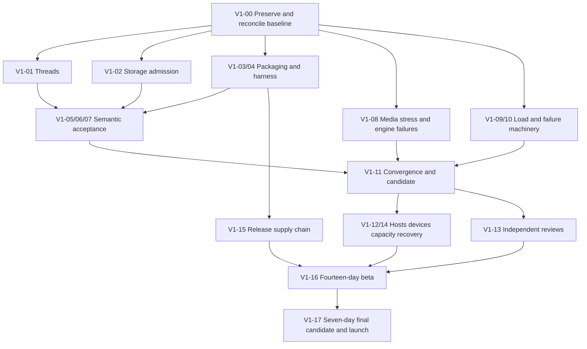

# BrrpBrrp: reviewed execution plan to v1.0.0

**Review started:** 3 October 2026; finalized 4 October 2026, America/Los_Angeles.  
**Audience:** the next implementing agent and the people responsible for qualification and release.  
**Source:** `codex/p9-private-reporting` at `1e5a98f2689f6bcdebf37e8d572dddd20cfddd78`, **including the pre-existing working-tree changes described below**.  
**Product identity:** `0.4.0-alpha.8`; database schema 25; backup format 2.  
**Companion:** [copy-ready handoff prompt](handoff-v1-release-agent-2026-10-03.md).  
**Review evidence:** [evidence directory](v1-review-evidence-2026-10-03/README.md).

This assignment produced a review and execution instructions. It did not implement the fixes, change release defaults, create a remote, publish a release, or approve any G0–G8 gate. The next agent must be assigned implementation work before acting on this plan.

## 1. Release assessment

The repository contains most of the planned product, but it is not ready for v1.0.0. There are current local defects and incomplete verification machinery in addition to the already acknowledged missing host, device, independent-review and pilot evidence. “All Phase B rows have implementations” is not equivalent to feature acceptance, and the acceptance matrix's green result is not proof that its scenarios passed.

The next agent should first repair and verify the current source, then produce a reproducible candidate with trustworthy evidence. Required Windows and Linux Docker qualification, physical media/push/accessibility work, independent review, the fourteen-day beta and the seven-day final observation follow. External prerequisites must be prepared in parallel, but their absence must not become a reason to abandon the remaining local work.

The most important findings from this review are:

| ID | Priority | Current finding | Evidence level | First action |
| --- | --- | --- | --- | --- |
| F-01 | P1 | Concurrent uploads can both pass the storage-quota check and commit beyond the quota. | Deterministic temporary-overlay reproduction: quota 10 bytes, 16 bytes committed, both responses 201. The overlay changes scheduling only after the real checks. | V1-02: enforce the quota in the serialized admission/commit boundary. |
| F-02 | P1 | Opening an older named-thread message link compares a message ID with a thread ID, so the intended context-loading path is bypassed. The `after` query also returns the newest page instead of the nearest newer page. | Source-confirmed at `NamedThreadPanel.svelte:208`, `workspace.svelte.ts:2562`, `threads.svelte.ts:105–115`, `internal/api/threads.go:528–540`; rendered reproduction still required. | V1-01: regress old and mid-history links, then fix both boundaries. |
| F-03 | P1 | The distributable source is missing scripts required by its Makefile. Additional imported/data dependencies are absent too. | Fresh `check-source-package.mjs` failure: six diagnostics for three missing scripts; source-list inspection also finds missing `rehearsal-kit.mjs` and the acceptance matrix. | V1-03: package the transitive dependency set and execute the extracted source. |
| F-04 | P1 | The Windows CI matrix contains Bash programs without a Bash shell declaration. | Source-confirmed shell mismatch in `check.yml`; no hosted Windows execution performed. | V1-04: use declared portable shells/scripts and prove the Windows job. |
| F-05 | P1 for qualification | The capacity driver cannot establish the claimed workload or latency/reconnect evidence. | Source-confirmed: one session for all clients, initial connection counted as reconnect, late delivery correlation, non-success search responses timed as samples, reported channel count not exercised. | V1-09: repair the measuring instrument before running the target soak. |
| F-06 | P2 | Upload body-copy errors, including disk exhaustion, are collapsed into “file too large.” | Source-confirmed at `uploads.go:143–146`; actual full-volume execution not performed. | V1-02: preserve error identity and add controlled write-failure coverage. |
| F-07 | P1 for qualification | The acceptance checker verifies that references exist, not that tests ran or cover the required behavior. A skipped test title satisfies its lookup. Several locally executable obligations remain. | Checker inspection and a disposable skipped-test fixture; current output says 29 scenarios, 132 references, 14 owed items. | V1-05 through V1-10: add semantic coverage and source-bound results. |
| F-08 | P2 | Browser harness configuration silently drops `BRRP_E2E_BROWSER`; restricted-channel exposure is not exercised by a declared enabled browser mode. | Source-confirmed environment filtering and project inventory. | V1-04/V1-06: explicit allowlist, actual-mode assertions, both gate states. |
| F-09 | P2 | Current-status prose, limits, host hash instructions and “next work” lists disagree with code and later decisions. | README, alpha.8 record, master-plan capacity table, host checklist and ledger compared with current constants/tranches. | V1-00: reconcile current status while retaining dated historical evidence. |
| F-10 | P1/P2 | Member-export attachment accounting can exceed its bound; reactions become coupled to attachment truncation; the byte limit is applied after full materialization. Pending-job and publication behavior also need boundedness/failure verification. | Source-confirmed in `export.go`; peak memory, admission-race and crash effects not measured in this review. | V1-02 export subtranche: incremental bounds, coherent snapshots, job admission and failure cleanup. |
| F-11 | P1 for recovery | Backup alerts age local job completion rather than the independently recoverable snapshot; slow alert delivery runs inside file maintenance and failed delivery is suppressed by the normal repeat window. | Source-confirmed in `alerts.go`, `maintenance.go`, compared with production recovery-health logic. | V1-09 operations subtranche: consistent recovery health and bounded asynchronous delivery. |
| F-12 | P2 | A “max GC pause” field reports the latest pause; each metrics scrape recursively walks upload/backup trees; Windows process counters are unavailable. | Source-confirmed; full-dataset scrape cost not measured. | V1-09 operations subtranche: truthful metrics and usable host instrumentation. |

Priorities above are work ordering. They are not a claim that every tooling defect is a production Severity 1 incident. Use the master plan's severity policy for release disposition.

## 2. Baseline, authority and review limits

### 2.1 What the next agent must read

Read in this order, with the stated purpose:

1. This plan and its [handoff prompt](handoff-v1-release-agent-2026-10-03.md): current residual work and execution order.
2. [Execution ledger](v1-execution-ledger-2026-10-01.md), especially “Owner decisions — 2 October 2026” and tranches 6–11: recent implementations and their evidence boundaries.
3. [Master plan](../docs/v1-implementation-plan.md): normative R-01–R-14, J-01–J-10, T-* scenarios, invariants, WP-01–WP-33 and G0–G8. Apply the later recorded owner decisions below to superseded proposals.
4. [Architecture](../docs/architecture.md), relevant [ADRs](../docs/adr/), [security](../docs/security.md), [production runbook](../docs/production-readiness.md), [host procedures](../docs/host-qualification.md).
5. Current source and tests for the work package being executed.
6. Earlier review documents only when tracing a finding or regression. Their “next steps” are not a fresh backlog.

Keep contractual authority separate from evidence. Owner decisions and applicable ADRs define intended behavior; inspected code and reproduced behavior establish what actually happens. A discrepancy is an issue to resolve, not permission to rewrite the contract to fit a passing test. Dated logs prove only their recorded source, configuration and environment.

### 2.2 Exact working-tree boundary

This review includes ten pre-existing modified tracked files:

```text
.github/workflows/check.yml
Makefile
planning/v1-execution-ledger-2026-10-01.md
web/e2e/release.spec.mjs
web/e2e/run.mjs
web/playwright.config.mjs
web/src/app.css
web/src/lib/components/Composer.svelte
web/src/lib/components/MessageItem.svelte
web/src/lib/components/Workspace.svelte
```

It also includes four pre-existing untracked implementation files:

```text
planning/acceptance-matrix.json
scripts/check-acceptance-matrix.mjs
web/e2e/thread-scale.spec.mjs
web/tests/acceptance-matrix.test.mjs
```

The tracked binary-diff SHA-256 at review entry was `8da538701db4b36f5425a50f467e213200b3b42d57a367ee576d6d448f407f94`. The evidence manifest records the four file hashes. New plan, prompt and review-evidence files are separate review outputs.

There is no Git remote. `main` is 212 commits behind the reviewed branch. Do not start from `main`, automatically fast-forward it, create a remote, reset this checkout, or discard the pending changes. Re-check status before doing anything; if a later agent has advanced the branch, review the delta and preserve the newer work.

A new worktree normally excludes uncommitted work. If isolation is useful, explicitly preserve and transfer the reviewed changes and verify the resulting content identity, or first integrate them in the authorized implementation session. Do not silently audit a clean checkout and call it this candidate. Give parallel agents disjoint file ownership; serialize changes to shared authorization, protocol, migrations and central frontend state.

### 2.3 Fresh checks and their limits

The review evidence directory contains exact commands and outputs. Fresh checks include:

- Frontend tests: **348 passed, zero failed or skipped** after allowing the existing loopback test servers to run. The first sandboxed attempt failed with `listen EPERM`; that is an environment limitation, not a product regression.
- `svelte-check`: **zero errors, zero warnings**.
- Frontend Prettier check: **passed**.
- Acceptance-reference check: **29 scenarios, 132 named references, 14 owed items**, no reference-integrity errors. Its `proved: 29` field means only that 29 entries contain a reference.
- Documentation links, schema statements, browser-step failure propagation and Docker input checks: **passed within each check's narrow scope**. They do not validate all prose, all workflow shells or actual Docker execution.
- Source-package check: **failed**, as F-03 describes.
- Concurrent-quota probe: **failed as expected**, reproducing F-01. The normal storage tests do not force this interleaving.
- Broad Go non-race suite: **passed all 11 test-bearing packages** with `-count=1 -timeout 15m`; two additional packages have no tests. The API package took 728.269 seconds. The first sandboxed attempt encountered denied loopback binds; the complete permitted rerun passed. This is not a race-detector pass.

No fresh browser suite, full race sweep, package build, real Windows/Docker installation, current vulnerability-database scan, physical-device acceptance, independent review or pilot was performed for this planning task. Historical passes are retained as historical evidence. This is an extensive targeted review, not an exhaustive security audit or a release certification.

The architect reviewed the completed plan and the corrections to load duration, alert detection cadence, cross-host timing and local/platform dependency separation; no blocking document-review findings remain. Backend and frontend reviewers also checked their work packages for factual accuracy. These reviews approve the handoff's quality, not any release gate.

### 2.4 Settled decisions: do not ask for them again

These decisions are recorded in the existing ledger; honor them unless the owner explicitly changes them:

| Topic | Applicable decision |
| --- | --- |
| Accounts | 100 live/recoverable accounts; permanently erased historical identities do not consume a slot. The old 250-account proposal is superseded. |
| Media networks | IPv4 media, embedded TURN only. Do not add external TURN or IPv6 to the v1 critical path. Test supported direct and embedded-relay routes, and state unsupported routes clearly. |
| Codec | VP8 fallback is acceptable alongside the H.264 policy in ADR 0019. |
| Text formatting | Emphasis and block quotes; lists are outside v1. Preserve literal code and inert markup. |
| Private feature defaults | Keep both gates off until the independent reviews have been entered and their P1 findings fixed. Beta must exercise the defaults/configuration intended to ship; beta entry additionally requires all master-plan prerequisites. |
| Remote/off-machine repository | None is to be created now. Prepare local work and packaging; hosted/public steps remain blocked until the owner changes this decision and supplies the destination. |
| Unavailable resources | No Windows/Docker hosts, required devices/networks, independent reviewers, signing identity, pilot communities, off-host storage or alternate releaser were supplied in the recorded decision. Verify availability when the owner provides it; never invent evidence. |

Code currently enforces **20 media participants serverwide and 10 per room**, with one screen publisher per room and two serverwide (`internal/rtc/sfu.go`). README/host references to ten serverwide are stale. This is an implementation boundary, not a measured capacity guarantee. Reconcile it before freezing the support statement.

### 2.5 Preserve these invariants throughout

- One embedded Go server, SQLite and bundled Svelte frontend remain the architecture. Do not introduce a service split or general rewrite to close a verification task.
- A community role is not authority to read an unrelated DM/group. Consent, accepted membership, blocking, selected report evidence and retained-history behavior follow the applicable ADRs.
- Authorization must hold at transaction commit and at each delivery admission. Revocation invalidates queued/replayed events, active streams, jobs, cached views and media according to the established contract.
- A logical send retains its operation key and immutable intent through uncertainty. Reusing a key for changed intent conflicts; retry after deletion must not recreate content, claim attachments or issue a new notification.
- Upload bytes must be durably published before an acknowledged row references them. A quota or error-handling fix must not invert that ordering.
- Migration, backup, application and protocol versions are distinct. Do not edit old migrations or run an older executable against a newer-schema live database.
- Client drafts/outbox belong to an account and destination. Access loss must clear protected views without silently destroying recoverable author text or restoring revoked server content.
- Stop/leave/revocation must terminate the applicable capture and forwarding. A UI icon changing state is insufficient media evidence.
- Diagnostics, load reports and labels must not contain passwords, session cookies, private message text, export contents or unbounded user-provided labels.

## 3. Execution order and dependency map

Use the new `V1-*` IDs to track this residual work; retain the original R/J/T/WP/G identifiers for traceability. Each package must end with a reviewable change, focused verification and an evidence entry. A package may be implemented without its corresponding release gate being approved.



Procurement and reviewer scheduling can start at V1-00 when the owner authorizes/provides them. External availability is not implied by this diagram. Independent security review can start before the final local convergence pass; subsequent code changes invalidate the relevant portion of that review.

Recommended work lanes after the baseline is preserved:

| Lane | Work | Coordination rule |
| --- | --- | --- |
| Data/authority | V1-02, V1-06, V1-10 | One owner for transaction/authorization contracts and migration allocation. |
| Frontend/product | V1-01, V1-07 | Coordinate `workspace.svelte.ts`, thread state and browser fixtures before parallel edits. |
| Media | V1-08 and media parts of V1-12 | Coordinate SFU/protocol changes with the client; every protocol change gets both-end evidence. |
| Release/QA | V1-03–05, V1-09, V1-11, V1-15 | Shared source/evidence schema; one integrator for workflow and package-list changes. |

Use the `architect` agent before a large implementation plan, when an error repeats, and before declaring a long tranche complete. Its role is review of plans, repeated errors and finished work. It is not an independent human security/accessibility sign-off.

## 4. Local work packages

### V1-00 — Preserve the candidate and make its status coherent

**Owner:** implementing lead/release agent. **Dependencies:** none. **Maps to:** WP-01–03, G0, R-14/J-10.

1. Capture HEAD, branch, status including untracked files, dirty-diff hash, toolchain and current feature defaults. Read the pending diff before editing any of its files.
2. Inspect the four pending additions and ten modified files as one integration tranche. Preserve the RTL and keyed-member-list fixes while testing them. Do not call the tranche complete just because the existing ledger says so.
3. Establish one current-status index with links to source-bound results. Remove the contradictory “Still open” list under ledger §11e or label it historical; completed ENG-01–15 work must not be reimplemented.
4. Update current-source descriptions for screen decoding/feedback, codec fallback, viewer controls, output selection, reconnect/protocol handling, formatting, profiles, navigation, metrics and encrypted-backup procedure. Preserve old alpha artifact statements as dated evidence rather than retroactively declaring an old binary fixed.
5. Reconcile 100-account capacity defaults, 20/10 media limits, supported host tiers, current schema/backup/protocol, feature-gate state and source-vs-published status. Include `.env` examples, Makefile comments, guide pages and package metadata where applicable.
6. Fix the host hash procedure: compare the archive's computed hash with its archive checksum before extraction; compare an executable hash only with a separately recorded executable digest. Remove unrealistic claims that LocalService can write literally nowhere outside the app data directory; test required application ACLs and the actual OS service security boundary.
7. Record owners for remaining decisions/resources. Do not assign a release date before those inputs and measurements exist.

**Acceptance:** a new agent can identify the actual candidate, all pending work, settled decisions and next executable task from one index; current claims agree with code; historical logs remain labeled. Doc/link/schema/package checks must pass after fixes that affect packaged documentation.

**Evidence:** baseline manifest, reviewed pending-file list, status reconciliation, updated support-profile proposal and unresolved dependency register.

### V1-01 — Repair named-thread links and prove complete bounded traversal

**Owner:** frontend + backend. **Dependencies:** V1-00. **Maps to:** R-05/R-06, J-04/J-07, T-THREAD-01/T-READ-01, WP-13/16, G3.

**Files:** `web/src/lib/components/NamedThreadPanel.svelte`, `threads.svelte.ts`, `workspace.svelte.ts`, `internal/api/threads.go`, `web/tests/thread-window.test.mjs`, `web/e2e/threads.spec.mjs`, pending `thread-scale.spec.mjs`, relevant Go thread tests.

**Implement and verify:**

1. Add a rendered reproduction with substantially more than 200 replies. Open a permalink to a message outside the latest page. Assert the exact target ID/text is visible and positioned in history, not just that the panel opened.
2. Replace the ambiguous global jump scalar with a correctly scoped target, or otherwise prove message/thread/account matching. Consume it only for the intended thread and account. Handle a second deep link into an already-mounted thread; `onMount` alone is not sufficient for that transition.
3. Define the `after` cursor contract. When requesting the next page after an anchor, query the nearest newer rows and return the documented display order. Current descending selection followed by reversal still selects the wrong rows. Preserve existing `before` behavior and access checks.
4. For a 1,000-reply fixture, assert contiguous IDs around early/middle/late anchors, uniqueness, deterministic order, page boundaries and no holes. Here “contiguous” means consecutive entries in the fixture's expected server-ID order, not numerically consecutive identifiers. Exercise equal timestamps if IDs are the ordering authority. Do not mock the current wrong query into the expected result.
5. Strengthen the scale browser journey to retain the seeded IDs and compare the union of visited IDs with the complete expected set. Window overlap is normal; duplicate rows inside a window are not. Reaching one oldest sentinel does not prove that intervening pages were complete. Include the root according to the actual promoted-thread contract and test its deleted tombstone separately.
6. Assert every window stays within the 200-row bound, each pagination operation fetches a bounded page, deep-link requests do not repeatedly load all history, and live arrivals do not jump a reader away from an older window.
7. Cover archived/locked/reopened threads, legacy promotion, root deletion/retention, restricted-parent revocation while context is held, unread cursor isolation and return to the channel position.

**Acceptance:** old/mid/new links and two consecutive links in the same panel resolve correctly; no cursor gaps; complete authorized history is reachable with bounded DOM/state; stale/revoked responses cannot repaint. Focused Go/controller/browser tests must fail against the pre-fix behavior and pass after the fix.

**Evidence:** deterministic fixture definition, seeded/visited ID comparison, browser trace, focused command results and explicit account/gate modes.

### V1-02 — Make storage admission and export limits safe under contention

**Owner:** backend/data. **Dependencies:** V1-00. **Maps to:** R-12/R-13, T-DATA-02/T-CONTENT-01/T-SOAK-01, WP-04/23/26, G1/G5.

**Files:** `internal/api/uploads.go`, `storage_limits_test.go`, `upload_authority_commit_test.go`, `staged_attachment_claim_test.go`, `internal/app/publish*.go`, disk/space helpers, maintenance cleanup.

The current quota read occurs before `BeginTx`; the row insert follows later. Two accepted quota reads can precede both inserts. The review's temporary scheduling barrier demonstrates this without changing quota logic. Preserve the probe and turn its intended interleaving into a durable regression using existing test hooks or a narrowly scoped injectable boundary.

1. Enforce total committed staged-and-attached upload bytes at the same serialized boundary as row admission. Choose a transaction or reservation design compatible with the store's connection/transaction model; explain why no concurrent interleaving exceeds the limit. A second unsynchronized pre-check is not a fix.
2. Preserve authorization and session revalidation after bytes arrive and before commit. Keep durable file publication before the database promises its existence; on quota, authorization, cancellation or commit failure, clean up the published file and release any reservation.
3. Preserve real `io.Copy`/read/write errors. Distinguish too-large input from ENOSPC, malformed/truncated multipart, cancellation and other I/O failures. Map actual space exhaustion to useful storage refusal across the supported operating systems, not only a Unix sentinel.
4. Examine concurrent disk-reserve admission: several uploads can each see the same free space. Document what is guaranteed about the app's in-flight writes and what external host writers can invalidate. Bound concurrency/reservations if needed; do not promise a hard OS-wide reserve from a point-in-time observation.
5. Specify whether quota counts originals, thumbnails, exports and temporary files, and how that differs from the disk reserve. Ensure the operator wording and metrics reflect that accounting.
6. Test two uploads that fit individually but not together, exactly-at-limit, staged files, canceled body, revoked upload permission, failed commit, failed publication, failure during body copy and restart cleanup. Assert no 201 for uncommitted/missing bytes; no leaked file/reservation; correct 507/413 distinction.
7. Run race coverage for the affected API/app paths and the controlled full-volume scenario in V1-10.

Do not hold a database transaction open while receiving a slow upload body. The serialized quota decision belongs after bounded file reception and alongside metadata admission.

#### Export subtranche: bounded construction, admission and publication

**Additional scope:** R-04/R-12/R-13, WP-12/23/26; `internal/api/export.go`, export limit/scope/revocation tests, ADR 0019b and `ExportPanel.svelte`.

The current export implementation correctly uses a coherent authorized snapshot and revocable download scopes; preserve those protections. The remaining issues are different from the already-fixed V17 export-delivery finding:

- `export.go:552` checks the 2,000-attachment budget once per message, but the loop at `558–565` can append multiple files. Starting at 1,999, a five-file message can end at 2,004.
- Reactions are read inside the same attachment-budget branch (`568–580`), so later reactions disappear when the attachment budget is reached. Define independent behavior and accurate omission reasons.
- `json.MarshalIndent` builds a second full representation before checking 256 MiB (`384–388`). This bounds publication size, not construction memory. The comment equating 4,000 characters with roughly 4,000 bytes is invalid for multibyte and escaped JSON content.
- The only database connection remains in the snapshot transaction through encoding/filesystem output and final commit. Query-per-message attachment/reaction reads can increase contention; actual worst-case chat latency is unmeasured.
- Admission counts ready exports (`871`) without reserving all building jobs. Reproduce concurrent different-account requests near the 50-export bound before selecting a fix; the race impact is not yet dynamically verified.
- Temporary `os.WriteFile` plus `os.Rename` publication (`412–418`) differs from the durable publication utility. Verify partial-file cleanup, failed commit/restart behavior and the promised export durability instead of assuming rename alone supplies it.

Implement this as a separate reviewed subtranche:

1. Enforce message/attachment/encoded-byte limits incrementally, including delimiters/escaping and summary overhead. Produce a valid bounded result or the documented explicit failure state; never silently exceed a cap. Preserve a consistent authorization snapshot while reducing avoidable work under the database transaction.
2. Specify snapshot and truncation semantics with explicit omission reasons. Reactions must not vanish merely because an unrelated attachment counter reached its limit unless an intentional, disclosed policy explicitly says so.
3. Bound active/queued/ready jobs and disk/memory use together. Admission, cancellation, expiry and terminal transitions must release reservations exactly once. Do not broaden job concurrency until measured against the single-store contention model.
4. Adopt the applicable durable publication/cleanup contract and reconcile ready/building/partial/orphan state after write, sync, rename, metadata commit and restart failure. Regenerable exports may have a distinct durability contract, but it must be explicit and cannot leave a ready record falsely claiming a usable file.
5. Add boundary fixtures at 1,999/2,000 attachments with a multi-file message, reaction-only later messages, multibyte/escape-heavy text, concurrent admissions at 49 ready jobs, cancellation, failed write/commit and restart. Retain recent-auth, scope/range reauthorization and mid-download revocation regressions.
6. Measure peak process RSS, build duration and ordinary chat latency while constructing the largest permitted export. Document the maximum actually exercised and whether build/query batching needs improvement. Do not label a serialized byte count as a memory measurement.

**Acceptance:** the forced quota interleaving cannot commit over the cap; genuine disk errors retain identity; export bounds hold at each boundary with honest omissions; pending jobs and temporary files stay bounded; durability, snapshot authority and revocation regressions remain green; export load fits the ratified resource/latency contract.

**Evidence:** before/after deterministic regression output, precise quota-accounting contract, file/row reconciliation and fault cleanup results.

### V1-03 — Make source packages self-contained and safe to distribute

**Owner:** release. **Dependencies:** V1-00; integrate with V1-04/05. **Maps to:** R-01/R-14, J-09/J-10, T-RELEASE-01, WP-27, G5.

**Files:** `scripts/release.go`, `check-source-package.mjs`, `check-package.mjs`, `Makefile`, `.dockerignore`, affected scripts and acceptance metadata.

Fresh review output reports missing `check-acceptance-matrix.mjs`, `backup-encrypted-rehearsal.mjs` and `probe.mjs`. The manual script list also omits the imported `rehearsal-kit.mjs`. Shipping the checker alone still fails because it reads `planning/acceptance-matrix.json`, which is not in the source list. Web tests import some of these scripts too.

1. Define the distributable source dependency closure: Makefile entry points, local module imports, data/config files they read, test fixtures, baseline identity files and documentation.
2. Either include the sanitized acceptance matrix explicitly or move distributable contract data to an appropriate included location and update all references. Do not include the entire planning directory merely to satisfy one data dependency.
3. Audit script imports and required files, not only Makefile strings. A small explicit runtime-input manifest can be preferable to an incomplete JavaScript parser; verify it by consuming the extraction.
4. Audit source exclusions for browser traces/reports, renamed `test-results-*` and `report-*` directories, local data, operator notes, environment secrets and generated binaries. The current `web` traversal excludes only selected exact output directory names, so new report names must not silently enter an archive.
5. Build a source archive, extract into a fresh directory outside the checkout, install locked dependencies, and run source build, checks, frontend tests and applicable local rehearsals there. No fallback paths into the original workspace or an unlisted shared helper are allowed.
6. Build and extract the native package for the current host, verify metadata and execute `check-package.mjs`. Keep archive hashes separate from executable hashes and record both.
7. Leave native Windows and actual Docker consumption to their required environments, with ready commands and manifest entries. Cross-compilation is not runtime qualification.

**Acceptance:** current source-package check passes; deleting a transitive input is caught; a clean extraction can execute its advertised workflow; packages contain no local evidence/credentials/private host notes; all artifacts identify the reviewed source.

**Evidence:** package content manifest, denylist audit, archive/executable hashes, clean extraction commands/results and package-consumer report.

### V1-04 — Repair CI portability and make browser modes explicit

**Owner:** release + frontend QA. **Dependencies:** V1-00. **Maps to:** R-01/R-11/R-14, T-AUTH-01/T-RELEASE-01, WP-17/27/29, G1/G5.

**Files:** `.github/workflows/check.yml`, `docker.yml`, `web/e2e/run.mjs`, `web/playwright.config.mjs`, `scripts/check-browser-steps.mjs` and support helpers.

1. Fix Bash-only bodies in the Windows OS matrix. Declare the shell where its syntax is required or move the operation to portable Node code. Audit every multi-line body, not just the existing browser `tee` steps. A browser-shell checker currently passes while the separate Windows test job remains invalid.
2. Explicitly allow the intended `BRRP_E2E_BROWSER` value through the harness filtering. Preserve the separation between server configuration and browser runner configuration. Print/assert the resolved engine/channel so a requested browser cannot silently become another one.
3. Add an explicit restricted-channel test-server mode. Maintain a gate-off refusal suite and a gate-on privacy suite; private-conversation opt-in is not restricted-channel opt-in. Prove the server's effective configuration, not just the runner variable.
4. Design engine projects with isolated fixtures for Chromium, Firefox and WebKit core flows. The current Firefox project runs media with Chromium-based release dependencies; it does not prove the full product on Firefox. Avoid running account-creating suites twice against one conflicting fixture.
5. Wire the thread-scale journey and subsequent expensive correctness/cycle suites into a clearly required candidate/periodic job. A test behind `BRRP_E2E_SCALE=1` that no required job enables is not candidate evidence.
6. Partition the expensive API race workload if needed. Enumerate actual test names; prove no missing or duplicate assignment; preserve shared fixtures and report shard identity. Do not simply lower timeouts, remove race instrumentation or filter out slow tests. Use uncached candidate results (`-count=1`).
7. Upload failure traces, server logs and reports even when a test command fails before the normal artifact rename. Assert that required projects/tests actually ran and were not skipped.
8. Validate packaging depends on every required native, browser, security, Docker, recovery and rollback job. Prepare the workflow locally; record hosted execution as unavailable until the owner supplies a remote.

**Local acceptance for V1-11:** portable step definitions and locally executable harness regressions are complete; each mode/channel reaches the intended consumer; failures propagate; locally available required projects execute; race partition coverage is exhaustive. **Platform acceptance, deferred to V1-12/15:** demonstrate actual relevant-OS/hosted job execution and required engine cells unavailable locally. Do not claim the Windows or hosted pass from static review alone; the deferred portion does not block preparing the local candidate.

### V1-05 — Turn acceptance references into an auditable completion system

**Owner:** QA/release, reviewed by architect. **Dependencies:** V1-00 and integration of pending matrix. **Maps to:** all R/J/T/G requirements, WP-03/27/32.

Keep the fast existing reference-integrity checker, but give it an accurate name/status. A named function, quoted test title or existing script is coverage inventory. It is not a successful run. `test.skip`, a comment containing the title, a weak assertion and a stale log cannot qualify a release.

1. Decompose each of the 29 T-* scenarios into its actual obligations, including privacy surfaces, lifecycle races, scale/duration, devices and failure modes. Record local automated, local manual, host/device and independent-review obligations separately.
2. Add explicit J-01–J-10 journey coverage and R-01–R-14 roll-up. Preserve the master plan's IDs; do not redefine “complete” as “one test exists.”
3. Use a small machine-readable candidate-results manifest: source and dirty identity, artifact hashes, environment, feature modes, commands, executed tests, results, skips, raw evidence paths and approval/disposition. Validate required records and evidence freshness. Avoid building a generic workflow platform.
4. Make candidate acceptance fail or remain incomplete when an obligation is unrun, failed, unexpectedly skipped, tied to different bytes, or unresolved in `owed`. Development reference checking may still pass with documented owed work; label that distinction clearly.
5. Review the semantics of the current mappings. Examples requiring expansion: T-READ's two devices/background/history, T-PWA's two actual builds, T-DATA-02's OS/VM failure, T-AUTH's complete surfaces, T-MEDIA's duration/receiver assertions. The current fourteen owed strings are not the exhaustive backlog.
6. Add checker regressions for missing/renamed tests, skipped mandatory results, stale/mismatched identities, missing artifacts, wrong feature mode, unexecuted gated projects and fabricated counts. Test meaningful gate behavior rather than duplicating serialization code.
7. Establish an evidence-invalidation map: storage/authorization changes rerun privacy/durability; media changes rerun complete media and physical paths; installer/migration changes rerun host recovery; executable/dependency/schema/protocol changes reset final observation.

**Acceptance:** a reviewer can follow a requirement to assertions, executed checks, exact bytes and remaining obligations. No purely static reference count is called “proved,” “qualified” or a passed G-gate.

### V1-06 — Close the authorization and moderation surface matrix

**Owner:** backend/security + frontend QA. **Dependencies:** V1-02/04/05; run alongside V1-01 fixes. **Maps to:** R-02–04/R-08, J-02/03/05, T-AUTH-01–04/T-IDENT-01/T-DM-01–02/T-GROUP-01/T-MOD-01/T-CONTENT-01, WP-05–12/15/28, G1/G2/G3.

**Files:** `internal/api/router.go`, `authz.go`, `conversation_access.go`, `delivery.go`, `authz/service.go`, websocket hub, notifications/jobs, private reports/export, current visibility/revocation/commit-order tests, browser privacy/direct/evidence journeys.

1. Inventory routes, WebSocket commands/events, streams, scheduled jobs, previews/push and media admissions. Every route/event gets a declared policy, parameterized positive/negative test or reviewed exclusion. New routes absent from the inventory must fail the coverage check.
2. Cross product the applicable actions with public/restricted channel, inherited named thread, pending/accepted/blocked DM and consenting/removed group membership. Include outsider with known IDs, ordinary member, delegated manager, owner/operator and revoked session. Respect the ADR's retained-history policy; do not accidentally “fix” intended history access by following an older prose sentence.
3. Cover list/state/history/context/replies/pins/counts/search, original/thumbnail/range, typing/events/activity/push, export build/download and voice/share admission. Test sensitive metadata as well as content and status code.
4. Force authority changes between initial lookup, transaction commit, queue resolution, stream registration and delivery. Assert zero new protected admission after the committed revision and cancellation of active deliveries according to the contract. Regrant must not replay a stale snapshot or previously forbidden operation.
5. Exercise community timeout versus private scopes, hierarchy limits, role delegation, assignment not implying report access, reporter-selected evidence, source deletion, retention expiry, audit atomically committed with the action, and failures during these transitions.
6. Test simultaneous recovery-code use/session revocation/credential changes and MFA recent-auth requirements over REST, sockets and media. Confirm privileged account/export/recovery paths do not confer unrelated conversation access.
7. Run the generated cases under both feature-off and feature-on modes and through real browser accounts for the critical transitions. A physical second device remains an additional V1-12 obligation.

**Acceptance:** no unclassified surface; all authorized/unauthorized assertions pass; known-ID outsiders learn no protected content/metadata; transaction/delivery race cases are deterministic; all reproduced findings have regressions. Independent review remains required.

### V1-07 — Prove message, read-state and PWA continuity across real transitions

**Owner:** frontend + API QA. **Dependencies:** V1-01/04/05/06. **Maps to:** R-05–07/R-11, J-02/04/07, T-CHAT-01–02/T-READ-01/T-NOTIFY-01–02/T-PWA-01, WP-09/13/14/16/17, G2/G3.

1. Run the required **1,000 logical sends** with immutable operation IDs, duplicate submissions, delayed/reordered events, lost POST acknowledgments, reconnect and deletion/purge before retry. Count stored logical results and notification/attachment side effects, not only successful HTTP responses.
2. Cover channel, named-thread, accepted DM and group destinations; multiple uncertain sends in one composer; edits to intent; expiry; reload with persistence on/off; account switch while upload/history/retry is held; destination revocation. Preserve full recoverable text without sending it to another account/scope.
3. Use two real browser contexts with distinct sessions plus a background tab. Assert monotonic channel/thread cursors, unseen history remains unread, a thread does not clear unrelated channel unread, and revoked content leaves no private counts. Later repeat selected paths on two physical devices.
4. Build **two different actual frontend/server candidates** for the PWA update test. Hold active voice, pending send, active upload and drafts in channel/thread/DM; present the update; assert correct blocking/retry, then successful update without losing authorized work. One-build store tests cannot prove service-worker activation behavior.
5. Verify offline shell behavior by inspecting caches: API/upload/export/private content is not cached. Revoke access or switch accounts across a pending update and confirm no stale private repaint.
6. Exercise duplicate app/service-worker notification claims, preference/mute/block/revocation before dispatch, navigation from the notice and the retained dedup horizon. Physical OS banners/closed-PWA delivery remain V1-12.
7. Continue RTL, keyboard focus, reduced-motion and phone-width journeys. The pending RTL journey's input currently contains Arabic/newlines but no English URL despite its comments/ledger claiming mixed Arabic/URL coverage. Add actual mixed RTL/LTR URLs, numbers, punctuation, code and usernames across channel/DM/thread composers, edit, search results, quotes and profiles; check composer and rendered direction plus IME composition without accidental sends. Named-thread/edit/search surfaces need inspection beyond the pending channel `dir="auto"` changes. Test focus when presence moves a member between groups, not only updates within a keyed group. Strengthen assertions around actual rendering/interaction; do not replace difficult UI behavior with CSS-string existence tests.

**Acceptance:** zero duplicate logical sends or lost acknowledged data in the exercised fault model; account/scope isolation; correct independent read positions; a real two-build update preserves the applicable work and cache boundary.

### V1-08 — Stabilize media and resolve the recorded engine intermittent

**Owner:** media + browser QA. **Dependencies:** V1-04/05; coordinate privacy cases with V1-06. **Maps to:** R-09/R-10, J-06, T-MEDIA-01–03/T-NET-01, WP-18–22, G4.

Current source already has real screen decoding, keyframe feedback, late-viewer discovery, screen presets/ceiling, VP8 fallback, viewer controls, output selection and rejoin work. Verify and harden them; do not implement their old roadmap descriptions again.

1. Investigate the recorded Firefox post-sign-in/session intermittent from ledger §11c. Capture HTTP status/body, cookie set/send timing, socket close/reason, setup/account identity and server session outcome. Separate product, fixture and browser focus/timing defects. Preserve the first failing trace; a passing rerun does not close the finding.
2. Run at least **100 share start/stop cycles** on a fixed candidate with late viewers, source replacement/cancellation, room move, reconnect, permissions withdrawn and restored, ownership conflict, deafen/mic/screen-audio separation and viewer audio-only/fullscreen behavior.
3. Measure peer/publication/goroutine/handle/track/capture counts before and after warmed equivalent cycles. Assert decoded frames and received RTP at the intended viewer; assert stopped forwarding at unauthorized/left viewers. Do not use only sender publication creation or packet generation as proof.
4. Exercise policy boundaries: ten per room, twenty serverwide including viewers/listen-only, one screen per room, two globally, video/audio bitrate policy and no unrelated moderator control over private calls.
5. Preserve H.264/VP8 negotiation and meaningful PLI/FIR/keyframe feedback; test a viewer joining after publication and a stopped publication never announced to a new viewer. Record actual negotiated codec and selected candidate pair.
6. Keep automated core/media checks across supported engines with documented capture exceptions. Do not claim Playwright WebKit equals Safari, synthetic tracks equal physical microphones, or forced relay on loopback equals a blocked-UDP network.
7. Define a repeat protocol before running: fresh fixture, no blind retries, retained failure artifacts, fixed source/configuration, measured sample counts. Use twenty consecutive executions of the previously intermittent journey as a local convergence criterion after a diagnosed fix, while retaining full-suite coverage in both feature modes.

**Acceptance:** all local media invariants hold, cycle resources return to an explained warmed baseline, no unexplained intermittent is hidden, and evidence states which physical/network obligations remain.

### V1-09 — Repair capacity measurement, recovery alerts and operational metrics

**Owner:** performance/QA + backend. **Dependencies:** V1-00/05. **Maps to:** R-13, T-CHAT-01/T-SOAK-01, WP-22/25/26, G5.

**Files:** `scripts/capacity-fixture.mjs`, `capacity-load.mjs`, `web/tests/capacity-client.test.mjs`, `Makefile`, metrics/probe outputs and the socket admission contract.

Current defects in the measuring instrument:

- Every simulated socket uses the same cookie, while `internal/ws/hub.go` enforces five connections per account. `--clients 100` cannot establish 50 people/two connections each.
- A successful HTTP upgrade is treated as a connected participant without proving application `hello` and a sustained admitted session.
- Delivery correlation is inserted after the HTTP response; a socket event can arrive before it. Only the primary sender tracks message timing, not authorized recipient fanout/render.
- Search samples include any response status, including an error or rate-limit response.
- “Reconnect” currently measures initial handshakes, with no injected disconnect/recovery.
- `--channels` is reported but the workload uses the first text channel; errors and missing samples are not a full correctness/failure-rate accounting system.
- The Makefile fixture default is still 250 accounts despite the accepted 100-account bound.

**Required change:**

1. Use a synthetic account/session manifest with per-person sockets, realistic roles and authorized channel/private memberships. Keep credentials out of logs and command history; use environment/protected temporary inputs.
2. Check expected admitted population using protocol/application state. Record requested, admitted, rejected and active counts; treat an unexpectedly closed peer as a failed run, not a silent smaller workload.
3. Correlate sends and socket events in both arrival orders using immutable operation identity and a bounded pending-event buffer. Assert expected recipients and forbidden recipients, and reconcile final database/message outcomes.
4. Report HTTP acknowledgment, instrumented server commit, socket arrival and browser-render measurements separately. Do not call HTTP response latency “commit time” without an actual commit measurement. For cross-machine sender-submit → recipient-render timing, verify clock synchronization and record error bounds, or measure receipt reports on one monotonic clock and disclose their return-path overhead. Unsynchronized browser timestamps cannot be subtracted meaningfully. Add a real-browser recipient sample for the master plan's render budget; do not relabel socket receipt as UI render.
5. Classify HTTP/protocol outcomes, deliberate overload, expected denials, injected fault periods and unexpected failures. Require enough valid samples and fail candidate qualification on missing populations, zero samples or unmet hard budgets.
6. Actually exercise the declared channels, private scopes, history/search mix, attachment corpus and target account profile. Build deterministic F-S/F-T/F-X fixture manifests with seeds/counts/hashes. Revise F-T to **100 accounts** while retaining proposed one-million-message/20-GiB retained-data targets unless explicitly changed and approved.
7. Inject a connection outage with recorded start/restoration, wait for resumed state and verify no duplicate peer/message or stale access. Measure from actual restoration/foreground resumption, not the initial connection.
8. Include bounded deadlines, error-path `finally` cleanup, machine identity, source and binary hash, generator placement, dataset identity and metrics sample interval. Keep loopback development reports explicitly separate from qualification.

#### Operations subtranche: trustworthy recovery health and monitoring

**Additional files:** `internal/api/alerts.go`, `backup_schedule.go`, `maintenance.go`, `metrics_handler.go`, `internal/app/production.go`, `internal/metrics/process_windows.go`, alert/metrics/production tests and operator guides.

The production recovery checker already distinguishes snapshot time, completion time and independently recoverable generation identity. The alert path instead ages `LastSuccess` and alerts after three backup intervals (`alerts.go:302–306`); its message uses `interval*24` as the recovery-point hours (`311`). Independent-copy age is considered only under certain copy-failure states. Thus a recent local job can conceal an old independently recoverable snapshot in alert status.

`maintain` holds `filesMu` while calling `raiseCurrentAlerts` (`maintenance.go:85–104`). `raise` releases its own bookkeeping lock but synchronously calls the network delivery routine (`alerts.go:149`), whose request timeout is twenty seconds. That can stall the maintenance/backup loop despite the comment promising otherwise. Failed deliveries also enter the normal six-hour suppression window. Fix the mechanism, not just the comment.

1. Share a single recovery-health model between production checks, API status/metrics and alert conditions. Base freshness on the latest verified independently recoverable **snapshot** and its identity/upload completeness. Unknown timestamps stay unknown; delayed copies do not make old data fresh.
2. Ratify the master-plan proposal (12-hour backup/copy cadence, warning at 18 hours, critical at 24 hours, prompt job/copy failure notice) or record an explicitly approved alternative. Test threshold text, clock boundaries, disabled/missing configuration and old-generation fallback separately.
3. Move delivery outside the file-maintenance lock/loop with a bounded queue/worker and cancellable timeout. Separate condition deduplication from retrying a failed delivery. Use bounded retries within the required alert window, clear recovery transitions, and disclose delivery failure. Also decouple **condition evaluation** from the hourly `maintain()` ticker: a faster delivery worker still cannot meet the detection contract if a condition waits up to an hour to be evaluated. Define a bounded evaluation cadence plus prompt job/copy-failure triggers and external outage probing. Do not spawn unbounded goroutines or recursively alert about every alert failure.
4. Prove fresh local/old independent copy still alerts; late copying does not reset snapshot age; malformed/missing times never become a green fresh point; a slow receiver does not delay backups; transient failure retries; resolved conditions recover visibly. Use a controllable clock to assert worst-case condition onset → detection → attempt → successful receipt within the approved windows, including a failure occurring just after a scheduled evaluation. Real external receipt remains required in V1-14.
5. Correct `go_gc_pause_ns_max` to an actual defined-window maximum or rename it to the latest pause. Measure recursive directory-scan cost at the target file population; cache/bound collection if needed, expose sample age/errors and preserve truthful values.
6. Supply real Windows RSS/CPU counters or an explicitly selected host collector for qualification. `ProcessUsage` currently returns unavailable on Windows; Go heap is not process RSS. Account for host/network/disk and media measurements absent from the app endpoint.
7. Map each required monitoring condition to app or host/external tooling: process availability, certificate expiry, schema/migration failure, sockets/queues, latency, disk/backup/recovery, media failures and alert delivery. Do not claim the current backup/space alerts cover the full operational contract.

**Local acceptance for V1-11:** small deterministic load tests catch early-event delivery, failed search, post-upgrade refusal, missing peers and real reconnect; a small live run proves the intended population/workload before any long target run. Budget failures produce an unsuccessful result. Recovery alerts agree with verified snapshot health, delivery cannot block maintenance, metrics describe the stated values, and required-host instrumentation is implemented or has an explicit collector procedure. **Platform acceptance, deferred to V1-12/14:** demonstrate actual usable counters, detection/receipt timing, full-dataset scrape cost and measurement accuracy on both required hosts. Do not hold the local-candidate checkpoint hostage to those unavailable hosts or claim their acceptance from local results.

### V1-10 — Finish migration, crash and encrypted-recovery failure coverage

**Owner:** data/operations. **Dependencies:** V1-02/03/05; host portion continues in V1-14. **Maps to:** R-12, J-08/J-09, T-DATA-01–02/T-BACKUP-01/T-RESTORE-01, WP-04/12/23/24, G1/G5.

1. Inventory supported migration origins and actual preserved artifacts. Include the pinned alpha.3/alpha.5 rollback inputs, schema-13 private-state baseline, alpha.7/current schema path and any newly supported version. Do not infer identity from an executable filename or version string.
2. Keep `scripts/schema13-baselines.json` Linux entry unqualified until a genuine artifact with recorded SHA/revision is supplied. A current binary writing a current schema is not a schema-13 seed. A later reproducible build from preserved historical source must be labeled and approved as such, not passed off as an archived released artifact.
3. For each supported fixture generation, verify IDs, row counts, foreign keys, FTS, roles/membership, consent/blocks, receipts/read cursors/preferences, reports/export state and attachment hashes before/after upgrade and restore. Check session/push invalidation.
4. Inject process termination and failure at publication, fsync, directory publication, DB insertion/commit, attachment claim and migration boundaries. Test retry/restart cleanup and no preflight side-effect migration. Use deterministic seams where useful, but retain real bounded-volume and controlled VM/OS failure as distinct obligations.
5. Run full-disk/permission/read-only/corrupt/truncated input cases only in disposable filesystems/VMs with explicit limits. Never fill the developer's actual disk. A process kill alone does not prove sudden host-loss durability; record storage/fsync assumptions.
6. Verify stale/touched backup archives, absent/incomplete completion markers, changed independent copies, missing files, wrong/deleted keys and unavailable storage cannot be labeled verified recovery points.
7. Extend the encrypted rehearsal across the documented age/gpg paths as well as the previously exercised OpenSSL path. Prefer the approved authenticated mechanism for production; disclose the existing fallback's limitations. One machine/two directories remains local rehearsal, not off-host recovery.
8. Reconcile post-snapshot bans, password changes, role/member removal, blocks and erasure before recovered data serves users. Record what cannot be reconstructed and require explicit operator disposition.
9. Assert every helper tears down its own servers on failure/cancel, leaves no locks/processes, and never deletes an unrelated data directory.

**Acceptance:** failures leave a recoverable state and no acknowledged reference to absent durable bytes within the approved fault model; old-binary rollback uses its own pre-upgrade archive; independent-copy verification cannot be spoofed by recency alone; origin-specific gaps remain explicit.

### V1-11 — Run convergence reviews and freeze a coherent local candidate

**Owner:** lead + QA + architect. **Dependencies:** the locally executable portions of V1-01–10. Actual Windows/Docker, unavailable engine/device, independent storage and hosted CI acceptance explicitly continues in V1-12/14/15. **Maps to:** WP-27–29/32; preparation for G1–G5.

1. Integrate small tranches, run focused regressions, then one complete required local sweep on a single coherent source identity. Avoid rerunning everything after documentation-only edits unless the package contents changed.
2. Complete frontend checks/build/unit tests; Go vet/format/module checks; uncached full Go tests and race suite; both feature modes; declared engine projects; scale/correctness/cycle jobs; recovery/rollback; source/native consumption; fresh vulnerability checks when network access is available.
3. Use fresh-context reviewers for transaction/delivery authority, data safety, frontend state and media/capture. Ask them to reproduce findings against current source, not only read prior ledgers. The architect reviews the final diff/evidence and repeated failures.
4. Require two consecutive review passes of the critical surfaces with no new unresolved P1 findings as a proposed engineering convergence criterion. This is additional local discipline, not a substitute for the independent reviews or elapsed observation windows.
5. Root-cause failures and add reproducing assertions. Do not increase timeouts, add retries or weaken assertions simply to get green. A justified harness correction must retain the product contract and record why the old assertion was invalid.
6. Freeze source/dependencies/configuration/schema/protocol and generate candidate evidence. Build a prerelease candidate only when its label accurately represents completed entry gates; keep local engineering checkpoints in alpha while formal beta prerequisites remain unmet.

**Acceptance:** no unresolved release-blocking local defect; complete execution record for the fixed candidate's locally executable obligations; architect review addressed; all unavailable platform/host/human obligations listed with owners and executable next steps. Such deferred acceptance is not a dependency back-edge to this checkpoint. This checkpoint is not v1.0.0 and does not close V1-04/09 platform acceptance or any formal gate by itself.

## 5. Host, human and release work packages

### V1-12 — Qualify actual installations, browsers, devices and media networks

**Owner:** operations + QA/media, with owner-supplied resources. **Dependencies:** V1-11 and corrected procedures. **Maps to:** R-01/R-07/R-09–11, J-01/02/06/09, T-INSTALL-01/T-NET-01/T-MEDIA-01–03/T-NOTIFY-01–02/T-PWA-01/T-A11Y-01, WP-19–24/29, G3/G4/G5.

Use [host qualification](../docs/host-qualification.md) after V1-00 corrects it. Record actual OS/build, CPU/RAM/disk/filesystem, service identity, Docker/Compose, browser/device and network details. Required full server tiers remain Windows x64 native on the selected private-network path and Linux amd64 Docker. Do not imply full macOS/ARM runtime support from successfully built archives.

**Windows:** verify archive/signature identity; first setup, UAC cancellation, paths containing spaces, service identity/ACLs, start/stop/crash recovery, reboot before sign-in, trusted HTTPS/Tailscale access, certificate renewal, offline owner recovery, interrupted setup/update, failed-start rollback and uninstall/reinstall data retention. Use the real installation flow and a novice operator, not only direct `serve` invocation.

**Docker:** validate all Compose combinations, build and run the actual image, correct non-root/volume permissions, persistence across replacement/restart, graceful stop/forced kill, read-only constraints where supported, UDP/TCP/TLS relay exposure, proxy/origin configuration, backup mount loss, clean-volume restore and upgrade/rollback. Test architecture-specific runtime only where claimed.

**Clients:** core Chromium/Firefox/WebKit automation plus actual chosen Chrome/Edge/Firefox/Safari clients, iOS Home Screen and Android phone. Record actual versions at qualification time. Exercise virtual keyboard, rotate, background/resume, screen lock, narrow/zoomed layout, real keyboard and screen readers. Browser engine simulation is supplemental evidence.

**Media/network matrix:**

- Community and private calls, physical microphones/speakers, headset change/unplug, permission deny/regrant, output selection with browser fallback, mute/deafen and screen-audio separation.
- Ten people in a room and twenty across rooms for the required two-hour call; controlled synthetic supplementation must be disclosed and cannot replace all physical listening observations.
- Clean LAN, normal WAN, restrictive NAT, forced embedded relay, genuinely blocked UDP with supported TCP/TLS relay, and defined impairment (150 ms RTT/30 ms jitter/2% random loss and restricted bandwidth).
- Ten-second outage, network switch, sleep/foreground recovery, late viewer, room move, browser/app stop and blocking/revocation during a private call. Check both forwarding and capture indicators.
- Record selected candidate pair, actual relay transport, codec, RTP loss/jitter/bitrate, decoded frames, first-frame delay, freezes and listening/chart-transcription results against frozen budgets. Verify firewall impairment actually took effect.
- IPv4 is the supported media policy. Test clear failure/disclosure for unsupported paths rather than expanding scope silently.

**Push/PWA:** real subscribed devices, active/background/closed PWA, mute/block/revoke before dispatch, dedup across app/worker, correct destination, private preview boundary, expiry/resubscription, update across two builds and OS background restrictions.

**Acceptance:** every supported host/client/network cell has result and evidence; unsupported cells have accurate product guidance; physical behavior meets the approved profile. A failed required cell blocks its gate until fixed/requalified or explicitly rescoped.

### V1-13 — Obtain independent security/privacy and accessibility acceptance

**Owner:** independent SEC and accessibility reviewer; lead implements fixes. **Dependencies:** reviewable V1-06–11 evidence; can start early, close after relevant final changes. **Maps to:** WP-28/29, G1/G6.

Prepare a bounded review bundle: threat model/trust boundary, ADRs, route/event inventory, roles/consent policies, data flow, retained evidence/export/backup handling, dependency/SBOM and scans, current findings, runnable adversarial scenarios and reproducible candidate.

Security review covers SSRF/redirect/DNS defenses, untrusted rendering and upload handling, session/MFA/recent authentication, owner/operator boundaries, authorization timing, private metadata/events, moderation evidence, data durability/recovery, release supply chain and diagnostics leakage. No unresolved critical/high finding may be hidden behind a default-off feature if that feature is required in the shipping beta.

Accessibility review covers complete journeys, keyboard/focus and dialogs, selected screen readers, meaningful labels/errors/status updates, zoom/reflow/text spacing, contrast/forced colors/reduced motion, touch/virtual keyboard, media controls and error recovery. Align automated rules with the declared WCAG 2.2 audit target: the current helper selects WCAG 2.0 A/AA tags, which does not establish coverage of later criteria. Automated axe results are supporting evidence, not the independent audit.

Each finding needs severity, affected requirement/version, reproduction, disposition, owner, fix/regression and reviewer recheck. Track accepted lesser findings with explicit rationale/workaround/deadline. The implementing agent and architect cannot grant the required independent human approval themselves.

**Acceptance:** named reviewers and signed/source-bound reports; no unresolved critical/high exposure or accessibility blocker; changes re-reviewed where they affect conclusions. Apply the recorded gate-default transition condition only once its evidence exists; full beta entry still waits for all G1–G5 and WP-28/29 prerequisites.

### V1-14 — Qualify capacity, recovery and operational response on both hosts

**Owner:** operations + performance QA. **Dependencies:** V1-09/10/11 and actual hosts/independent backup storage. **Maps to:** R-12/R-13, J-08/J-09, T-SOAK-01/T-RESTORE-01/T-BACKUP-01, WP-23–26/30, G5/G6.

Freeze a support-profile record first: 100-account decision; proposed 50 active people/100 sockets; 100 community channels; ten-member groups; media limits; retained-data/attachment profile; actual host allocation and storage budget. The older four-core/8-GiB/80-GiB-free/100-Mbit reference is a proposal to ratify, not a marketed minimum. Account for live data, retained full archives, archive construction, WAL/snapshot and restore/decryption staging; 80 GiB alone may not meet the chosen retention policy.

Use a separate generator, validated V1-09 instrumentation, deterministic F-S/F-T/F-X and both required host types. Record steady-state, mixed workload, recovery and overload separately. Include search cold/warm, attachments, private traffic, reconnect storms, retention/backup work and the maximum supported media combination. Measure startup/resume and low-end-phone interaction independently.

Provisional master-plan budgets to ratify before the run:

| Measurement | Proposed target and required interpretation |
| --- | --- |
| LAN message delivery | p95 ≤500 ms, p99 ≤1 s, sender submit to authorized recipient render; commit/socket arrival separate. |
| Target search | p95 ≤1 s, p99 ≤2 s; successful responses and cold/warm split. |
| Conversation switch | Cached p95 ≤150 ms; fresh LAN history p95 ≤1 s. |
| Healthy mutation failures | <0.1% unexpected failures; deliberate denials/faults classified separately. |
| Correctness | Zero lost acknowledged logical messages, duplicate logical sends or unauthorized deliveries under the approved fault contract. |
| Socket recovery | p95 ≤10 s after actual connectivity restoration. |
| Media | p95 join ≤8 s direct/≤12 s relay after permission; rejoin ≤15 s from restoration/foreground as specified. |
| CPU/RSS | Mean CPU ≤65%, one-minute p95 ≤85% of allocation; process RSS ≤2 GiB; no unexplained monotonic resource growth. |
| Warmed idle recovery | End-of-soak idle RSS within 15% of comparable warmed baseline, with allocator behavior explained. |
| Egress | <70% of reference link for supported maximum combinations, measuring SFU and relay traffic separately. |
| Recovery | RPO ≤24 h; RTO ≤60 min for approved F-T, including fetch/decrypt, operator response, security reconciliation and validation; total outage also reported. |
| Monitoring | Proposed host checks every 15 min/external checks every minute; sustained outage alert ≤5 min, periodic host failure alert ≤20 min. |

Execute the master plan's §10.4 program on **each** required deployment:

1. Thirty-minute small/target baselines, including cold and warm storage/cache behavior.
2. Ramp 10 → 25 → 50 active people and 20 → 50 → 100 sockets, with realistic idle/activity patterns and admitted populations verified.
3. Two-hour peak: proposed ten aggregate creates/second, a thirty-second burst to thirty/second within per-account limits, two searches/second, five reaction/edit/delete operations/second, periodic near-limit uploads and the declared media maximum. Freeze final workload rates before qualification.
4. A **24-hour mixed soak on each host**, with real backups, retention, preview jobs, private traffic, membership revocation and reconnect waves. Sample chat delivery throughout and include long physical-media sessions. This is additional to the controlled two-hour media test, fourteen-day beta and seven-day final observation.
5. Controlled failure program: process termination, safe VM/OS reset, full disposable volume, lost backup mount, expired relay credentials, broken certificate route, ten-second network loss, slow clients and corrupt/truncated restore input. Verify data/authorization invariants at each boundary.
6. Above-limit admission attempts followed by load removal: predictable rejection and recovery without database repair or unbounded queues.

Carry forward V1-09's synchronized-clock/error-bound or single-monotonic-clock receipt method in every cross-host latency result. Record the fault schedule and sample requirements before execution. The required durations are not freely selectable; changing them needs an explicit owner-approved rebaseline. On failure, fix, change an explicitly approved profile, or keep the gate open. Never tune a threshold after seeing a bad result and present the run as if it met the original budget.

Rehearse loss of the original installation and retrieval of an **encrypted independent** backup onto a clean Windows host/fresh Docker volume using only documented materials. Record key custody, missing/wrong key, storage outage, restored hash/count/search/privacy checks, invalidated sessions/push and post-snapshot security reconciliation. Verify that an alert reaches a responsible operator and that they can execute the runbook. A configured webhook or second local directory is insufficient.

**Acceptance:** both host reports meet the frozen profile; overload rejects cleanly and recovers; independent recovery meets objectives; delivered alerts and a named primary/alternate operator exist.

### V1-15 — Prepare the actual release supply chain and supported distribution

**Owner:** owner + release maintainer. **Dependencies:** V1-03/04/11; owner-provided destinations/identities and qualifying host evidence. **Maps to:** R-14/J-10/T-RELEASE-01, WP-01/27/31, G0/G5/G7/G8.

Current policy is **no remote now**. Continue preparing local scripts, packages, manifests and instructions; do not create a repository, push, publish or enable a public intake without the owner changing that decision and approving the concrete destination.

When the inputs are supplied:

1. Establish approved repository/registry/release identities, permission boundaries, branch/review rules, owner/alternate recovery and a working private security contact. Preserve MIT/CLA decisions; verify notices/SBOM for the actual distribution.
2. Run the hosted OS/browser/security/Docker/recovery/rollback workflow on the actual candidate. Supply genuine pinned baseline artifacts/variables, including Linux schema 13. Do not skip the failing dependency to obtain a package job.
3. Produce final native/source/image artifacts with immutable source, toolchain, dependencies, frontend identity, app/protocol/schema/backup versions and build configuration. Document reproducibility and any signature/timestamp differences without claiming byte-for-byte reproducibility that was not tested.
4. Sign Windows distribution under the selected identity; sign/notarize macOS if it is officially distributed under that requirement. Record signing identity, verification result and final hashes after signing/repacking. No private keys enter the repository or evidence bundle.
5. Record image digests and registry provenance; test the actual pulled image rather than only a local tag. Prepare checksums and a clear consumer verification process; distribute them only through the explicitly authorized candidate/publication process.
6. Have a clean consumer/second releaser obtain candidate materials through the intended distribution path, verify signatures/digests, install, restore and exercise documented upgrade/rollback. Trace those bytes to the completed checks.
7. Prepare accurate release notes, support tiers, capacity limits, privacy/trust disclosure, known issues, maintenance policy, security intake, installation/update/recovery docs and the support/incident owner roster.

**Acceptance:** the hosted and consumer evidence refers to the exact candidate bytes; required jobs cannot be bypassed; identity/credentials/intake are operational. Publication itself remains a separate final owner action.

### V1-16 — Run and accept the fourteen-day beta

**Owner:** owner + operations + QA + independent reviewers. **Dependencies:** G1–G5, completed security/privacy/accessibility acceptance, verified recovery, usable docs and consenting communities. **Maps to:** WP-28–31, G6.

Before beta, verify and intentionally change the feature defaults/configuration under the recorded decision. Run all relevant tests in the intended shipping configuration, with explicit-off compatibility/refusal tests retained. Update examples/docs/installers so a nominally default-on build is not actually deployed with silently overriding old off flags. Beta must exercise the full required product.

Use at least **three small communities** with different operators/usage patterns, both required server deployments and desktop/phone clients on independent networks. At least one operator and several members must not be the primary developer. Record informed prerelease participation and recovery/support coverage.

For **fourteen consecutive clean days** per affected deployment, record daily build/configuration identity, activity, prescribed journey attempts/successes, incidents, delivered alerts and independent recovery status. Require:

- Every operator completes install, backup/restore and update using documentation without undocumented application repair.
- All communities exercise invites, restricted channels, consented DMs/groups, threads/inbox, reporting/moderation, voice and desktop sharing.
- At least 90% of prescribed critical journeys complete without author intervention, with every failure investigated and 100% eventual success for required journeys on the supported matrix.
- At least 30 complete cross-device calls, including six longer than 30 minutes, with route/browser outcomes.
- No open unauthorized disclosure, acknowledged-data-loss, unrecoverable migration, hidden forwarding/capture or core-flow blocker.
- Backup age, delivered alerts and independent recovery objectives are met; silent backup failure fails acceptance.

Severity 0/1 findings restart the affected deployment's fourteen-day clean window after the fix and required requalification. Preserve unaffected evidence only with a written rationale. Do not call fourteen runs or fourteen simulated dates a fourteen-day beta.

**Acceptance:** complete dated pilot evidence, dispositioned issues, reviewer/owner/operator approval of G6 and ready final-candidate scope. Do not schedule monitoring or send participant messages unless explicitly authorized to do so.

### V1-17 — Freeze final bytes, observe seven days, publish and hand over

**Owner:** owner + lead + security + operations + release. **Dependencies:** G6, V1-15 and complete release ledger. **Maps to:** WP-32/33, G7/G8.

1. Freeze source/dependencies/configuration defaults/schema/protocol/support matrix/docs and distribution artifacts. Assign the intended final version consistently (`internal/app/version.go`, web package/lock metadata and release helper, plus protocol/backup identity as applicable).
2. Qualify the actual final stable-version bytes privately before publication, or explicitly rebuild and repeat all affected checks. Do not rename an RC ZIP and pretend its embedded version/signature/checksum now describes `1.0.0`.
3. Complete **seven consecutive days** of final-candidate observation on both required deployments. Perform a clean independent recovery and rollback rehearsal using final materials.
4. Any executable/dependency/schema/protocol change creates a new artifact identity and restarts the seven-day window. Documentation/signing/repacking changes require final-byte checks and an explicit decision about retained runtime evidence.
5. Close the G7 checklist: no open Severity 0/1; accepted lesser issues have owner/rationale/workaround; exact-byte CI/host/consumer evidence, security contact, signatures/digests, rollback/key access and support ownership are verified.
6. Present the completed release bundle and go/no-go decision to the owner. Publication approval is the last action, after the result is concrete and reviewable. This plan does not authorize it.
7. Once explicitly approved, publish through the intended channels and verify fresh downloads/images. Stage rollout from pilots to a small early-adopter cohort, then expand only after operational review.
8. Transfer primary/alternate maintenance and incident/recovery ownership, patch process and supported-version policy. Plan day-7 and day-30 reviews; create reminders/automations only if requested.

**Stop expansion immediately** for suspected private-data exposure, unexplained acknowledged-write loss, failed recovery, repeatable upgrade damage or widespread core-flow failure. Preserve incident evidence and use the documented containment/rollback path.

**Acceptance:** G7 approval plus explicit publication authorization, independently verified public artifacts, successful staged upgrades and accepted maintenance ownership. Only then is G8/v1.0.0 complete.

## 6. Requirement, gate and evidence crosswalk

### 6.1 Required journeys

| Journey | Primary residual packages | Evidence needed beyond a happy-path test |
| --- | --- | --- |
| J-01 Owner installation | V1-00/12/14/15 | Actual host install, HTTPS, recovery setup, restricted channel/invite and novice operator. |
| J-02 Returning member | V1-06/07/12 | MFA/session boundaries; two-device unread/preferences; physical return/resume. |
| J-03 Private conversation | V1-06/07/12 | Consent/group lifecycle, attachments, removal, old links/queued delivery, retained-history policy. |
| J-04 Busy thread | V1-01/07 | Complete ID traversal, old links, two-device reads, lock/archive/root retention. |
| J-05 Abuse/moderation | V1-06/13 | Selected evidence, hierarchy, private/community separation, current reviewer access and audit. |
| J-06 Live room | V1-08/12/14 | Actual capture, decoded receiver, physical listening, impairment/relay, stop/rejoin and capacity. |
| J-07 Interruption | V1-01/06/07 | Lost ACK, same operation identity, account/scope boundaries, no data loss/duplication. |
| J-08 Recovery | V1-02/10/14 | Delivered alert, independent encrypted copy, clean restore and reconciliation within objective. |
| J-09 Upgrade | V1-03/10/12/15/17 | Actual final artifacts, supported old fixtures, preflight/backup, client update, rollback. |
| J-10 Contributor/release | V1-00/03/04/05/15 | Clean source consumption, reviewable contribution, live intake, source-to-distribution traceability. |

### 6.2 Release gate ownership

All gates were unapproved in the reviewed records. Do not infer approval from this table.

| Gate | Residual work that supplies its evidence | Required approval |
| --- | --- | --- |
| G0 Baseline | V1-00/15: settled scope, environments, budgets, ownership and no unowned blocking decision | OWNER + TL + OPS |
| G1 Privacy foundation | V1-02/05/06/10/13: authority surfaces, delivery races, safe recovery and interim independent review | TL + SEC + QA |
| G2 Private integration | V1-06/07: consent/group/block/account lifecycle and shared authority regression | TL + QA |
| G3 Community complete | V1-01/06/07/12/13: thread/notification/moderation/core journey evidence | OWNER + QA |
| G4 Media complete | V1-08/12/14: engines, physical capture, networks, lifecycle and approved profile | MEDIA + QA + OPS |
| G5 Operational recovery | V1-03/04/09/10/12/14/15: required hosts, capacity, independent recovery, artifacts | OPS + REL + QA |
| G6 Beta accepted | V1-13/16: independent reviews, fourteen-day beta and newcomer rehearsals | OWNER + SEC + QA + OPS |
| G7 Final candidate | V1-17: frozen final bytes, full evidence and seven-day observation | OWNER + TL + SEC + OPS + REL |
| G8 Release | V1-17: explicit publication, verified consumer downloads, rollout and maintenance handoff | OWNER + REL |

### 6.3 Required evidence record

Store reviewable summaries in the repository and appropriately redacted raw artifacts in the approved artifact store. Until one exists, use a local evidence directory and identify its lack of independent durability. Do not include private data in public packages.

```json
{
  "work_item": "V1-01",
  "requirements": ["R-05", "J-04", "T-THREAD-01", "G3"],
  "source_commit": "full SHA",
  "dirty_diff_sha256": "hash or null for a clean tree",
  "untracked_input_hashes": {},
  "artifact_sha256": {"server": "...", "source_archive": "..."},
  "identity": {"app": "...", "schema": 25, "backup": 2, "protocol": "read from source"},
  "environment": {"os": "...", "hardware": "...", "browser": "...", "toolchain": "..."},
  "feature_modes": {"private_conversations": true, "restricted_channels": true},
  "command": "exact executed command with secrets redacted",
  "started_at": "timestamp with timezone",
  "duration_seconds": 0,
  "exit_code": 0,
  "counts": {"passed": 0, "failed": 0, "skipped": 0},
  "assertions_established": ["specific observable contract"],
  "raw_evidence": ["relative path or approved artifact URL"],
  "limitations": ["physical devices not exercised"],
  "finding_disposition": [],
  "reviewer": "actual reviewer identity or unreviewed",
  "gate_status": "local pass; G3 pending"
}
```

This is a proposed schema, not a claim that the current scripts emit these fields. Do not copy placeholder values into accepted evidence. Record failure as failure and blocked as blocked. Keep “implemented,” “tested locally,” “qualified on platform,” and “approved” distinct.

## 7. Execution commands and safe environment setup

Run from the repository root. Inspect `package.json`, Makefile and script flags first if the source has changed. These commands prepare/verify local work; none publishes a release.

```sh
git status --short --branch
git rev-parse HEAD
git diff --stat
git remote -v
go version
node --version
npm --version

npm --prefix web ci
npm --prefix web test
npm --prefix web run check
npm --prefix web run format:check
npm --prefix web run build

go vet ./...
gofmt -l internal cmd scripts
go mod tidy -diff
go test ./... -count=1 -timeout 15m
go test -race ./... -count=1 -timeout 60m

node scripts/check-acceptance-matrix.mjs --json
node scripts/check-doc-links.mjs --self-test
node scripts/check-doc-links.mjs
node scripts/check-schema-docs.mjs --self-test
node scripts/check-schema-docs.mjs
node scripts/check-browser-steps.mjs --self-test
node scripts/check-browser-steps.mjs
node scripts/check-docker-inputs.mjs --self-test
node scripts/check-docker-inputs.mjs
BRRP_GO=go node scripts/check-source-package.mjs
BRRP_GO=go node scripts/licenses.mjs --check

go build -o dist/brrpbrrp-e2e ./cmd/brrpbrrp
```

Use approved temporary Go caches if the sandbox prevents writes to the default cache. Do not interpret a denied loopback bind as an application test failure; obtain the appropriate tool permission to run the same existing tests, record the environment and keep assertions intact. Do not disable network/security checks to manufacture a green result.

Browser invocations, **after rebuilding the embedded frontend and E2E binary**:

```sh
# Each invocation creates its own disposable server/data directory.
(cd web && BRRP_E2E_PRIVATE_CONVERSATIONS=0 npm run test:e2e)
(cd web && BRRP_E2E_PRIVATE_CONVERSATIONS=1 npm run test:e2e)
(cd web && BRRP_E2E_FIREFOX=1 npm run test:e2e -- --project=voice-firefox)
(cd web && BRRP_E2E_SCALE=1 npm run test:e2e -- --project=thread-scale)
```

Install required Playwright engines if missing, with the permitted network access. Add the new restricted-enabled/WebKit/core and fault/cycle commands from V1-04–08 to the final command index; do not invent an environment flag that the present harness does not consume. `BRRP_E2E_BROWSER=chrome` is currently dropped and needs V1-04 first.

Rehearsals use script-specific `--binary`, `--old-release`, `--seed-dir` and `--report` options; review the current CLI and pass explicit disposable locations. Existing entry points are:

```text
scripts/upgrade-recovery.mjs
scripts/upgrade-recovery-private.mjs
scripts/upgrade-rollback.mjs
scripts/upgrade-schema13-private.mjs
scripts/backup-encrypted-rehearsal.mjs
scripts/check-package.mjs
scripts/check-docker.mjs
scripts/probe.mjs
```

For candidate security checks, run the repository's pinned `govulncheck` command and `npm audit --audit-level=moderate` with current databases, recording date/version/output. A cached historical clean scan does not prove today's candidate is clear. Run the expensive complete sweep once the related fixes are coherent, then rerun only affected gates unless new failures justify a broader run.

## 8. External dependency register and blocked-work behavior

| Required input | Current record | Needed for | Useful work before it arrives |
| --- | --- | --- | --- |
| Approved remote/artifact host/registry | Owner explicitly deferred; no remote | Hosted CI, baseline acquisition, public source/intake, distribution | V1-00–11, local source/native packaging, CI definitions and evidence templates |
| Windows x64 host and private-network peer | Unavailable | Native lifecycle, actual service/ACLs, recovery and media | Prepare corrected runbook and artifact/fixture bundle |
| Linux amd64 Docker host | Unavailable | Container runtime, volume lifecycle, load/recovery | Static Docker inputs, extracted source build and Compose procedures |
| Linux schema-13 and pinned rollback artifacts | Linux schema-13 identity absent | Hosted genuine-origin upgrade/rollback | Preserve local genuine baselines; fixture verifier; explicit acquisition instructions |
| Phones, desktop devices, headsets, network control | Unavailable | Physical audio/push/PWA/a11y and NAT/UDP-blocked acceptance | Browser automation, fixed test media/chart, capture/statistics bundle |
| Independent security/accessibility reviewers | Unavailable | G1/G6 and feature-default transition | Threat model, test matrix, reviewable candidate and known findings |
| Independent encrypted backup destination/key custodians | Unavailable | Actual off-host loss/recovery and RPO/RTO | Local cryptographic/recovery rehearsal, documented key-loss procedure |
| Signing/notarization and release identities | Unavailable | Supported signed distribution/final-byte qualification | Local package manifests and consumer verification scripts |
| Three pilot communities/support coverage | Unavailable | Fourteen-day beta | Entry checklist, daily ledger, incident/severity policy, journey scripts |
| Primary and alternate releaser/operator | Unassigned | Publication/recovery continuity and maintenance | Role checklist and concrete handoff bundle |

Ask only for an input that is needed now, with a concrete ready-to-run bundle and the exact action its absence prevents. Honor earlier answers. Do not repeatedly request a remote when the recorded answer is “not now.” Do not contact reviewers/communities, purchase infrastructure, create accounts or schedule reminders without authorization.

When a dependency is unavailable, record the blocked package/gate and continue independent local work. When all independent work is done, deliver an accurate checkpoint: source/artifact identities, completed packages, failed/unrun obligations, required input and the precise next command/procedure. Do not substitute a version bump, simulated host, skipped test or invented approval for that dependency.

## 9. First implementation session and completion contract

The next agent's first session should produce concrete engineering progress, not another general roadmap:

1. Preserve/reconcile V1-00 and read the pending diff.
2. Reproduce F-01/F-02, then implement V1-01 and V1-02 in separate coordinated tranches.
3. In parallel, fix source-package closure and CI/harness portability (V1-03/04).
4. Review and integrate the pending acceptance/RTL/scale work; strengthen its evidence under V1-05 rather than treating its current green reference count as completion.
5. Run focused tests and clean-extraction verification; record exact results, then proceed through V1-06–11 while preparing external bundles.

For every tranche, report the user-visible behavior changed, why it was wrong/incomplete, files/contracts changed, tests actually run, remaining risk/evidence limits and next executable step. Preserve unrelated work. If an error repeats, consult the architect before repeating the same approach.

Do not promise a release date from the old effort estimates: they were based on an earlier source and already-completed work. Re-estimate implementation after the first two verified tranches and after real host/reviewer availability is known. The master plan's fourteen-day beta and subsequent seven-day final observation impose at least **21 elapsed observation days after their respective entry conditions**, with resets for relevant defects/changes. Faster code generation does not shorten those windows.

The implementation assignment is complete only when its authorized scope is complete and accurately evidenced. The overall v1.0.0 objective is complete only when G0–G8 have actual required evidence/approvals, final artifacts are published with explicit authorization, clean consumers verify them and maintenance ownership is accepted. If external inputs prevent that outcome, leave an honest reproducible checkpoint rather than declaring v1.0.0 finished.
